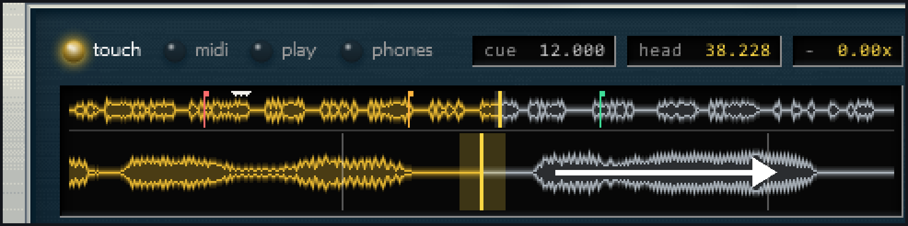
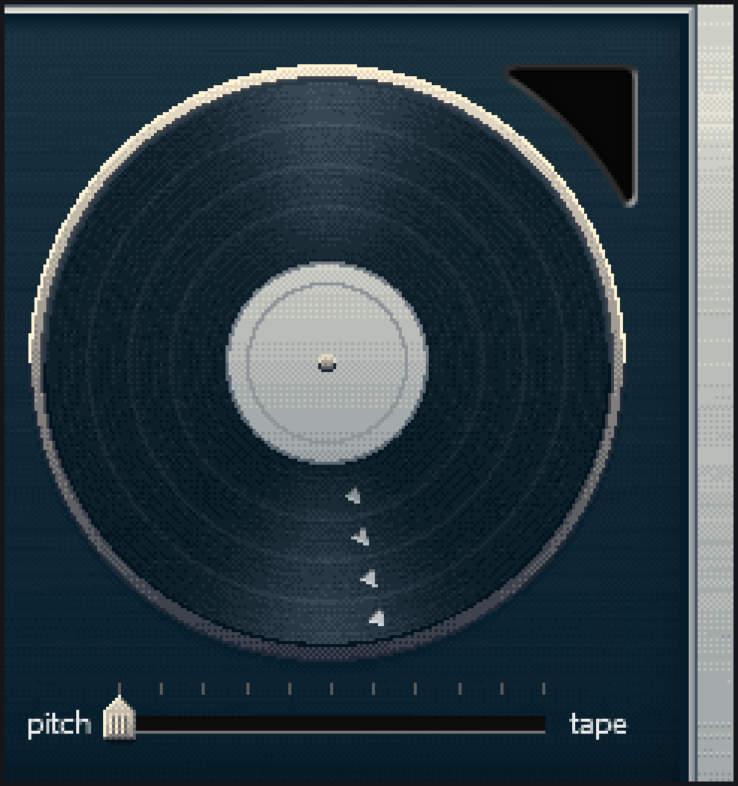
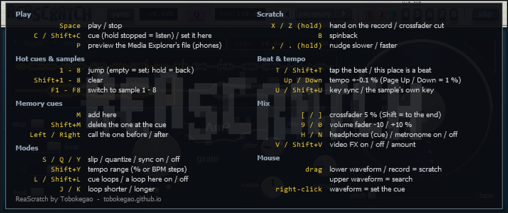

[ReaScratch](../README.md) › Basic use

<!-- Generated by tools/make_docs.py from manual/ReaScratch_manual_en.md. Edit that file and build again -->

## Basic use

**Contents**

- [Step 1: Import a video](#step-1-import-a-video)
- [Step 2: Start the sync](#step-2-start-the-sync)
- [Step 3: Scratch](#step-3-scratch)
- [Loading with the LOAD button (from the Media Explorer)](#loading-with-the-load-button-from-the-media-explorer)
- [Loading by dragging a file](#loading-by-dragging-a-file)
- [Previewing a Media Explorer file (P key)](#previewing-a-media-explorer-file-p-key)
- [Loading cues from rekordbox](#loading-cues-from-rekordbox)

All the scripts can be run by typing `reascratch` into the search box of `Actions` > `Show action list...`. With the window layout, the buttons at the top left ([“ReaScratch buttons (toolbar 3)”](setup.md#reascratch-buttons-toolbar-3)) run the same scripts.

### Step 1: Import a video

Run `reascratch_import_video.lua` and choose a video file (MP4 / MOV / AVI and so on).

- The video is placed on the `video` track, and its audio is extracted to `Data/ReaScratch_samples/<name>.wav` and loaded into the JSFX automatically.
- An item for viewing the waveform is placed on the `audio` track (muted automatically).
- With deck B, the video goes into the deck whose window (the JSFX window of `scratch engine` or `scratch engine B`) was opened last. When a video item on the `video` or `video B` track is selected, it goes into that track's deck. When neither tells the deck, you are asked which deck to use (see [“Two decks with layered video (deck B)”](two-decks-with-layered-video-deck-b.md)).
- Up to 8 sample slots are available. If the current sample (the lit number among `1`–`8` at the bottom of the screen) is empty, the video goes there. If it is in use, you are asked “The current slot N (name) is in use.” with “Yes: put it in the empty slot …” and “No: replace slot …” (when all 8 are in use: “Slots 1-8 are all in use. Replace the current slot …?”). A replaced sample's CUE, hot cues, memory cues and BPM are reset (since it is a new video).
- Each sample's video sits at its own place on the timeline (sample 1 at 0 s, sample 2 at 1 hour (3600 s), sample 3 at 2 hours, …). The video sync script moves the edit cursor to the place of the sample in use.
- If you select a video item on the `video` track before running the script, that video is re-imported as the sample for that place.
- There is a length limit (the total of all 8 samples; with REAPER 7.80, about 23 minutes of 48 kHz stereo, about 25 minutes at 44.1 kHz, or about 11.5 minutes at 96 kHz; the imported audio keeps the video's sample rate; older REAPER versions may allow less). Beyond this limit, a notice informs you that only the first portion of the audio was loaded, and the JSFX's waveform view shows it in red. To use the rest, cut the video shorter before importing.
- The imported audio is loaded in pieces (so that the other deck, if it is playing, does not drop out while loading). With long videos or on slower PCs, it can take a few seconds before the deck you imported into starts to sound. The same goes for opening a project; the currently selected sample is loaded first.
- Importing a video with the same name replaces `Data/ReaScratch_samples/<name>.wav` with the new audio (and the converted `<name>_mjpeg.avi` too). If a different video has the same filename, the audio of older projects gets overwritten as well, so rename the video before importing.
- The script checks whether the video is already all-intra. If it is, it says “This video is already all keyframes (…). No conversion needed.” and finishes. If not, it asks “Convert it to all keyframes (AVI/MJPEG) and replace it?” (after Yes you choose the height: 720, 540 or 360); **as a rule, answer Yes** (this prevents the picture from stuttering while scratching). A video that is already all-intra but taller than the height chosen in setup gets the question whether to convert it smaller.

### Step 2: Start the sync

If you answered Yes to auto-sync during setup, skip this step (it is already syncing).

If you answered No, run `reascratch_video_sync.lua`.

- This keeps the JSFX's read position and REAPER's edit cursor in sync.
- To stop syncing, run this script again (it toggles on and off).

### Step 3: Scratch

1. Check that **record arm (the red circle)** and **input monitoring (the speaker icon)** are on for the `scratch engine` track.
2. Turn the controller's jog or knob to scratch (set `Preset` to your model first, in step 5 of the setup).
   - **PLAY button**: plays automatically at normal speed (1x) while your hand is off (can also be switched with `Untouched transport` in the JSFX).
   - **CUE button**: works like a CDJ. While playing, it returns to the CUE point and stops. While stopped, the current position becomes the CUE point and it plays only while you hold the button (release to return to the CUE point and stop; press PLAY while holding to keep playing after release).
   - **Hot cues (pads 1–8)**: on the DDJ-FLX4, switch the pad mode to `HOT CUE` and use the 8 pads (on the Reloop Buddy, hold `PERFORMANCE MODES` and press the `HOT CUE` pad to switch, then use the 8 pads).
     - Press an empty pad: stores the current read position (with quantize `Q` on, it is set to the nearest beat)
     - Short-press a stored pad: jumps there and keeps playing (playback starts even when stopped)
     - Hold a stored pad: plays from there only while held; on release it returns to the previous position and the previous play/stop state
     - Press PLAY while holding: keeps playing after you let go of the pad
     - SHIFT + pad: clears that pad's position
     - The boundary between short and long presses is `Hot cue hold time` (default 300 ms). Stored positions are saved in the project file.
   - **Sample switching (pads 1–8)**: on the DDJ-FLX4, set the pad mode to `SAMPLER`; the 8 pads choose samples 1–8 (set by the `DDJ-FLX4` preset; not yet tested on the real hardware). Pressing the pad of an empty sample does nothing.
   - **Crossfader**: Deck 1 is the left deck and Deck 2 the right one. Moving the fader to the opposite end silences the deck and hides its picture (set by the preset on controllers with a crossfader). The picture is hidden only while the video sync (Step 2) is running.
3. When you finish, save the project in REAPER (`File` > `Save project`). The imported samples, CUE, hot cues, memory cues, BPM, `Preset` and the other settings are saved in the project and come back when you open it.

**Without a controller (mouse and keyboard)**

Open the JSFX window (the [FX] button of `scratch engine`) and play there.

 

*Figure 3. Scratching with the mouse (left: dragging the lower waveform to the right, i.e. backwards; right: grabbing the record)*

- **Grab the record and turn it** (usually on the right; on the left in deck A's window when you made deck B): scratch. Clockwise moves forward, counter-clockwise moves back. One turn moves 1.8 seconds of the sample (same as a record at 33 rpm). You can grab anywhere on the record and keep turning without letting go. Holding the mouse button counts as "touching the jog"; releasing counts as taking your hand off. Hold Shift for 1/4 sensitivity. The thin line on the record shows the angle of the current read position (it turns at 33 rpm while playing with `play`). Near the centre the angle cannot be read reliably, so movement there is not counted.
- **Grab the zoomed waveform at the bottom and drag left/right**: scratch. The point you dragged follows the cursor, so dragging the waveform left moves forward and dragging it right moves back (while playing, the waveform flows from right to left). While dragging counts as "touching the jog"; releasing counts as taking your hand off (with `play` it runs on at 1x, with `stop` it stops). When you get near the edge of the screen, let go and grab again (like repositioning your hand on a record). Hold Shift while dragging for 1/4 sensitivity (the cursor and the waveform then no longer move together).
- **Click or drag the upper (whole-track) waveform**: search (like needle search on a CDJ or in rekordbox). It moves to the clicked position at once and plays from there at 1x. If you keep the button down and move left or right, short bits of sound at the cursor position play in a stutter (it does not fast-forward through the parts in between, so there is no fast-forward "zzzt"). When you release, it stops there with `stop` or keeps playing from there with `play`. During search the picture is updated only about 10 times a second, and the exact frame appears the moment you release
- **Right-click the waveform**: makes that spot the CUE point (upper or lower waveform). Right-clicking right next to (within 3 px of) a coloured hot cue line clears that hot cue
- The coloured lines on the waveform are hot cues (1 = red, 2 = orange, 3 = green, 4 = purple, 5 = sky blue, 6 = pink, 7 = lime, 8 = copper; the lower waveform also shows the numbers)
- The small white triangles hanging from the top edge of the waveform are memory cues (the lower waveform also shows faint lines). Right-clicking right next to (within 3 px of) a triangle clears that memory cue.
- **`1`–`8` at the bottom of the screen**: sample switching. The current sample's number is pressed in and lit. Empty samples have faint numbers and do nothing when clicked. Hover over a button to see the sample's filename in the strip at the bottom of the screen
- **The 8 small pads at the top of the screen (on the frame)**: hot cues 1–8. Click to jump (an empty one stores the current position; hold it to return when you let go; with CUE LOOP on, it loops from that cue). Right-click or Shift+click clears it. Clicking the `HOT CUE` label above the pads turns CUE LOOP on/off
- **`◀` `memory` `▶` at the top of the screen (on the frame)**: click `memory` to store the current position; right-click or Shift+click clears the memory cue at the CUE point. `◀` `▶` are CALL (previous / next) and light up while there is a memory cue to call in that direction
- Keyboard (works only after you click the JSFX window once, while it has focus; if REAPER's main window has focus, Space starts REAPER's playback)
  - If Space still starts REAPER's playback while the JSFX window has focus, click the `+` button at the top right of the JSFX window and tick `Send all keyboard input to plug-in` (running `reascratch_setup.lua` ticks it for you; the template has it ticked already)
  - `Space`: same as the PLAY button (toggles play/stop when your hand is off)
  - `C`: same as the CUE button (while playing: return to the CUE point and stop. While stopped: the current position becomes the CUE point and it plays while held; release to return and stop, or press PLAY while holding to keep playing)
  - `Shift`+`C`: make the current read position the CUE point
  - `1`–`8`: same as hot cue pads 1–8 (press `Space` while holding to keep playing after release). `Shift`+`1`–`8` clears them (the keys are read by their Japanese-keyboard symbols, so on an English keyboard `Shift`+`7` clears pad 6, and pad 7 cannot be cleared from the keyboard)
  - Hold `X`: counts as touching the jog (stops on the spot and keeps sounding the same grain: a freeze). Release to go back
  - `M`: store the current read position as a memory cue. `Shift`+`M`: clear the memory cue at the CUE point (the one you just called; if there is none at the CUE point, the one closest to the read position)
  - `←` / `→`: CALL (previous / next memory cue; hold to keep stepping). While playing, `←` skips memory cues you passed less than 0.5 s ago and goes to the one before (press again to go further back)
  - `L`: CUE LOOP on/off (pressing a hot cue loops from there). `Shift`+`L`: enter / exit a loop of the current length at the current position. `J` / `K`: halve / double the loop length (default 4 beats)
  - `S`: SLIP mode on/off (same as the `slip` button at the top right)
  - `B`: spinback (throws the record backwards, slows down and stops; good for endings)
  - `Q`: quantize (beat-quantized jumps) on/off (same as the `Q` button at the top)
  - `?`: show / close the key list (`Esc` closes it too)
  - `T`: tap along with the beat while playing; from the 4th tap the BPM is calculated and entered, and the position of the last tap becomes the beat position. `Shift`+`T`: make the current read position a beat (most accurate if you stop on the start of a beat first). With a BPM, the nearest beat moves there. The first time the whole grid moves; pressing it again somewhere else stretches only the beats between there and the place you pressed before (how to fix a song that drifts; see “Songs whose tempo changes” below)
  - `↑` / `↓`: tempo up/down by 0.1%. `PageUp` / `PageDown`: by 1% (all of these turn SYNC off)
  - `U`: KEY SYNC (match the other deck's key; same as clicking the `key` window above `grain`). `Shift`+`U`: the key knob back to 0
  - `Y`: SYNC on/off (same as the `sync` button at the top). `Shift`+`Y`: cycle the tempo range (within %: ±8% → ±16% → ±50%; within BPM: ±5 → ±10 → ±15 → ±20 → ±30 → ±40 → ±60 BPM)
  - `F1`–`F8`: switch to samples 1–8 (empty samples are ignored). `F2` and up are taken by REAPER unless `Send all keyboard input to plug-in` is ticked
  - Hold `Z`: crossfader closed (no sound, no picture). Drag the waveform while tapping `Z` to practise cuts
  - Hold `,` / `.`: nudge (the job of the jog's outer ring). While playing, slows down / speeds up by 4% and returns to normal speed on release (for matching beats by ear). While stopped, moves the position slowly
  - `[` / `]`: crossfader 5% left / right. With `Shift` (`{` / `}`), all the way. Whichever deck's window you press it in, both decks take the same position (moving the controller's crossfader takes over from there)
  - `9` / `0`: this deck's volume fader down / up by 10% (volume and picture strength; same job as a channel fader)
  - `H`: this deck on headphones (Cue) on/off (same as clicking the `phones` lamp)
  - `N`: the metronome on/off (same as clicking the window in the record's corner; see [“Listening to a metronome while you play”](listening-to-a-metronome-while-you-play.md))
  - `P`: preview the file chosen in the Media Explorer (sound in the headphones only, picture only in this deck's record). Press again to stop ([“Previewing a Media Explorer file (P key)”](#previewing-a-media-explorer-file-p-key))
  - `V`: this deck's video effect on/off (same as FX ON on the Buddy; returns to the amount before it was turned off). `Shift`+`V`: cycle the amount 25% → 50% → 75% → 100%. Choose the effect type on the setup `FX` tab

*Figure 4. The key list (the screen shown by the help button or the ? key)*

### Loading with the LOAD button (from the Media Explorer)

The controller's LOAD button loads the file chosen in REAPER's Media Explorer into a deck's sample slot, so you can bring in the next video or track while you play. The LOAD buttons are mapped in the `Reloop Buddy` preset (`LOAD A` = deck A, `LOAD B` = deck B), the APC40 (`REC ARM` 1 / 5; `SHIFT` + a pad in the grid's 3rd row loads into that sample) and many controllers that have LOAD buttons, such as the DDJ-FLX4 (see [“Preset list”](controller-setup-and-midi-mapping.md#preset-list)).

1. Open the Media Explorer from REAPER's `View` > `Media Explorer` and click the file to load (if it is closed, pressing LOAD opens it).
2. Press `LOAD A` or `LOAD B`.
   - `LOAD` alone: into an empty slot. While the deck is playing, into an empty slot after the current one (the slot playing is not read again).
   - `SHIFT` + `LOAD`: replaces the slot in use.
3. The file is loaded when its audio has been converted (the video keeps following meanwhile). A stopped deck switches to that slot; a playing deck keeps playing its current slot (switch with the `1`–`8` buttons at the bottom of the screen or the pads). The BPM and beat position are estimated automatically.

- Requirements: the video sync script (`reascratch_video_sync.lua`) running, the js_ReaScriptAPI extension (install it with ReaPack) and FFmpeg (used to convert the audio to WAV; looked for in the places listed in "Heavy video", method A). Windows only (FFmpeg is run through a batch file; on macOS, pressing it says so).
- Video files (mp4, mov, avi, mkv, webm, wmv, m4v, mpg, mpeg, flv, ts, mts) and audio files (wav, mp3, flac, ogg, aif, aiff, m4a, aac, opus, wma) can be loaded. An audio-only file becomes a slot with no video, shown as a spinning speaker picture instead (one turn per platter turn of about 1.8 s, adjusted so the looped length is a whole number of turns and the picture carries on when it loops — the looped length is the sample's length, or, with a BPM and `At end of sample` set to loop, the loop's length in whole bars; it turns back and forth as you scratch); a video with no sound gets silence as long as the video.
- If the video is not all keyframes (H.264 and so on), or is taller than the height chosen in setup, FFmpeg converts it to all keyframes (MJPEG) in the background after the audio is loaded, and swaps in only the picture when it is done (`<name>_mjpeg.avi` appears next to the original video; playing is not interrupted). A message appears next to the mouse during the conversion and when it finishes. If a `_mjpeg.avi` of the same video already exists with the same number of frames, it is used at once. Videos added by methods other than LOAD are not converted automatically (see [“Heavy video”](heavy-video-all-intra-conversion.md)).
- The audio is written to a fixed file per slot (`Data/ReaScratch_samples/rs_load_a1.wav` to `rs_load_b8.wav`); loading into the same slot again overwrites it. When you reopen the project without saving it, or undo a LOAD, the sound file is written again from its source (a message appears next to the mouse; if the source file is missing, the message says so).
- If the JSFX does not know these files yet (for example a JSFX added before running the setup), the first LOAD reloads the JSFX, so stop the deck before pressing it. While the deck is playing, it shows `stop the deck for the first LOAD (it reloads the JSFX to prepare)` and loads nothing.
- Messages appear briefly next to the mouse (for example `select a file in the Media Explorer` when no file is chosen, `no empty slot after the current one (stop the deck to use the ones before it)` while playing with no empty slot after the current one, `file not found (a database view of the Media Explorer cannot be read: …)` when the file was chosen in a database view of the Media Explorer: open its folder and choose it there).
- To use another controller's buttons, set the numbers in the `Browser` group of the setup screen's `More` tab: `Browser section MIDI channel` (the buttons' MIDI channel) and the note numbers `LOAD note` (into an empty slot) and `LOAD replace note` (replace). On some controllers the LOAD button sends on a different MIDI channel from the BROWSE knob (common on units that use a separate channel for each deck). For those, enter numbers in `LOAD button (any ch)` (into an empty slot) and `LOAD replace (any ch)` (replace) instead of `LOAD note` and `LOAD replace note`. The number is `(channel − 1) × 128 + note`; look up the channel and note in the unit's MIDI list. The presets set them for the units they cover.

### Loading by dragging a file

You can also drag a file from the Media Explorer or the Windows Explorer onto a deck's JSFX window. It loads the same way as `LOAD` (the same requirements and messages; js_ReaScriptAPI is not needed).

- Drop it on one of the `1`–`8` buttons at the bottom: it goes into that slot (replacing what was there).
- Drop it anywhere else: it goes into an empty slot, as with `LOAD` (while playing, an empty slot after the current one).
- Drop several files at once and they go into empty slots one by one (dropped on a button: the first into that slot, the rest into empty slots). Folders cannot be loaded.

### Previewing a Media Explorer file (P key)

When you preview a video with the play button of REAPER's Media Explorer, its picture shows in the video window (the screen the audience sees). With ReaScratch's preview, the sound goes only to the headphones and the picture only to the record in the JSFX window.

1. In the Media Explorer, click a video or audio file to select it.
2. Select a deck's JSFX window and press `P`. The preview's picture shows in the centre (label) of that deck's record, with its position below it, such as `PREVIEW 0:12`. The sound goes to the same headphone output as the `Cue` track (not through the crossfader or `Cue mix`).
3. Press `P` again to stop. Select another file and press `P` to switch to it. It also stops when you press `P` on the other deck, press `LOAD`, or the file plays to its end.

You can also preview with a MIDI controller's button (the same as `P`). On the Reloop Buddy and Reloop Ready, hold the mode button (`PERFORMANCE MODES`) and press `LOAD`. On the APC40 mkII and mkI, press `REC ARM` (`RECORD ARM` on the mkI) of column 2 (column 6 for deck B); it lights while previewing. Most other controllers get a preview button from their preset too (on those with pad mode buttons and `LOAD`: `LOAD` pressed while holding the mode button; each controller's button is in "Metronome and preview buttons by controller"). For a controller without a preset, or to use another button, enter `(channel − 1) × 128 + note` in `PREVIEW button` in the `Browser` group of the setup screen's `More` tab. With `Mode button + LOAD` on, `LOAD` pressed while holding the mode button previews instead. Then, on controllers that switch their pad modes themselves and send other notes in each mode (those using `Pad modes by notes`), ReaScratch's pad mode changes when you let go of the mode button, not when you press it (and not at all if you previewed with `LOAD` while holding it).

- What you need: the video sync script (`reascratch_video_sync.lua`) running, the js_ReaScriptAPI and SWS extensions (both from ReaPack), and a `Cue` track with a headphone output chosen. Without that output it does not play. The picture needs deck B (with deck A only, you get the sound only).
- The first preview makes a `preview view` track right below `video B view`. It holds the preview's picture and never shows in the video window. If you delete or move it, the next preview makes it again.
- When `Auto-play selected media` in the Media Explorer's `Options` menu is on, just selecting a file starts the Media Explorer's own preview, and its picture shows in the video window. Turn it off.
- REAPER has no setting that keeps the Media Explorer's own preview out of the video window (checked with REAPER 7.80).

### Loading cues from rekordbox

You can load the hot cues, memory cues, BPM and beat grid, and key you set in rekordbox into the samples of the same tracks.

1. In rekordbox, choose `File` → `Export Collection in xml format` and save the XML
2. Run `reascratch_rekordbox.lua` from REAPER's action list and choose that XML. The samples now in the decks that are in rekordbox get its values (a list shows which samples were found and which were not)
3. From then on, importing a video and LOAD also read from this XML by themselves (the XML is remembered: choose it again only when you export it to another place after editing cues in rekordbox; saving over the same file needs nothing)

- How a track is found: first the track with the same file, else the one with the same filename (without the extension). What ReaScratch adds to the name when importing (such as `_mjpeg`) is ignored
- What a sample gets: hot cues A–H → 1–8 (a loop hot cue: its start), memory cues (up to 32), CUE = the first memory cue (where rekordbox loads a track), BPM and beat grid (the first tempo, lined up so bars start on the grid), key. Values rekordbox does not have (such as the CUE of a track without memory cues) stay as they are. For a track whose tempo changes, the beats follow its tempo changes (“Songs whose tempo changes”)
- rekordbox's values take priority over ReaScratch's own estimates
- Note: when rekordbox analysed a different file than the video you imported (an MP3 of the song and its music video, for example), the song may start at a different time in each, and the cues will be off. Loading the video file into rekordbox too and setting the cues there avoids this

#### Traktor and VirtualDJ track data

The same `reascratch_rekordbox.lua` also reads Traktor's and VirtualDJ's track data. It tells which program a file is from by its contents.

- **Traktor**: `collection.nml` (on Windows, `Documents\Native Instruments\Traktor <version>\collection.nml`). Hot cues 1–8 (a loop: its start), cues that are not hot cues and load cues → memory cues, BPM and the beat grid marker (a bar's start), key
- **VirtualDJ**: `database.xml` (on Windows, `Documents\VirtualDJ\database.xml`; tracks on an external drive are in that drive's `VirtualDJ\database.xml`). Cues numbered 1–8 → hot cues, other cues and saved loops → memory cues, BPM and the beat grid (a bar's start), key
- ReaScratch only reads these files and never changes them. To be sure the cues you set in Traktor or VirtualDJ are included, close that program first (it saves on closing)
- Note: Traktor and VirtualDJ reading has been tested with files built from public documentation and converter tools, not yet with files written by Traktor or VirtualDJ themselves. Please report values that come in wrong

#### Writing out track data

`reascratch_export.lua` writes the hot cues, memory cues, CUE, BPM and beat grid, and key of the samples now in the decks' slots to a file. When run, it asks which kind to write.

- **Yes = an XML for rekordbox**: read it through rekordbox's "rekordbox xml". In rekordbox, turn on `rekordbox xml` under `Preferences` → `View` → `Layout`, and set this file as `rekordbox xml` under `Advanced` → `Database`. Select the tracks that appear under `rekordbox xml` on the left, right-click, and choose `Import To Collection`. ReaScratch only writes a new file and never touches rekordbox's database. The CUE is added as a memory cue (rekordbox loads a track at its first memory cue). A sample whose tempo changes gets one tempo per stretch between its tempo changes
- **No = ReaScratch track data**: a file for reading back into ReaScratch. It has the same form as the rekordbox XML, plus the CUE as it is (not added as a memory cue), the auto gain loudness, and the beat map as it is. To read it back, choose this file in `reascratch_rekordbox.lua`
- The file written for each track: the video the sample came from (LOAD's record, else the video at the slot's place on the video track; for a video converted to MJPEG, the original file beside it if there is one), else the sample's WAV. The WAV holds the whole sound of the video from its start, so the times match the original video
- When the same file is in two slots, it is written once (the first one found)
- Where: with the js_ReaScriptAPI extension, a save dialog lets you choose. Without it, the file goes to `Data\ReaScratch_export` in REAPER's resource folder, named by the date and time
- Note: whether importing into tracks already in rekordbox's collection overwrites or adds to their cues has not been tested yet. With a collection that matters, back up rekordbox first (`File` → `Library` → `Backup Library`). Writing to Traktor and VirtualDJ is not available yet, because it would mean changing their own data

---

---

← [Setup](setup.md)   |   [Contents](../README.md#documentation)   |   [Pad modes, loops, filter and effects](pad-modes-loops-filter-and-effects.md) →
