[ReaScratch](../README.md) › Controller setup and MIDI mapping

<!-- Generated by tools/make_docs.py from manual/ReaScratch_manual_en.md. Edit that file and build again -->

## Controller setup and MIDI mapping

### Preset list

*Table 19. What each preset can do* ● yes, ○ no, ※ partly (see the notes), ✓ tested on real hardware. Numbers: left = deck 1, right = deck 2.

**Akai**

| No. | Preset | Tested | Jog | Touch | PLAYCUE | SYNC | Tempo | Loop | Cross-fader | Volume | Phones | Filter | Hotcues | Samples | Modes | Effects |
|---|---|---|---|---|---|---|---|---|---|---|---|---|---|---|---|---|
| 1・2 | APC40 mkI (two decks) |  | ● | ○ | ● | ● | ○ | ● | ● | ● | ● | ● | ● | ● | ● | ● |
| 3・4 | APC40 mkII (two decks) | ✓ | ● | ○ | ● | ● | ● | ● | ● | ● | ● | ● | ● | ● | ● | ● |

- APC40 mkI: Jog with TRACK KNOB 1 / 5. Buttons light (3 colours)
- APC40 mkII: Jog with TRACK KNOB 1 / 5. Buttons light in hot cue colours

**Behringer**

| No. | Preset | Tested | Jog | Touch | PLAYCUE | SYNC | Tempo | Loop | Cross-fader | Volume | Phones | Filter | Hotcues | Samples | Modes | Effects |
|---|---|---|---|---|---|---|---|---|---|---|---|---|---|---|---|---|
| 5・6 | CMD Micro |  | ● | ● | ● | ● | ● | ● | ● | ● | ● | ○ | ○ | ○ | ○ | ○ |

- CMD Micro: Both decks ch 1

**Denon DJ**

| No. | Preset | Tested | Jog | Touch | PLAYCUE | SYNC | Tempo | Loop | Cross-fader | Volume | Phones | Filter | Hotcues | Samples | Modes | Effects |
|---|---|---|---|---|---|---|---|---|---|---|---|---|---|---|---|---|
| 7・8 | SC5000 / SC6000 |  | ● | ※2 | ● | ● | ● | ● | ○ | ○ | ○ | ○ | ● | ○ | ● | ○ |
| 9・10 | Prime 4 |  | ● | ● | ● | ● | ● | ● | ● | ● | ● | ● | ● | ○ | ● | ● |

- SC5000 / SC6000: Computer Mode. Two units: split by MIDI input
- Prime 4: Put the unit in Computer Mode

**Gemini**

| No. | Preset | Tested | Jog | Touch | PLAYCUE | SYNC | Tempo | Loop | Cross-fader | Volume | Phones | Filter | Hotcues | Samples | Modes | Effects |
|---|---|---|---|---|---|---|---|---|---|---|---|---|---|---|---|---|
| 11・12 | FirstMix |  | ● | ● | ● | ● | ○ | ○ | ● | ○ | ● | ○ | ○ | ○ | ○ | ○ |

- FirstMix: Both decks ch 1

**Hercules**

| No. | Preset | Tested | Jog | Touch | PLAYCUE | SYNC | Tempo | Loop | Cross-fader | Volume | Phones | Filter | Hotcues | Samples | Modes | Effects |
|---|---|---|---|---|---|---|---|---|---|---|---|---|---|---|---|---|
| 13・14 | DJ Control MP3 e2 (MP3 LE, Glow) |  | ● | ※2 | ● | ● | ○ | ● | ● | ● | ● | ○ | ● | ○ | ○ | ○ |
| 15・16 | DJControl Compact |  | ● | ※2 | ● | ● | ○ | ● | ● | ○ | ○ | ○ | ● | ● | ○ | ● |
| 17・18 | DJControl Starlight |  | ● | ● | ● | ● | ○ | ○ | ● | ● | ● | ● | ● | ● | ● | ○ |
| 19・20 | DJControl MIX |  | ● | ● | ● | ● | ○ | ○ | ● | ● | ● | ● | ● | ● | ● | ○ |
| 21・22 | DJ Control Instinct |  | ● | ● | ● | ● | ○ | ● | ● | ● | ● | ○ | ● | ○ | ○ | ● |
| 23・24 | DJ Control AIR |  | ● | ※2 | ● | ● | ● | ● | ● | ● | ● | ○ | ○ | ● | ○ | ● |
| 25・26 | DJ Console Mk4 |  | ● | ※2 | ● | ● | ○ | ● | ● | ● | ● | ○ | ● | ○ | ○ | ● |
| 27・28 | DJ Console 4-Mx |  | ● | ● | ● | ● | ● | ● | ● | ● | ● | ○ | ● | ● | ○ | ○ |
| 29・30 | DJ 4Set |  | ● | ● | ● | ● | ● | ○ | ● | ● | ● | ○ | ● | ○ | ○ | ○ |
| 31・32 | DJControl Jogvision |  | ● | ● | ● | ● | ● | ● | ● | ● | ● | ● | ● | ● | ● | ● |
| 33・34 | Inpulse 200 / 300 (MK2) |  | ● | ● | ● | ● | ● | ● | ● | ● | ● | ● | ● | ● | ● | ● |
| 35・36 | Inpulse 500 |  | ● | ● | ● | ● | ● | ● | ● | ● | ● | ● | ● | ● | ● | ○ |

- DJ Control MP3 e2: Needs the Hercules driver
- DJControl Compact: Both decks ch 1. 4 pads
- DJControl Starlight: 4 pads
- DJControl MIX: Connect over USB. 4 pads
- DJ Control Instinct: Both decks ch 1. 2 hot cues
- DJ Control AIR: SCRATCH button on. Both decks ch 1
- DJ Console Mk4: Both decks ch 1. 4 hot cues
- DJ Console 4-Mx: Needs the driver. SCRATCH button on
- DJ 4Set: Needs the driver. 3 hot cues
- Inpulse 200 / 300 (MK2): VINYL mode (200 MK2: SHIFT+LOOP)
- Inpulse 500: VINYL mode

**ION**

| No. | Preset | Tested | Jog | Touch | PLAYCUE | SYNC | Tempo | Loop | Cross-fader | Volume | Phones | Filter | Hotcues | Samples | Modes | Effects |
|---|---|---|---|---|---|---|---|---|---|---|---|---|---|---|---|---|
| 37・38 | Discover DJ |  | ● | ● | ● | ● | ○ | ○ | ● | ○ | ○ | ○ | ○ | ○ | ○ | ○ |
| 39・40 | Discover DJ Pro |  | ● | ※2 | ● | ● | ● | ● | ● | ● | ● | ○ | ○ | ○ | ○ | ○ |

- Discover DJ: Both decks ch 1
- Discover DJ Pro: Both decks ch 1

**Korg**

| No. | Preset | Tested | Jog | Touch | PLAYCUE | SYNC | Tempo | Loop | Cross-fader | Volume | Phones | Filter | Hotcues | Samples | Modes | Effects |
|---|---|---|---|---|---|---|---|---|---|---|---|---|---|---|---|---|
| 41・42 | KAOSS DJ |  | ● | ● | ● | ● | ● | ● | ● | ● | ● | ○ | ● | ○ | ○ | ● |

- KAOSS DJ: 3 hot cues

**Native Instruments**

| No. | Preset | Tested | Jog | Touch | PLAYCUE | SYNC | Tempo | Loop | Cross-fader | Volume | Phones | Filter | Hotcues | Samples | Modes | Effects |
|---|---|---|---|---|---|---|---|---|---|---|---|---|---|---|---|---|
| 43・44 | HID bridge (S2 / S3 / S4) (Traktor Kontrol S4 MK3 / MK2, S3, S2 MK3 / MK2 / MK1) |  | ● | ● | ● | ● | ● | ○ | ● | ● | ● | ○ | ● | ● | ○ | ○ |

- HID bridge (S2 / S3 / S4): Keep the zip's HID bridge running

**Numark**

| No. | Preset | Tested | Jog | Touch | PLAYCUE | SYNC | Tempo | Loop | Cross-fader | Volume | Phones | Filter | Hotcues | Samples | Modes | Effects |
|---|---|---|---|---|---|---|---|---|---|---|---|---|---|---|---|---|
| 45・46 | Party Mix (original) |  | ● | ※2 | ● | ● | ● | ○ | ● | ● | ● | ○ | ● | ● | ● | ○ |
| 47・48 | Party Mix II / Live |  | ● | ● | ● | ● | ● | ○ | ● | ● | ● | ● | ● | ● | ● | ○ |
| 49・50 | DJ2GO2 (no touch) |  | ● | ※2 | ● | ● | ● | ○ | ● | ○ | ● | ○ | ● | ● | ● | ○ |
| 51・52 | DJ2GO2 Touch |  | ● | ● | ● | ● | ● | ○ | ● | ○ | ● | ○ | ● | ● | ● | ○ |
| 53・54 | Mixtrack (original) |  | ● | ● | ● | ● | ● | ● | ● | ● | ● | ○ | ○ | ○ | ○ | ● |
| 55・56 | Mixtrack Pro (original) |  | ● | ● | ● | ● | ● | ● | ● | ● | ● | ○ | ● | ○ | ○ | ● |
| 57・58 | Mixtrack 2 |  | ● | ● | ● | ● | ● | ● | ● | ● | ● | ○ | ● | ○ | ○ | ● |
| 59・60 | Mixtrack (Pro) 3 |  | ● | ● | ● | ● | ● | ● | ● | ● | ○ | ● | ● | ● | ● | ● |
| 61・62 | Mixtrack Platinum (without FX) |  | ● | ● | ● | ● | ● | ● | ● | ● | ● | ● | ● | ○ | ● | ● |
| 63・64 | Mixtrack Pro / Platinum FX |  | ● | ● | ● | ● | ● | ● | ● | ● | ● | ● | ● | ● | ● | ● |

- Party Mix: 4 pads (SHIFT+pad does not clear)
- Party Mix II / Live: 4 pads
- DJ2GO2: 4 pads. Ticks per turn provisional
- DJ2GO2 Touch: 4 pads
- Mixtrack: Both decks ch 1
- Mixtrack Pro: Both decks ch 1. 3 pads
- Mixtrack 2: Both decks ch 1. 3 pads. Volume numbers doubtful
- Mixtrack (Pro) 3: Headphone CUE arrives on ch 1 and cannot be read
- Mixtrack Platinum: 4 pads

**Pioneer DJ / AlphaTheta**

| No. | Preset | Tested | Jog | Touch | PLAYCUE | SYNC | Tempo | Loop | Cross-fader | Volume | Phones | Filter | Hotcues | Samples | Modes | Effects |
|---|---|---|---|---|---|---|---|---|---|---|---|---|---|---|---|---|
| 65・66 | DDJ-FLX2 |  | ● | ● | ● | ● | ● | ○ | ● | ● | ● | ● | ● | ● | ● | ○ |
| 67・68 | DDJ-FLX4 |  | ● | ● | ● | ● | ● | ● | ● | ● | ● | ● | ● | ● | ● | ● |
| 69・70 | DDJ-FLX6 |  | ● | ● | ● | ● | ● | ● | ● | ● | ● | ● | ● | ● | ● | ● |
| 71・72 | DDJ-FLX10 |  | ● | ● | ● | ● | ● | ● | ● | ● | ● | ● | ● | ● | ● | ● |
| 73・74 | DDJ-REV1 |  | ● | ● | ● | ● | ● | ● | ● | ● | ● | ● | ● | ● | ● | ● |
| 75・76 | DDJ-REV5 |  | ● | ● | ● | ● | ● | ● | ● | ● | ● | ● | ● | ○ | ● | ● |
| 77・78 | DDJ-200 |  | ● | ● | ● | ● | ● | ○ | ● | ● | ● | ● | ● | ○ | ○ | ● |
| 79・80 | DDJ-RB |  | ● | ● | ● | ● | ● | ○ | ● | ● | ● | ● | ● | ● | ○ | ● |
| 81・82 | DDJ-400 |  | ● | ● | ● | ● | ● | ● | ● | ● | ● | ● | ● | ● | ● | ● |
| 83・84 | DDJ-800 |  | ● | ● | ● | ● | ● | ● | ● | ● | ● | ● | ● | ● | ● | ● |
| 85・86 | DDJ-1000 |  | ● | ● | ● | ● | ● | ● | ● | ● | ● | ● | ● | ● | ● | ● |
| 87・88 | DDJ-SB |  | ● | ● | ● | ● | ● | ○ | ● | ● | ● | ● | ● | ● | ○ | ● |
| 89・90 | DDJ-SB2 |  | ● | ● | ● | ● | ● | ○ | ● | ● | ● | ● | ● | ● | ○ | ● |
| 91・92 | DDJ-SB3 / SX |  | ● | ● | ● | ● | ● | ● | ● | ● | ● | ● | ● | ● | ● | ● |
| 93・94 | DDJ-SX3 |  | ● | ● | ● | ● | ● | ● | ● | ● | ● | ● | ● | ● | ● | ● |
| 95・96 | CDJ-2000NXS2 (one unit = one deck) |  | ● | ● | ● | ● | ● | ● | ※1 | ○ | ○ | ○ | ● | ○ | ○ | ○ |
| 97・98 | CDJ-3000 / 3000X (one unit = one deck) |  | ● | ● | ● | ● | ● | ● | ※1 | ○ | ○ | ○ | ● | ○ | ○ | ○ |
| 99・100 | XDJ-RX3 / XZ |  | ● | ● | ● | ● | ● | ● | ● | ○ | ○ | ● | ● | ○ | ● | ○ |

- DDJ-FLX2: Tempo range with the Shift+Y keys
- DDJ-FLX4: Turn the jog's VINYL button on
- DDJ-REV1: Tempo range with the Shift+Y keys
- DDJ-RB: Tempo range with the Shift+Y keys
- DDJ-SB: Tempo range with SHIFT+KEYLOCK
- DDJ-SB2: Tempo range with SHIFT+KEYLOCK. DECK button back to decks 1/2
- DDJ-SB3 / SX: Tempo range with SHIFT+KEYLOCK
- DDJ-SX3: Tempo range with SHIFT+KEYLOCK
- CDJ-2000NXS2: Put the unit in USB-MIDI mode
- CDJ-3000 / 3000X: Put the unit in SOFTWARE CONTROL
- XDJ-RX3 / XZ: Put the unit in PC Control mode

**Reloop**

| No. | Preset | Tested | Jog | Touch | PLAYCUE | SYNC | Tempo | Loop | Cross-fader | Volume | Phones | Filter | Hotcues | Samples | Modes | Effects |
|---|---|---|---|---|---|---|---|---|---|---|---|---|---|---|---|---|
| 101・102 | Reloop Buddy | ✓ | ● | ● | ● | ● | ● | ● | ● | ● | ● | ● | ● | ○ | ● | ● |
| 103・104 | Reloop Ready |  | ● | ● | ● | ● | ● | ● | ● | ● | ● | ● | ● | ○ | ● | ● |
| 105・106 | Reloop Mixage |  | ● | ● | ● | ● | ※3 | ● | ● | ● | ● | ● | ● | ○ | ○ | ● |
| 107・108 | Reloop Mixon 4 |  | ● | ● | ● | ● | ● | ● | ● | ● | ● | ● | ● | ● | ● | ● |
| 109・110 | Reloop Mixon 8 Pro |  | ● | ● | ● | ● | ● | ● | ● | ● | ● | ● | ● | ● | ● | ○ |
| 111・112 | Reloop Touch |  | ● | ● | ● | ● | ● | ● | ● | ● | ● | ● | ● | ○ | ● | ● |
| 113・114 | Reloop Beatpad |  | ● | ● | ● | ● | ● | ● | ● | ● | ● | ● | ● | ● | ● | ● |
| 115・116 | Reloop Beatpad 2 |  | ● | ● | ● | ● | ● | ○ | ● | ● | ● | ● | ● | ● | ● | ○ |
| 117・118 | Reloop Beatmix 2/4 |  | ● | ● | ● | ● | ● | ● | ● | ● | ● | ○ | ● | ● | ● | ● |
| 119・120 | Reloop Terminal Mix 2/4 |  | ● | ● | ● | ● | ● | ● | ● | ● | ○ | ● | ● | ● | ○ | ● |
| 121・122 | Reloop Terminal Mix 8 |  | ● | ● | ● | ● | ● | ● | ● | ● | ● | ● | ● | ● | ● | ● |

- Reloop Buddy: Windows: Reloop ASIO Driver
- Reloop Ready: Windows probably needs Reloop's driver
- Reloop Mixage: Both decks ch 1. Hot cues with SHIFT+button
- Reloop Beatpad: Jog in Vinyl mode. 4 pads
- Reloop Beatpad 2: Assumed same numbers as the Beatpad (no official list)
- Reloop Terminal Mix 8: Turn the VINYL button on

**Other**

| No. | Preset | Tested | Jog | Touch | PLAYCUE | SYNC | Tempo | Loop | Cross-fader | Volume | Phones | Filter | Hotcues | Samples | Modes | Effects |
|---|---|---|---|---|---|---|---|---|---|---|---|---|---|---|---|---|
| 0 | Custom |  |  |
| 123 | FLX4 Emu test |  |  |

- Custom: Controllers not in the list. Set the numbers yourself ([“Manual mapping (Custom)”](#manual-mapping-custom))
- FLX4 Emu test: For development; not for normal use

Notes:

- ※1: CDJ: the unit has no crossfader, so only the deck's side is set (use the keyboard or another controller for the fader)
- ※2: Controllers without a touch signal (SC5000M, Party Mix (original), DJ2GO2, Compact, MP3 e2, AIR, DJ Console Mk4) and with touch sent as a CC (Discover DJ Pro): "touching" means while turning
- ※3: Mixage: tempo on deck 1 only (deck 2's pitch bend arrives on MIDI channel 2)

Choose from `Preset` in the settings list opened with `setup` at the bottom right of the JSFX window. The menu goes manufacturer → model → `deck 1` / `deck 2` (`(ch 1)` / `(ch 2)` for CDJs; Pioneer DJ / AlphaTheta has an extra `DDJ` / `CDJ / XDJ` level in between). Within each manufacturer, models are listed together by series (DDJ-FLX, DDJ-REV and so on), cheaper models first. The current model is marked. Click the search box to the right of `Preset` and type part of a name (`flx4`, `ddj 400`, `3000`, `s4`, `reloop` and so on; case and `-` are ignored, and with several words separated by spaces, only entries containing all of them are listed. Adding a number, as in `beatpad 2`, also matches `deck 2`, so pick from the list of candidates) and the candidates appear below. Choose with ↑↓ and Enter, or click; Esc closes it. While you type, keys do not reach the deck. Choosing a preset fills in the jog, touch and buttons, crossfader, hot cue and sample pads, tempo and SYNC, the video effect knob, the channel fader and the headphone CUE in one go. Presets marked ⚠︎ have not been tested on the real hardware. The numbers in the table below are the `Preset` values, in the order of the menu.

In “Notes by model”, "pad modes" are written as the controller's mode label → the ReaScratch mode (see [“Pad modes, loops, filter and effects”](pad-modes-loops-filter-and-effects.md) above). Following the Reloop Buddy, the EQ and filter knobs are HI = filter Morph, LOW = Resonance, CFX / FILTER / COLOR = Cutoff, and MID = how much the video effects act on the sound (on controllers with SHIFT, holding SHIFT gives echo length, feedback and key). LOAD does the same job as on the Buddy. The BROWSE knob: turn = how much the video effects act on the sound, push = switch the deck the knob works on, SHIFT + turn = the headphone cue mix (the Reloop Buddy and Ready work as their notes say).

Most controllers with an FX section read it as the Reloop Buddy's FX controls ("Buddy-style" in “Notes by model”). The FX ON button = the Buddy's FX ON bar (each press turns it on or off; while it is lit, the bar counts as engaged), the FX section's knob (LEVEL/DEPTH, DRY/WET and so on) = the FX knob, and BEAT ◀ ▶ or an unused FX button = `FX PARAM` ◀ ▶. What they act on depends on what you hold, as on the Buddy (see the Reloop Buddy notes). On controllers without a separate SHIFT number, the unit's SHIFT is used, and a knob or ◀ ▶ that reaches only deck B is passed to deck A. On Buddy-style controllers, turning BROWSE = the headphone Cue mix (while FX ON is on, that effect's sound amount).

| Preset name | Controller / mode | Preparation |
|---|---|---|
| 1 · 2 **APC40 mkI deck 1 / deck 2** 3 · 4 **APC40 mkII deck 1 / deck 2** | Akai APC40 (original, mkI) and APC40 mkII. Two decks on one unit | — |
| 5 · 6 **Behringer CMD Micro deck 1 / deck 2** | Behringer CMD Micro | — |
| 7 · 8 **Denon SC5000/SC6000 deck 1 / deck 2** | Denon DJ SC5000 and SC6000 (M versions too) | Set the unit to `Computer Mode`. With two units, set each track's MIDI input to its unit |
| 9 · 10 **Denon Prime 4 deck 1 / deck 2** | Denon DJ Prime 4 (Computer Mode) | Put the unit in Computer Mode |
| 11 · 12 **Gemini FirstMix deck 1 / deck 2** | Gemini FirstMix | — |
| 13 · 14 **Hercules DJ Control MP3 e2 deck 1 / deck 2** | Hercules DJ Control MP3 e2, MP3 LE and Glow | Needs the Hercules driver (MIDI channel 1) |
| 15 · 16 **Hercules DJControl Compact deck 1 / deck 2** | Hercules DJControl Compact | — |
| 17 · 18 **Hercules DJControl Starlight deck 1 / deck 2** 19 · 20 **Hercules DJControl MIX deck 1 / deck 2** | Hercules DJControl Starlight and MIX (connect the MIX over USB; Bluetooth is for phones) | — |
| 21 · 22 **Hercules DJ Control Instinct deck 1 / deck 2** | Hercules DJ Control Instinct | — |
| 23 · 24 **Hercules DJ Control AIR deck 1 / deck 2** | Hercules DJ Control AIR | — |
| 25 · 26 **Hercules DJ Console Mk4 deck 1 / deck 2** | Hercules DJ Console Mk4 | Not known whether the Hercules driver is needed |
| 27 · 28 **Hercules DJ Console 4-Mx deck 1 / deck 2** | Hercules DJ Console 4-Mx | Needs the Hercules driver (deck mode: 2 decks) |
| 29 · 30 **Hercules DJ 4Set deck 1 / deck 2** | Hercules DJ 4Set | Needs the Hercules driver (`Deck mode`: `2-deck basic`) |
| 31 · 32 **Hercules DJControl Jogvision deck 1 / deck 2** | Hercules DJControl Jogvision | — |
| 33 · 34 **Hercules Inpulse 200/300 (MK2) deck 1 / deck 2** 35 · 36 **Hercules Inpulse 500 deck 1 / deck 2** | Hercules DJControl Inpulse 200 and 300 (the MK2s use the same numbers) and 500. On the 200 MK2, VINYL is `SHIFT` + `LOOP` | — |
| 37 · 38 **ION Discover DJ deck 1 / deck 2** | ION Discover DJ | — |
| 39 · 40 **ION Discover DJ Pro deck 1 / deck 2** | ION Discover DJ Pro | — |
| 41 · 42 **Korg KAOSS DJ deck 1 / deck 2** | Korg KAOSS DJ | Not known whether the message Korg's software sends at start-up is needed |
| 43 · 44 **HID bridge (NI S2/S3/S4) deck 1 / deck 2** | Native Instruments Traktor Kontrol S4 MK3, S4 MK2, S3, S2 MK3, S2 MK2 and S2 MK1 (controllers connected over HID) | Run the bridge program (the `HID bridge` folder in the zip) |
| 45 · 46 **Numark Party Mix deck 1 / deck 2** | Numark Party Mix (original) | — |
| 47 · 48 **Numark Party Mix II/Live deck 1 / deck 2** | Numark Party Mix II and Party Mix Live | — |
| 49 · 50 **Numark DJ2GO2 deck 1 / deck 2** 51 · 52 **Numark DJ2GO2 Touch deck 1 / deck 2** | Numark DJ2GO2 and DJ2GO2 Touch | — |
| 53 · 54 **Numark Mixtrack deck 1 / deck 2** 55 · 56 **Numark Mixtrack Pro deck 1 / deck 2** 57 · 58 **Numark Mixtrack 2 deck 1 / deck 2** | Numark Mixtrack (original), Mixtrack Pro (original) and Mixtrack 2 | — |
| 59 · 60 **Numark Mixtrack (Pro) 3 deck 1 / deck 2** | Numark Mixtrack 3 and Mixtrack Pro 3 (same numbers) | — |
| 61 · 62 **Numark Mixtrack Platinum deck 1 / deck 2** | Numark Mixtrack Platinum (without FX) | — |
| 63 · 64 **Numark Mixtrack Pro/Platinum FX deck 1 / deck 2** | Numark Mixtrack Pro FX and Mixtrack Platinum FX | — |
| 65 · 66 **DDJ-FLX2 deck 1 / deck 2** | AlphaTheta DDJ-FLX2 | — |
| 67 · 68 **DDJ-FLX4 deck 1 / deck 2** | Pioneer DDJ-FLX4 | Turn the jog's VINYL button ON |
| 69 · 70 **DDJ-FLX6 deck 1 / deck 2** 71 · 72 **DDJ-FLX10 deck 1 / deck 2** 73 · 74 **DDJ-REV1 deck 1 / deck 2** 81 · 82 **DDJ-400 deck 1 / deck 2** 83 · 84 **DDJ-800 deck 1 / deck 2** 85 · 86 **DDJ-1000 deck 1 / deck 2** | Pioneer DJ / AlphaTheta DDJs (same numbering as the FLX4) | — |
| 75 · 76 **DDJ-REV5 deck 1 / deck 2** | AlphaTheta DDJ-REV5 | — |
| 77 · 78 **DDJ-200 deck 1 / deck 2** | Pioneer DJ DDJ-200 | — |
| 79 · 80 **DDJ-RB deck 1 / deck 2** 87 · 88 **DDJ-SB deck 1 / deck 2** 89 · 90 **DDJ-SB2 deck 1 / deck 2** | Pioneer DJ DDJ-SB, DDJ-SB2 and DDJ-RB | — |
| 91 · 92 **DDJ-SB3 / SX deck 1 / deck 2** 93 · 94 **DDJ-SX3 deck 1 / deck 2** | Pioneer DJ DDJ-SB3, DDJ-SX and DDJ-SX3 (Serato layout) | — |
| 95 · 96 **CDJ-2000NXS2 (MIDI ch 1) / (MIDI ch 2)** | Pioneer DJ CDJ-2000NXS2 (one player = one deck; ch 1 for deck A, ch 2 for deck B) | USB-MIDI mode, MIDI channel (1st player 1, 2nd 2); Windows needs the driver |
| 97 · 98 **CDJ-3000/3000X (MIDI ch 1) / (MIDI ch 2)** | Pioneer DJ CDJ-3000 and AlphaTheta CDJ-3000X (one player = one deck; ch 1 for deck A, ch 2 for deck B) | `SOFTWARE CONTROL`, MIDI channel (1st player 1, 2nd 2); Windows needs the driver |
| 99 · 100 **XDJ-RX3 / XZ deck 1 / deck 2** | Pioneer DJ XDJ-RX3 and XDJ-XZ (both checked against the official MIDI lists) | Put the unit in MIDI mode (XDJ-XZ: PC Control mode) |
| 101 · 102 **Reloop Buddy deck 1 / deck 2** | Reloop Buddy (deck 1 = left deck, deck 2 = right deck) | Windows needs the driver ([“Troubleshooting”](troubleshooting.md)) |
| 103 · 104 **Reloop Ready deck 1 / deck 2** | Reloop Ready | Windows probably needs Reloop's driver |
| 105 · 106 **Reloop Mixage deck 1 / deck 2** | Reloop Mixage (Interface Edition, MK2 and Controller Edition; one mapping in Mixxx) | — |
| 107 · 108 **Reloop Mixon 4 deck 1 / deck 2** | Reloop Mixon 4 | — |
| 109 · 110 **Reloop Mixon 8 Pro deck 1 / deck 2** | Reloop Mixon 8 Pro | — |
| 111 · 112 **Reloop Touch deck 1 / deck 2** | Reloop Touch | — |
| 113 · 114 **Reloop Beatpad deck 1 / deck 2** 115 · 116 **Reloop Beatpad 2 deck 1 / deck 2** | Reloop Beatpad and Beatpad 2 | Set the jog mode to Vinyl |
| 117 · 118 **Reloop Beatmix 2/4 deck 1 / deck 2** | Reloop Beatmix 2 and Beatmix 4 (MK2) | — |
| 119 · 120 **Reloop Terminal Mix 2/4 deck 1 / deck 2** 121 · 122 **Reloop Terminal Mix 8 deck 1 / deck 2** | Reloop Terminal Mix 2, 4 and 8 | — |
| 0 **Custom** | Generic / manual setup | Set up by hand using the table below |
| 123 **FLX4 Emu test (loopMIDI deck 2)** | Virtual MIDI for development and testing | Connect `tools/flx4_emu.py` (for development) |

#### Notes by model

**1 · 2 APC40 mkI deck 1 / deck 2**

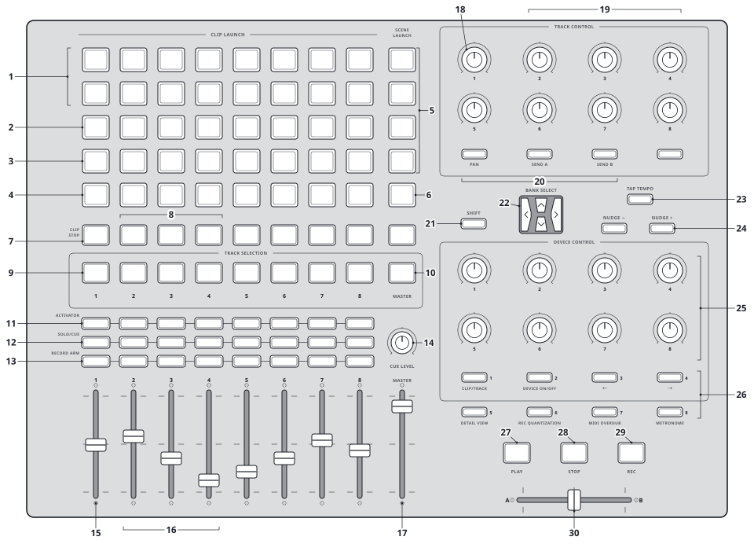

*Figure 20. The APC40 mkI's controls (numbered on columns 1–4 = deck A; columns 5–8 = deck B are the same)*

Columns 1–4 are deck A, columns 5–8 deck B. The mouse works too for the jog. The `TRACK CONTROL` knobs are in the top right, not above the grid, and `CUE LEVEL` is in the master column. The grid is the 5 rows of clips, the columns are MIDI channels 1–8.

<!-- devlist 1 Left (the grid and the rows of buttons) -->

1. **Grid rows 1 and 2**: Pads 1–8 (in `HOT CUE` mode, hot cues 1–8; SHIFT clears)
2. **Grid row 3**: Samples (22's ◀ ▶ shifts it to 5–8; with SHIFT, LOAD into that sample)
3. **Grid row 4**: Memory cues (MEMORY, CALL ◀, CALL ▶, DELETE)
4. **Grid row 5**: While held, fast spinback, reverse, half speed, fast forward (with SHIFT, LOOP, SYNC, Q and SLIP on/off)
5. **SCENE LAUNCH 1–4**: Auto loops of 1, 2, 4, 8 beats (with SHIFT, jump −4, −1, +1, +4 beats)
6. **SCENE LAUNCH 5**: Exit / return to the loop
7. **CLIP STOP 1 (5)**: Freeze (with SHIFT, that deck's video effect on/off)
8. **CLIP STOP 2–4 (6–8)**: Toggle the effect of the fader below (16)
9. **TRACK SELECTION 1 / 5**: Select deck A / B. 5, 6 and the right side (22–29) act on the selected deck
10. **MASTER**: While held, `PLAY`, `CUE` and `SYNC` act on both decks (`PLAY` plays / stops both together)
11. **ACTIVATOR**: Mute (with SHIFT, picture only)
12. **SOLO/CUE**: Headphone Cue
13. **RECORD ARM**: LOAD (with SHIFT, replace). `RECORD ARM` of column 2 (6) previews (the same as the `P` key; it lights while previewing), and `RECORD ARM` of column 3 (7) turns the metronome on/off (the same as the `N` key; it lights while on)
14. **CUE LEVEL**: Headphone Cue mix
15. **Track fader 1 (5)**: Amount of the video effects applied to the sound
16. **Track faders 2–4 (6–8)**: Echo, bitcrusher, vibrato
17. **Master fader**: Video effect amount after the mix

<!-- devlist 18 Right side -->

18. **TRACK CONTROL knob 1 (5 for deck B)**: Jog (stopping for 0.15 s counts as releasing it)
19. **TRACK CONTROL knobs 2–4 (6–8)**: Filter Morph, Resonance, Cutoff. The `SEND A` page is the mkII's `SENDS` page, the `SEND B` page its `USER` page
20. **PAN, SEND A, SEND B**: The pages of the knobs (19) (`PAN` goes back; while SHIFT is held, `SEND A`)
21. **SHIFT**: Hold with another control to use its second function
22. **BANK SELECT**: ◀ ▶ = shift the samples of grid row 3 to 5–8. ▲ ▼ = double / halve the loop (with SHIFT, move it 1 beat)
23. **TAP TEMPO**: Tap tempo
24. **NUDGE − / +**: A little slower / faster while held (beat matching)
25. **DEVICE CONTROL knobs 1–8**: Amounts of the 8 video effects (knob 8 is VHS, SHIFT + knob 8 is Strobe)
26. **DEVICE CONTROL buttons 1–8**: Pad mode (see [“Pad modes”](pad-modes-loops-filter-and-effects.md#pad-modes)). Their labels differ from the mkII's: CLIP/TRACK, DEVICE ON/OFF, ←, →, DETAIL VIEW, REC QUANTIZATION, MIDI OVERDUB, METRONOME. The video blend is chosen with the pads in mode 8
27. **PLAY**: Play / stop (with SHIFT, both decks at once)
28. **STOP**: Tempo range
29. **REC**: CUE
30. **Crossfader**: Left = deck A, right = deck B

Controls without a number (STOP ALL CLIPS, SEND C) are not used. The mkI has no `TEMPO` knob, `CROSSFADER A/B`, `BANK` or `SESSION` (which the mkII has).

**3 · 4 APC40 mkII deck 1 / deck 2**

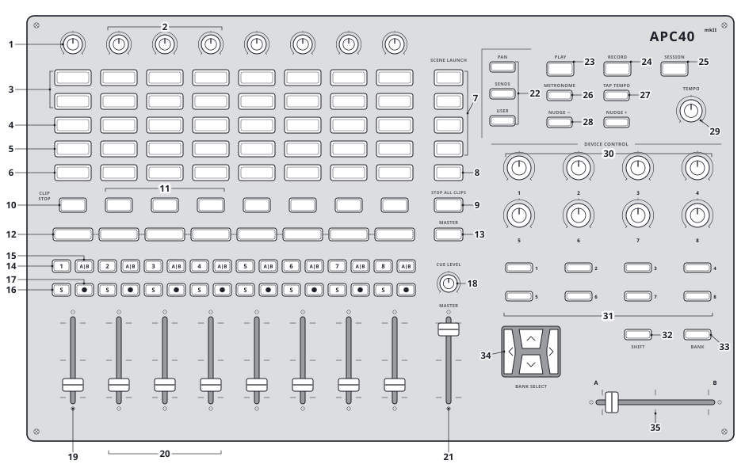

*Figure 21. The APC40 mkII's controls (numbered on columns 1–4 = deck A; columns 5–8 = deck B are the same)*

Same mapping as the mkI, laid out differently (the mkI's `TRACK CONTROL` knobs are the mkII's `TRACK KNOB`s above the grid). Columns 1–4 are deck A, columns 5–8 deck B. The mouse works too for the jog.

<!-- devlist 1 Top (knobs, grid, SCENE LAUNCH) -->

1. **TRACK KNOB 1 (5 for deck B)**: Jog (stopping for 0.15 s counts as releasing it)
2. **TRACK KNOB 2–4 (6–8)**: Filter Morph, Resonance, Cutoff. On the `SENDS` page: echo length and feedback, vibrato step (with SHIFT, the width of the swing), gate steps; on the `USER` page: volume, picture strength, grain length, key
3. **Grid rows 1 and 2**: Pads 1–8 (in `HOT CUE` mode, hot cues 1–8; SHIFT clears)
4. **Grid row 3**: Samples (34's ◀ ▶ shifts it to 5–8; with SHIFT, LOAD into that sample)
5. **Grid row 4**: Memory cues (MEMORY, CALL ◀, CALL ▶, DELETE)
6. **Grid row 5**: While held, fast spinback, reverse, half speed, fast forward (with SHIFT, LOOP, SYNC, Q and SLIP on/off)
7. **SCENE LAUNCH 1–4**: Auto loops of 1, 2, 4, 8 beats (with SHIFT, jump −4, −1, +1, +4 beats)
8. **SCENE LAUNCH 5**: Exit / return to the loop
9. **STOP ALL CLIPS**: Tempo range

<!-- devlist 10 Bottom (buttons and faders) -->

10. **CLIP STOP 1 (5)**: Freeze (with SHIFT, that deck's video effect on/off)
11. **CLIP STOP 2–4 (6–8)**: Toggle the effect of the fader below (20)
12. **TRACK SELECT 1 / 5**: Select deck A / B. 7–9 and the right side (23–31, 34) act on the selected deck
13. **MASTER**: While held, `PLAY`, `CUE` and `SYNC` act on both decks (`PLAY` plays / stops both together)
14. **ACTIVATOR**: Mute (with SHIFT, picture only)
15. **CROSSFADER A/B**: Crossfader assign (A / B)
16. **SOLO**: Headphone Cue
17. **REC ARM**: LOAD (with SHIFT, replace). `REC ARM` of column 2 (6) previews (the same as the `P` key; it lights while previewing), and `REC ARM` of column 3 (7) turns the metronome on/off (the same as the `N` key; it lights while on)
18. **CUE LEVEL**: Headphone Cue mix
19. **Track fader 1 (5)**: Amount of the video effects applied to the sound
20. **Track faders 2–4 (6–8)**: Echo, bitcrusher, vibrato
21. **Master fader**: Video effect amount after the mix

<!-- devlist 22 Right side -->

22. **PAN, SENDS, USER**: The pages of TRACK KNOB (2) (`PAN` goes back; while SHIFT is held, `SENDS`)
23. **PLAY**: Play / stop (with SHIFT, both decks at once)
24. **RECORD**: CUE
25. **SESSION**: REAPER recording
26. **METRONOME**: Video blend (with SHIFT, one back)
27. **TAP TEMPO**: Tap tempo
28. **NUDGE − / +**: A little slower / faster while held (beat matching)
29. **TEMPO**: Tempo
30. **DEVICE CONTROL knobs 1–8**: Amounts of the 8 video effects (knob 8 is VHS, SHIFT + knob 8 is Strobe)
31. **DEVICE CONTROL buttons 1–8**: Pad mode (see [“Pad modes”](pad-modes-loops-filter-and-effects.md#pad-modes))
32. **SHIFT**: Hold with another control to use its second function
33. **BANK**: All effects off while held
34. **BANK SELECT**: ◀ ▶ = shift the samples of grid row 3 to 5–8. ▲ ▼ = double / halve the loop (with SHIFT, move it 1 beat)
35. **Crossfader**: Left = deck A, right = deck B

Buttons light up (hot cues in their colours, the sample in use in green and so on). For this, enable the APC40 as a MIDI output in REAPER too (see [“Button lights”](#button-lights) below).

From the official MIDI lists (mkII from the spec sheet at hand, mkI from a version preserved on the Internet Archive). The mkII was tested on real hardware (jog, hot cues, lights, LOAD, crossfader, two controllers at once and more; the SHIFT combinations, the `SENDS` and `USER` pages, `MASTER`, `METRONOME`, `BANK`, `SESSION` and others have not been tested on real hardware yet). The mkI has not been tested on real hardware yet.

**5 · 6 Behringer CMD Micro deck 1 / deck 2**

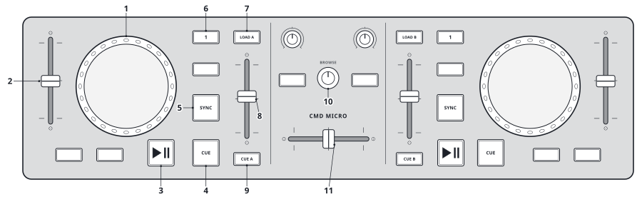

*Figure 22. The CMD Micro's controls (numbered on the left deck and the centre; the right deck is the same)*

Both decks on MIDI channel 1. No pads.

<!-- devlist 1 Deck -->

1. **Jog**: Top = touch scratch
2. **Outer fader**: Tempo (7-bit)
3. **PLAY/PAUSE**
4. **CUE**
5. **SYNC**
6. **1**: Loop (toggles with each press; the 4-beat beat loop button in Mixxx)

<!-- devlist 7 Mixer and centre -->

7. **LOAD A**: Loads the file chosen in the Media Explorer into this deck (see [“Loading with the LOAD button (from the Media Explorer)”](basic-use.md#loading-with-the-load-button-from-the-media-explorer))
8. **Inner fader**: That deck's volume and picture strength (channel fader)
9. **CUE A**: Listen to this deck on headphones (toggles with each press)
10. **BROWSE**: Turn = how much the video effects act on the sound
11. **Crossfader**: Deck 1 on the left side, deck 2 on the right

Controls without a number (2, PITCH BEND − / +, LEFT, RIGHT, MAIN LEVEL, CUE LEVEL) are not used by ReaScratch. From Mixxx's mapping; not yet tested on the real hardware.

**7 · 8 Denon SC5000/SC6000 deck 1 / deck 2**

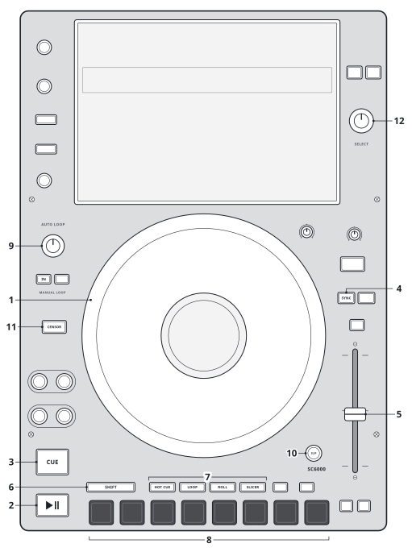

*Figure 23. The SC6000's controls (one unit = one deck; the SC5000 is laid out the same)*

Set the unit to `Computer Mode` in its Control Center (SHORTCUTS). Every unit sends on MIDI channel 1, so with two units, set the MIDI inputs of the `scratch engine` and `scratch engine B` tracks to the name of each unit (with "All MIDI inputs", both decks move).

<!-- devlist 1 Deck -->

1. **Jog**: Top scratch (3683 steps per turn, measured on an SC5000M). The SC5000M sends no touch signal, so "touching" means while turning
2. **PLAY**
3. **CUE**
4. **SYNC**
5. **Tempo (pitch fader)**: The tempo direction is unconfirmed
6. **SHIFT**: Hold it with another control for its second function
7. **Pad mode buttons**: `HOT CUE` = HOT CUE, `LOOP` → AUTO LOOP, `ROLL` → BOUNCE LOOP, `SLICER` = SLICER
8. **Pads**: The 8 pads of the current mode. `SHIFT` + pad clears a hot cue
9. **AUTO LOOP**: The loop knob (turn = length, push = loop)
10. **SLIP**
11. **CENSOR**: Reverse while held
12. **SELECT**: BROWSE

LOOP IN (`IN` of `MANUAL LOOP`) also makes a loop. Controls without a number (OUT, TRACK SKIP, BEAT JUMP, VINYL, PITCH BEND, the buttons round the screen and so on) are not used by ReaScratch.

The numbers come from a third party's measurements on a real SC5000M (the same numbers as Denon's official list for the LC6000). Whether the SC6000 is the same, and the tempo direction, are unconfirmed. Not yet tested on the real hardware.

**9 · 10 Denon Prime 4 deck 1 / deck 2**

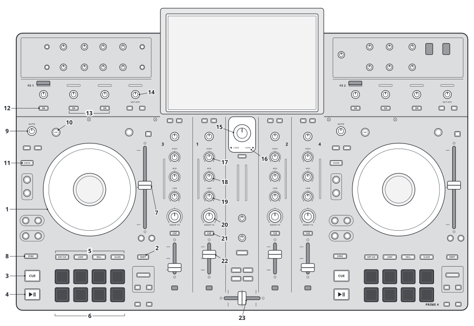

*Figure 24. The Prime 4's controls (numbered on the left deck, FX 1, the mixer's channel 1 and the centre; the right deck, FX 2 and channel 2 are the same)*

Put the unit in Computer Mode. Left deck on ch 5, right deck on ch 6, the mixer's channels 1 and 2 on ch 1 and ch 2 (deck 1 and deck 2), crossfader on ch 16. From a Mixxx mapping draft that was never merged.

<!-- devlist 1 Deck -->

1. **Jog**: Scratch from the platter position (jog mode `Platter position (Denon)`), touch. The ticks per platter turn are not documented, so Mixxx's value (1000 ticks per turn = `556`) is used provisionally
2. **SHIFT**: Hold it with another control for its second function
3. **CUE**
4. **PLAY**
5. **PERFORMANCE MODES buttons**: `HOT CUE` = HOT CUE, `LOOP` → AUTO LOOP, `ROLL` → BOUNCE LOOP, `SLICER` = SLICER
6. **Pads**: The 8 pads of the current mode. `SHIFT` + pad clears a hot cue
7. **Tempo (pitch fader)**
8. **SYNC**
9. **AUTO**: The loop knob (turn = length, push = loop)
10. **SLIP**
11. **CENSOR**: Reverse while held

<!-- devlist 12 FX 1 (Buddy-style) -->

12. **ON (left)**: The Buddy's FX ON bar (that deck's video effect on / off)
13. **ON (middle, right)**: The Buddy's `FX PARAM` ◀ ▶ (effect type; see the note below)
14. **WET/DRY**: The Buddy's FX knob (effect amount; see the note below)

<!-- devlist 15 Mixer -->

15. **BROWSE**: Turning and pushing work as on the DDJ-FLX4's BROWSE
16. **LOAD ◀ ▶**: ◀ loads into deck 1, ▶ into deck 2 (as the Reloop Buddy's LOAD A / B)
17. **HIGH**: Filter Morph (echo length with SHIFT)
18. **MID**: How much the video effects act on the sound
19. **LOW**: Filter Resonance (echo feedback with SHIFT)
20. **SWEEP FX**: Filter Cutoff (key with SHIFT)
21. **Headphone CUE**: Listen to this deck on headphones (toggles with each press)
22. **Channel fader**: That deck's volume and picture strength
23. **Crossfader**: Deck 1 on the left side, deck 2 on the right

Note (13 · 14): What they act on depends on what you hold (as in the Reloop Buddy's note).

Controls without a number (IN and OUT of MANUAL LOOP, DECK, TRACK SKIP, BEAT JUMP, VINYL, KEY LOCK, PITCH BEND, BEAT GRID, PARAMETER, the knobs above the FX buttons, the MIC and MASTER sections, the SWEEP FX buttons, channels 3 and 4 and so on) are not used by ReaScratch. Not yet tested on the real hardware.

**11 · 12 Gemini FirstMix deck 1 / deck 2**

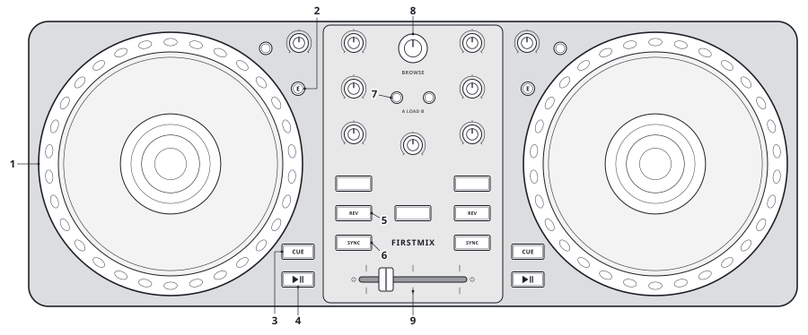

*Figure 25. The FirstMix's controls (numbered on the left deck and the left channel; the right side is the same, mirrored)*

Both decks on MIDI channel 1. No tempo or channel faders, no pads.

<!-- devlist 1 Deck -->

1. **Jog**: Top = touch scratch
2. **E (the EFX button)**: Listen to this deck on headphones (toggles with each press; the same as Mixxx's mapping)
3. **CUE**
4. **PLAY/PAUSE**

<!-- devlist 5 Mixer -->

5. **REV**: Reverse play while held
6. **SYNC**
7. **LOAD A** (the left of `A LOAD B`): Loads the file chosen in the Media Explorer into this deck
8. **BROWSE**: Turn = how much the video effects act on the sound
9. **Crossfader**: Deck 1 on the left side, deck 2 on the right

Controls without a number (the EFX knob, SEL, GAIN, TREBLE, BASS, SCRATCH, MASTER, PREVIEW) are not used by ReaScratch. From Mixxx's mapping; not yet tested on the real hardware.

**13 · 14 Hercules DJ Control MP3 e2 deck 1 / deck 2**

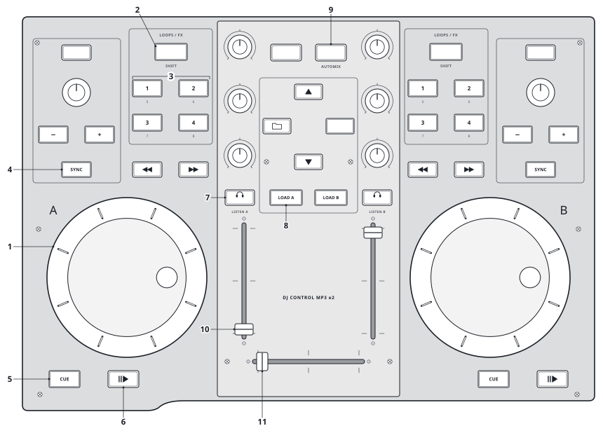

*Figure 26. The DJ Control MP3 e2's controls (numbered on the left deck and the centre; the right deck is the same, mirrored)*

Needs the Hercules driver (the MIDI channel can be changed in the driver's settings; the preset uses 1).

<!-- devlist 1 Deck -->

1. **Jog**: Scratch. No touch signal, so "touching" means while turning
2. **LOOPS / FX (SHIFT)**: Switches the keys 1–4 (while lit, they are the printed 5–8 = K5–K8)
3. **Keys 1–4**: K5–K8 are hot cues 1–4 (hold AUTOMIX to clear), K1 a loop, K3 reloop
4. **SYNC**
5. **CUE**
6. **PLAY/PAUSE**

<!-- devlist 7 Mixer and centre -->

7. **LISTEN A**: Headphone CUE (listen to this deck on headphones)
8. **LOAD A**: LOAD
9. **AUTOMIX**: Acts as SHIFT while held (clears hot cues and so on)
10. **Volume fader**: Channel fader (that deck's volume and picture strength)
11. **Crossfader**

Controls without a number (MASTER TEMPO, PITCH, PITCH BEND − / +, ◀◀ ▶▶, TREBLE, MEDIUM, BASS, SCRATCH, the browser buttons) are not used by ReaScratch. Tempo is an endless knob (PITCH), so it is not read. From Hercules' official VirtualDJ mapping; not yet tested on the real hardware.

**15 · 16 Hercules DJControl Compact deck 1 / deck 2**

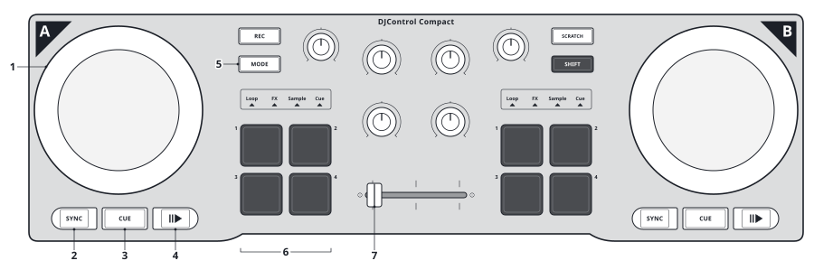

*Figure 27. The DJControl Compact's controls (numbered on the left deck and the centre; the pads and the jog are the same on the right deck; MODE and REC are only on the left, SCRATCH and SHIFT only on the right)*

Both decks on MIDI channel 1. No tempo or channel faders.

<!-- devlist 1 Deck -->

1. **Jog**: Scratch. No touch signal, so "touching" means while turning
2. **SYNC**
3. **CUE**
4. **PLAY/PAUSE**
5. **MODE**: Switches the pad mode (there is only one MODE, on the left; whether it works on both decks or on one is not confirmed. The lamps over the printed `Loop`, `FX`, `Sample` and `Cue` show the current one)
6. **Pads**: The 4 pads of the current mode. `Cue` = hot cues (cleared with the neighbouring button), `Sample` = samples, `FX` = Buddy-style (pad 9 = FX ON, 10 / 11 = ◀ ▶; no knob), `Loop` = the loop buttons (reloop, 8-beat loop, halve, double)

<!-- devlist 7 Centre -->

7. **Crossfader**

Controls without a number (REC, VOLUME, MEDIUM, BASS, SCRATCH, SHIFT) are not used by ReaScratch. The official manual and MIDI list say SHIFT + pad clears a hot cue (notes 0x05-0x08), which differs from "cleared with the neighbouring button" in 6 (not confirmed on the real hardware). From Mixxx's mapping; not yet tested on the real hardware.

**17 · 18 Hercules DJControl Starlight deck 1 / deck 2**

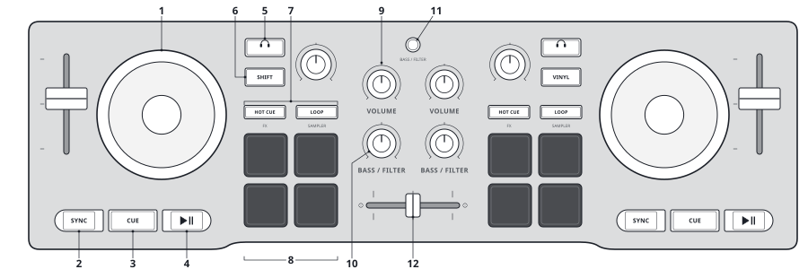

*Figure 28. The DJControl Starlight's controls (numbered on the left deck and the centre; the right deck has the same layout, but SHIFT is only on the left and VINYL only on the right)*

Same numbers as the Inpulse 200. Decks on ch 2 / ch 3 (pads on ch 7 / ch 8). There is no tempo fader on the unit.

<!-- devlist 1 Deck -->

1. **Jog**: Top scratch (touch), outer ring = nudge
2. **SYNC**
3. **CUE**
4. **PLAY/PAUSE**
5. **Headphone button**: Headphone CUE (listen to this deck on headphones)
6. **SHIFT**: `SHIFT` + pad clears a hot cue
7. **Mode buttons**: The mode of the 4 pads (HOT CUE, LOOP → AUTO LOOP, SHIFT + HOT CUE for FX → TOUCH FX, SHIFT + LOOP for SAMPLER → samples)
8. **Pads**: The 4 pads of the current mode

<!-- devlist 9 Mixer -->

9. **VOLUME**: Works as the channel fader (that deck's volume and picture strength)
10. **BASS / FILTER**: Set to FILTER = the FILTER knob (filter Cutoff), set to BASS = the LOW knob (Resonance)
11. **BASS / FILTER switch**: What knob 10 does (lit = FILTER, off = BASS)
12. **Crossfader**

Controls without a number (TEMPO, MASTER, HEADPHONES, VINYL) are not used by ReaScratch. From Mixxx's mapping; not yet tested on the real hardware.

**19 · 20 Hercules DJControl MIX deck 1 / deck 2**

*Figure 29. The DJControl MIX's controls (the same layout as the Starlight; numbered on the left deck and the centre; the right deck has the same layout, but SHIFT is only on the left and VINYL only on the right)*

Same numbers and layout as the Starlight (only the mode buttons are printed differently). Connect it by USB (Bluetooth is for smartphones). Decks on ch 2 / ch 3 (pads on ch 7 / ch 8). There is no tempo fader on the unit.

<!-- devlist 1 Deck -->

1. **Jog**: Top scratch (touch), outer ring = nudge
2. **SYNC**
3. **CUE**
4. **PLAY/PAUSE**
5. **Headphone button**: Headphone CUE (listen to this deck on headphones)
6. **SHIFT**: `SHIFT` + pad clears a hot cue
7. **Mode buttons**: The mode of the 4 pads (HOT CUE, SAMPLER → samples, SHIFT + HOT CUE for FX → TOUCH FX, SHIFT + SAMPLER for LOOP → AUTO LOOP)
8. **Pads**: The 4 pads of the current mode

<!-- devlist 9 Mixer -->

9. **VOLUME**: Works as the channel fader (that deck's volume and picture strength)
10. **FILTER / BASS**: Set to FILTER = the FILTER knob (filter Cutoff), set to BASS = the LOW knob (Resonance)
11. **FILTER / BASS switch**: What knob 10 does (off = FILTER, lit = BASS)
12. **Crossfader**

Controls without a number (TEMPO, MASTER, HEADPHONES, VINYL) are not used by ReaScratch. From Mixxx's mapping; not yet tested on the real hardware.

**21 · 22 Hercules DJ Control Instinct deck 1 / deck 2**

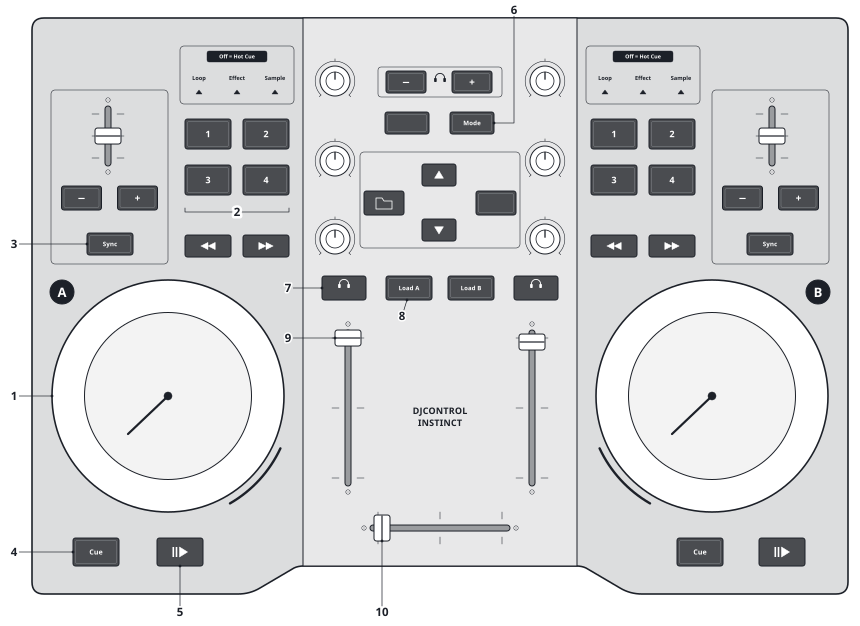

*Figure 30. The DJ Control Instinct's controls (numbered on the left deck and the centre; the right deck is the same, mirrored)*

Both decks on MIDI channel 1.

<!-- devlist 1 Deck -->

1. **Jog**: Top scratch (touch)
2. **Keys 1–4**: What they do depends on the mode chosen with `Mode`. `Hot Cue` (the `Loop`, `Effect` and `Sample` lamps off) = 1 / 2 are hot cues, 3 / 4 clear them. `Loop` = 1 a loop (IN), 3 reloop, 4 halve. `Effect` = Buddy-style (1 = FX ON, 2 / 3 = ◀ ▶)
3. **Sync**
4. **Cue**
5. **PLAY/PAUSE**

<!-- devlist 6 Mixer and centre -->

6. **Mode**: Switches the mode of the keys 1–4
7. **Headphone button**: Headphone CUE (listen to this deck on headphones)
8. **Load A**: LOAD
9. **Volume fader**: Channel fader (that deck's volume and picture strength)
10. **Crossfader**

Controls without a number (Pitch, Pitch − / +, ◀◀ ▶▶, Treble, Mid, Bass, the headphone volume − / +, Vinyl, the browser buttons) and the keys 1–4 in the `Sample` mode are not used by ReaScratch. Tempo is ± buttons only, so it is not read. From Mixxx's mapping; not yet tested on the real hardware.

**23 · 24 Hercules DJ Control AIR deck 1 / deck 2**

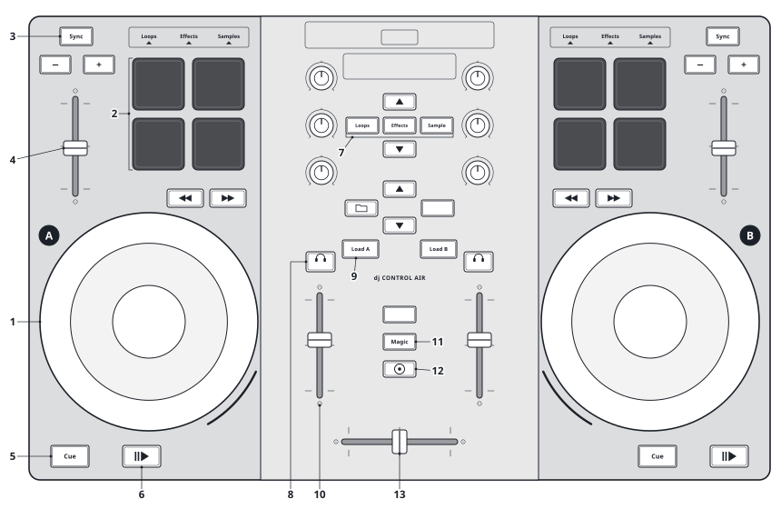

*Figure 31. The DJ Control AIR's controls (numbered on the left deck and the centre; the right deck is the same, mirrored)*

Both decks on MIDI channel 1.

<!-- devlist 1 Deck -->

1. **Jog**: With the `SCRATCH` button (12) on, the top scratches (no touch signal, so "touching" means while turning); with it off, the outer ring nudges
2. **Pads**: The 4 pads of the mode chosen with the mode buttons in the centre (7). `Loops` = 1 a loop (IN), 3 double, 4 reloop. `Effects` = 1 is the Buddy-style FX ON (the Flanger button). `Samples` = the 4 sample buttons
3. **Sync**
4. **Tempo fader**: Tempo (7-bit)
5. **Cue**
6. **PLAY/PAUSE**

<!-- devlist 7 Mixer and centre -->

7. **Loops · Effects · Sample**: Switch the pad mode
8. **Headphone button**: Headphone CUE (listen to this deck on headphones)
9. **Load A**: LOAD
10. **Volume fader**: Channel fader (that deck's volume and picture strength)
11. **Magic**: Acts as SHIFT while held
12. **SCRATCH**: Top scratch on the jog on / off (1)
13. **Crossfader**

The FX knob of FX (Buddy-style) is CC 0x3F, which Mixxx's mapping calls the Flanger depth (which control on the unit sends it is not confirmed).

Controls without a number (− / +, ◀◀ ▶▶, Treble, Mid, Bass, the browser buttons, Rec) are not used by ReaScratch. From Mixxx's mapping; not yet tested on the real hardware.

**25 · 26 Hercules DJ Console Mk4 deck 1 / deck 2**

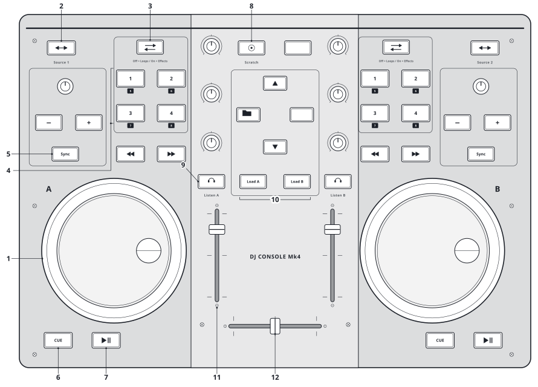

*Figure 32. The DJ Console Mk4's controls (numbered on the left deck and the centre; the right deck is the same, mirrored)*

<!-- devlist 1 Deck -->

1. **Jog**: Scratch. No touch signal, so "touching" means while turning
2. **Source 1**: Video effect on/off (Buddy-style FX ON). Mixxx's mapping calls it the `Flanger` button (notes 0x13 / 0x27); taken to be the unit's `Source` button from the order of the numbers (not checked on the real hardware)
3. **Off = Loops / On = Effects**: When lit, the keys 1–4 (4) become K5–K8
4. **Keys 1–4**: Lit (K5–K8) = hot cues 1–4 (hold `Scratch` to clear). Unlit (K1–K4) = key 1 loops, key 3 reloops
5. **Sync**
6. **CUE**
7. **PLAY/PAUSE**

<!-- devlist 8 Mixer -->

8. **Scratch**: Acts as SHIFT while held
9. **Listen A**: Listen to this deck on headphones (headphone CUE)
10. **Load A / B**: Load into deck A / B (as on the Reloop Buddy)
11. **Channel fader**: That deck's volume and picture strength
12. **Crossfader**: Deck 1 on the left side, deck 2 on the right

The DJ Control MP3 e2's numbers (both decks on MIDI channel 1). Tempo (the `Pitch` knob) arrives as relative values, so it is not read. Whether the Hercules driver is needed is not known. The controls without a number (Pitch, Pitch Bend, ◀◀ ▶▶, Treble / Medium / Bass, the browser buttons, Mic On/Off) are not used by ReaScratch. From Mixxx's mapping; not yet tested on the real hardware.

**27 · 28 Hercules DJ Console 4-Mx deck 1 / deck 2**

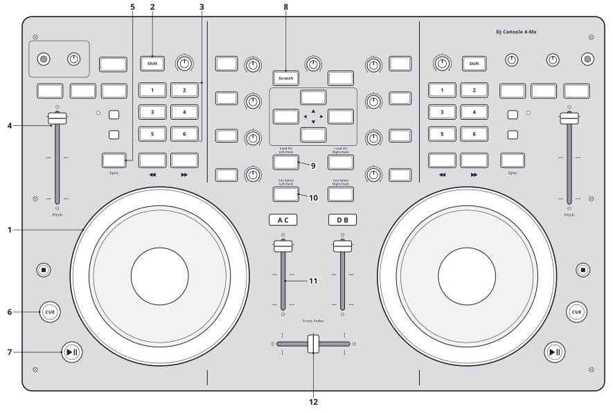

*Figure 33. The DJ Console 4-Mx's controls (numbered on the left deck and the centre; the right deck is the same, mirrored)*

<!-- devlist 1 Deck -->

1. **Jog**: With the unit's `Scratch` (8) on, the top scratches (touch); turning without touching works as the outer ring
2. **Shift**: When lit, the buttons 1–6 (3) become 7–12 (the unit's user guide). ReaScratch also reads it as SHIFT while held
3. **Buttons 1–6 (the FX buttons)**: With Shift unlit = button 2 reloops, 5 and 6 pick samples. 1–4 turned into 7–10 with Shift = hot cues 1–4 (as in Mixxx)
4. **Pitch**: Tempo (7-bit)
5. **Sync**
6. **Cue (round button)**
7. **Play (round button)**

<!-- devlist 8 Mixer -->

8. **Scratch**: Top scratch on the jog on / off (1)
9. **Load On Left Deck**: LOAD (as on the Reloop Buddy)
10. **Cue Select Left Deck**: Listen to this deck on headphones (headphone CUE)
11. **Channel fader**: That deck's volume and picture strength
12. **Crossfader**: Deck 1 on the left side, deck 2 on the right

Needs the Hercules driver (set its deck mode to 2 decks). Both decks on MIDI channel 1. The controls without a number (Stop, P. Bend, Pitch Scale, Deck C / D, Ctrl, ◀◀ ▶▶, Source, Kill, the EQ knobs, the browser buttons, Auto) are not used by ReaScratch. From Mixxx's mapping; not yet tested on the real hardware.

**29 · 30 Hercules DJ 4Set deck 1 / deck 2**

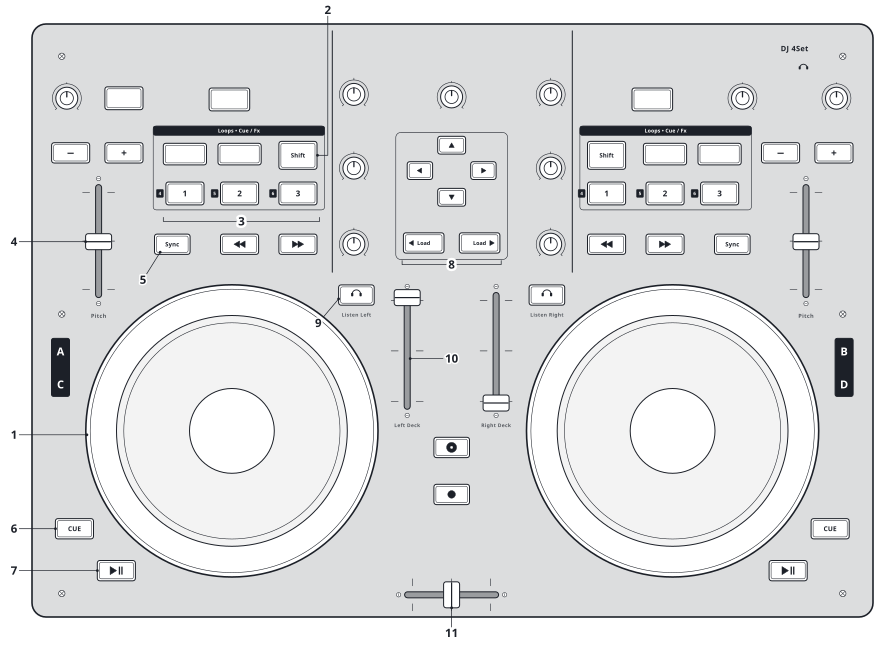

*Figure 34. The DJ 4Set's controls (numbered on the left deck and the centre; the right deck is the same, mirrored)*

<!-- devlist 1 Deck -->

1. **Jog**: Top scratch (touch); turning without touching works as the outer ring
2. **Shift**: When lit, the keys (3) become 4–6 and clear that hot cue
3. **Keys 1–3 (K1–K3)**: Hot cues 1–3
4. **Pitch**: Tempo (7-bit)
5. **Sync**
6. **CUE**
7. **PLAY/PAUSE**

<!-- devlist 8 Mixer -->

8. **Load ◀ ▶**: ◀ = load into deck A, ▶ = deck B (as on the Reloop Buddy)
9. **Listen Left**: Listen to this deck on headphones (headphone CUE)
10. **Channel fader**: That deck's volume and picture strength
11. **Crossfader**: Deck 1 on the left side, deck 2 on the right

The DJ Console 4-Mx's numbers (from the MIDI list at the end of Hercules' official user guide, via the Internet Archive). Needs the Hercules driver (set `Deck mode` in its control panel to `2-deck basic`). Both decks on MIDI channel 1. The controls without a number (Mic, DECK C / D, Modulate, Pitch Bend, ◀◀ ▶▶, Hi / Med / Low, Main, the browser buttons, Scratch, Record) are not used by ReaScratch. Not yet tested on the real hardware.

**31 · 32 Hercules DJControl Jogvision deck 1 / deck 2**

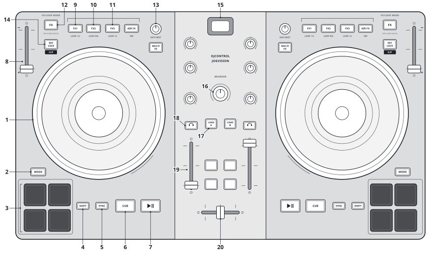

*Figure 35. The DJControl Jogvision's controls (numbered on the left deck and the centre; the right deck is the same, mirrored)*

<!-- devlist 1 Deck -->

1. **Jog**: Top scratch (touch), outer ring
2. **MODE**: Hold it and press pad 1–4 to pick the pad mode (HOT CUE, SAMPLER → samples)
3. **Pads**: The 4 pads of the current mode. In `HOT CUE`, SHIFT + pad clears a hot cue
4. **SHIFT**: Hold it with another control for its second function
5. **SYNC**
6. **CUE**
7. **PLAY/PAUSE**
8. **Tempo fader**: Tempo (14-bit)
9. **FX1 (LOOP ×½)**: In FX mode = the Buddy's FX ON bar (note 0x04; toggles with each press); in loop mode = halve the loop
10. **FX2 (LOOP ON)**: In FX mode = the Buddy's `FX PARAM` ◀ (note 0x05); in loop mode = loop
11. **FX3 (LOOP ×2)**: In FX mode = `FX PARAM` ▶ (note 0x06); in loop mode = double the loop
12. **FX/LOOP MODE**: Switches 9–11 and 13 between FX and loop
13. **DRY/WET (LOOP SIZE)**: In FX mode = the Buddy's FX knob; in loop mode = the loop knob (length)
14. **KEY-LOCK / SLIP**: SHIFT + KEY-LOCK = SLIP
15. **AIR FX sensor**: Filter Cutoff (CC 0x0F; the value Mixxx's mapping calls Filter; switch it on with the AIR FX button)

<!-- devlist 16 Mixer -->

16. **BROWSER**: Turn = the headphone Cue mix (while FX ON is on, that effect's sound amount), push = switch decks
17. **LOAD A / B**: As on the Reloop Buddy (LOAD A = deck 1, LOAD B = deck 2; LOAD B is on ch2 81)
18. **CUE-SELECT (the headphone button)**: Listen to this deck on headphones (headphone CUE)
19. **Channel fader**: That deck's volume and picture strength
20. **Crossfader**: Deck 1 on the left side, deck 2 on the right

Decks on ch 1 / ch 2. The FX section is read Buddy-style (9–11 and 13 above). Besides press, halve, double and the loop knob, the loop can also be moved (Mixxx's `Move Loop By N Beats`; which control on the unit sends it is not known). The controls without a number (AIR FX, MULTI FX, TREBLE / MEDIUM / BASS, VINYL, MIC, VIEW, LOAD PREPARE) are not used by ReaScratch. From Mixxx's mapping; not yet tested on the real hardware.

**33 · 34 Hercules Inpulse 200/300 (MK2) deck 1 / deck 2**

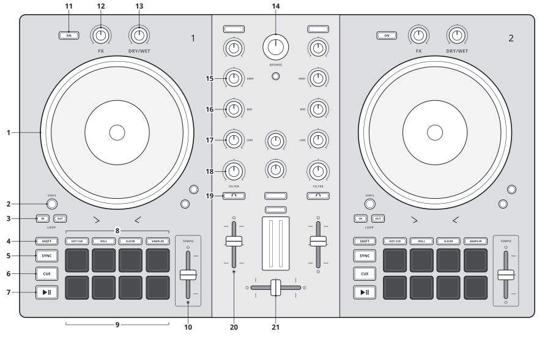

*Figure 36. The DJControl Inpulse 300's controls (numbered on the left deck and the centre; the right deck is the same. The 300 MK2 is taken to have nearly the same layout; not checked)*

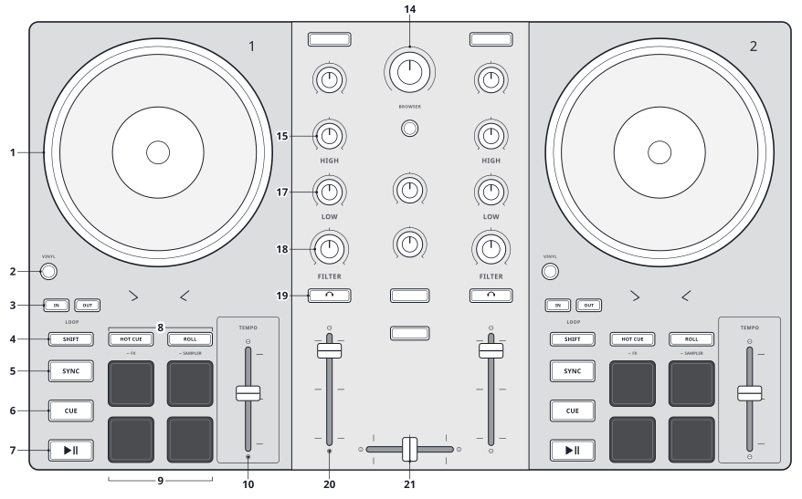

*Figure 37. The DJControl Inpulse 200's controls (the MK2 has the same layout; the numbers are those of the 300's list; 11–13 and 16 are on the 300 only)*

<!-- devlist 1 Deck -->

1. **Jog**: Top scratch (VINYL mode), outer ring, touch
2. **VINYL**: Top scratch on/off (`SHIFT` + `LOOP` on the 200 MK2)
3. **IN · OUT**: IN (LOOP IN) = loop, OUT (LOOP OUT) = reloop
4. **SHIFT**: Hold it with another control for its second function
5. **SYNC**
6. **CUE**
7. **PLAY/PAUSE**
8. **Mode buttons**: 300: `HOT CUE` = HOT CUE, `ROLL` → BOUNCE LOOP, `SLICER` → SLICER, `SAMPLER` → samples. The second modes (a 0.5-second long press): Toneplay → PITCH PLAY, FX → TOUCH FX, Slicer loop → AUTO LOOP, Beatjump → NEURAL MIX. For the 200, see the note below
9. **Pads**: The 8 pads of the current mode (4 on the 200). SHIFT + pad clears a hot cue
10. **TEMPO**: Tempo fader
11. **ON (300 only)**: The Buddy's FX ON bar (toggles with each press; with SHIFT, turns this deck's effects off while held)
12. **FX (300 only)**: The amount of the video effect after the mix (FX LVL)
13. **DRY/WET (300 only)**: The Buddy's FX knob

<!-- devlist 14 Mixer -->

14. **BROWSE**: Turn = the headphone Cue mix (while FX ON is on, that effect's sound amount), push = switch decks
15. **HIGH**: Filter Morph (echo length with SHIFT)
16. **MID (300 only)**: How much the video effects act on the sound
17. **LOW**: Filter Resonance (echo feedback with SHIFT)
18. **FILTER**: Filter Cutoff (key with SHIFT)
19. **Headphone CUE**: Listen to this deck on headphones
20. **Channel fader**: That deck's volume and picture strength
21. **Crossfader**: Deck 1 on the left side, deck 2 on the right

Decks on ch 2 / ch 3 (pads on ch 7 / ch 8), crossfader on ch 1. The FX section (300) is read Buddy-style. PADFX SELECT (notes 0x25 / 0x26 in the official MIDI list) is set as ◀ ▶, but the list does not say which control on the unit sends it, so it has no number in the drawing. The 200 has 2 mode buttons (`HOT CUE`, `ROLL`; on the MK2 `HOT CUE`, `STEMS`), and holding SHIFT gives the second modes (FX, SAMPLER). Its pads use the 300's numbers: HOT CUE = HOT CUE, ROLL (STEMS) → BOUNCE LOOP, FX → SLICER, SAMPLER → samples (read from the numbers; not checked on the real hardware). LOAD (ch2 13 / ch3 13) loads the file chosen in the Media Explorer into an empty sample slot. SHIFT + LOAD (ch5 13 / ch6 13) replaces the slot in use. Hold a mode button (8) and press LOAD to preview (the same as the `P` key). The controls without a number (Q, SLIP, GAIN, ASSISTANT, the HEADPHONES / MASTER knobs, MASTER, BEATMATCH GUIDE) are not used by ReaScratch. From Hercules' official MIDI list and Mixxx's mapping; not yet tested on the real hardware.

**35 · 36 Hercules Inpulse 500 deck 1 / deck 2**

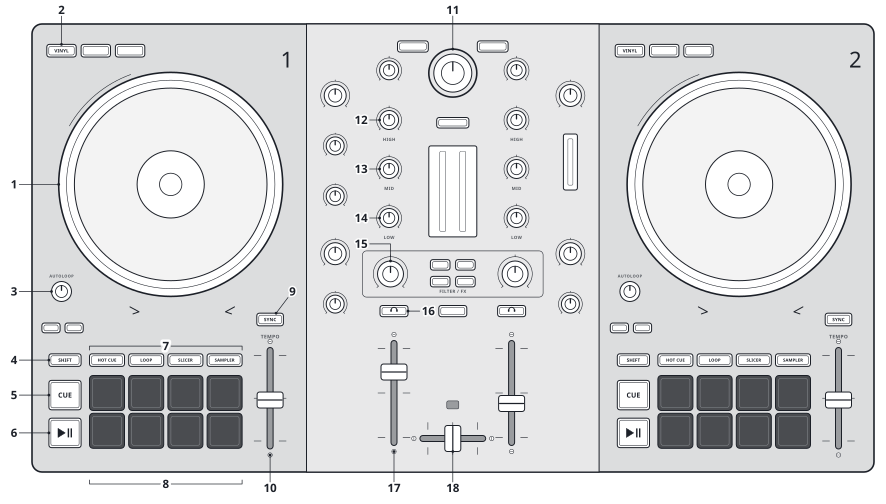

*Figure 38. The DJControl Inpulse 500's controls (numbered on the left deck and the centre; the right deck is the same)*

<!-- devlist 1 Deck -->

1. **Jog**: Top scratch (VINYL mode), outer ring, touch
2. **VINYL**: Top scratch on/off
3. **Loop knob (AUTOLOOP)**: Turn = length, press = loop
4. **SHIFT**: Hold it with another control for its second function
5. **CUE**
6. **PLAY/PAUSE**
7. **Mode buttons**: `HOT CUE` = HOT CUE, `LOOP` → AUTO LOOP, `SLICER` → SLICER, `SAMPLER` → samples. The second modes (MODE 5–8): Pitch → PITCH PLAY, Roll → BOUNCE LOOP, Effect → TOUCH FX, BeatJump → NEURAL MIX
8. **Pads**: The 8 pads of the current mode. SHIFT + pad clears a hot cue
9. **SYNC**
10. **TEMPO**: Tempo fader

<!-- devlist 11 Mixer -->

11. **BROWSE**: Turn = how much the video effects act on the sound, push = switch the deck the knob works on, SHIFT + turn = the headphone Cue mix
12. **HIGH**: Filter Morph (echo length with SHIFT)
13. **MID**: How much the video effects act on the sound
14. **LOW**: Filter Resonance (echo feedback with SHIFT)
15. **FILTER**: Filter Cutoff (key with SHIFT)
16. **Headphone CUE**: Listen to this deck on headphones
17. **Channel fader**: That deck's volume and picture strength
18. **Crossfader**: Deck 1 on the left side, deck 2 on the right

Decks on ch 2 / ch 3 (pads on ch 7 / ch 8), crossfader on ch 1. The jog's tick count differs from the 200/300 (`138` on the 200/300, `400` on the 500). LOAD (ch2 13 / ch3 13) loads the file chosen in the Media Explorer into an empty sample slot. SHIFT + LOAD (ch5 13 / ch6 13) replaces the slot in use. Hold a mode button (7) and press LOAD to preview (the same as the `P` key). The controls without a number (SLIP, QUANT, IN, OUT, ASSISTANT, the MIC / AUX knobs, GAIN, MASTER VOL, HEADPHONES, CUE / MASTER, FX1–FX4, BEATMATCH GUIDE) are not used by ReaScratch. From Hercules' official MIDI list and Mixxx's mapping; not yet tested on the real hardware.

**37 · 38 ION Discover DJ deck 1 / deck 2**

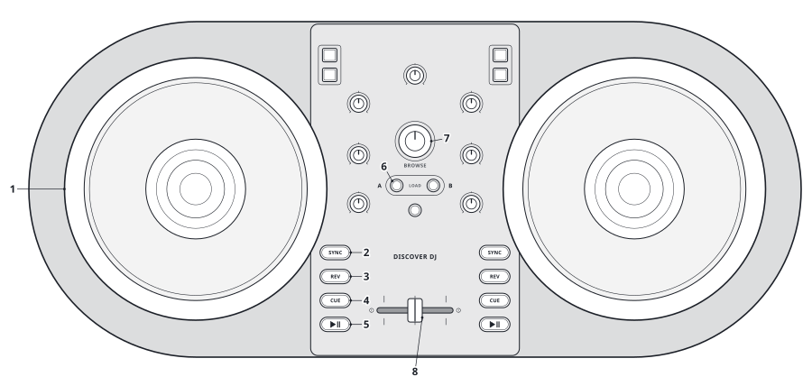

*Figure 39. The Discover DJ's controls (numbered on the left deck and the centre; the right deck is the same, mirrored)*

Both decks on MIDI channel 1. No tempo or channel faders, no pads.

<!-- devlist 1 Deck -->

1. **Jog**: Top = touch scratch
2. **SYNC**
3. **REV**: Reverse play while held
4. **CUE**
5. **PLAY/PAUSE**

<!-- devlist 6 Centre -->

6. **LOAD A**: Loads the file chosen in the Media Explorer into this deck
7. **BROWSE**: Turn = how much the video effects act on the sound
8. **Crossfader**: Deck 1 on the left side, deck 2 on the right

Controls without a number (PITCH −% / +%, MASTER VOLUME, TREBLE, BASS, VOLUME, SCRATCH/SEARCH) are not used by ReaScratch. From Mixxx's mapping; not yet tested on the real hardware.

**39 · 40 ION Discover DJ Pro deck 1 / deck 2**

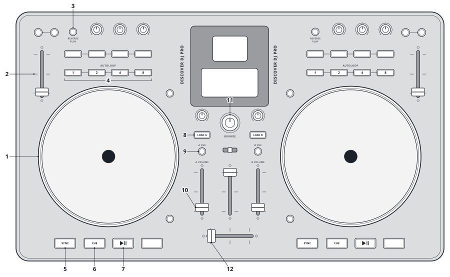

*Figure 40. The Discover DJ Pro's controls (numbered on the left deck and the centre; the right deck is the same)*

Both decks on MIDI channel 1. No pads.

<!-- devlist 1 Deck -->

1. **Jog**: Top scratch. Touch arrives as a CC rather than a note, so "touching" means while turning
2. **Outer slider**: Tempo (7-bit)
3. **REVERSE PLAY**: Each press turns reverse play on/off
4. **AUTOLOOP buttons**: Loop (toggles with each press) and reloop. Taken from the notes in Mixxx's mapping (deck 1: 0x53 / 0x55, deck 2: 0x56 / 0x58); which of the buttons 1, 2, 4 and 8 sends which is unconfirmed (in Mixxx 0x53 = loop in, 0x54 = loop out, 0x55 = reloop, 0x61 = manual loop toggle)
5. **SYNC**
6. **CUE**
7. **PLAY/PAUSE**

<!-- devlist 8 Centre -->

8. **LOAD A**: Loads the file chosen in the Media Explorer into this deck
9. **A CUE**: Listen to this deck on headphones (toggles with each press)
10. **A VOLUME**: That deck's volume and picture strength (channel fader)
11. **BROWSE**: Turn = how much the video effects act on the sound
12. **Crossfader**: Deck 1 on the left side, deck 2 on the right

Controls without a number (PITCH BEND, BASS, MID, TREBLE, MUTE, KEYLOCK, SCRATCH, STUTTER, CUE VOLUME, MASTER VOLUME, CUE SOURCE, iPod VOLUME) are not used by ReaScratch. From Mixxx's mapping; not yet tested on the real hardware.

**41 · 42 Korg KAOSS DJ deck 1 / deck 2**

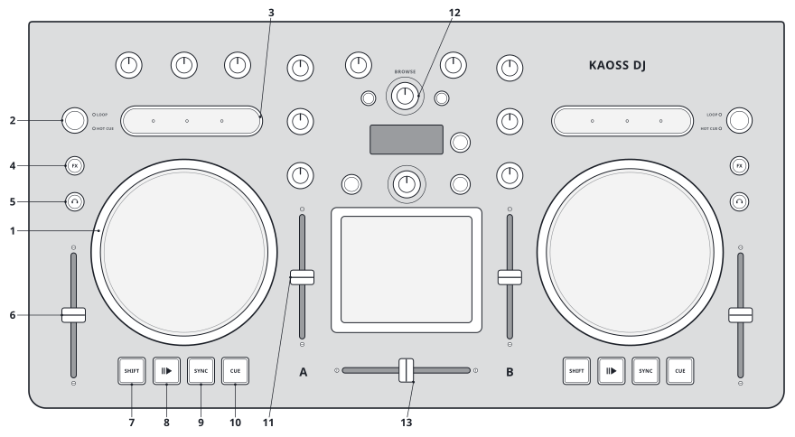

*Figure 41. The KAOSS DJ's controls (numbered on the left deck and the centre; the right deck is the same)*

Decks on ch 8 / ch 9, the crossfader and BROWSE on ch 7. From Mixxx's mapping (the main numbers also match Korg's official MIDI list; the numbers for SHIFT + touch slider are not in the official list, only in Mixxx's mapping).

<!-- devlist 1 Deck -->

1. **Touch wheel**: Touch and turn = touch scratch. What the controller sends while its scratch mode is off is read as the outer ring (nudge). The scratch mode switches when you touch the centre of the touch slider in its Normal mode (Korg's owner's manual). `SHIFT` + turn makes big jumps
2. **Touch slider mode button**: Switches the touch slider's mode (Normal, Loop, Hot Cue; inside the controller)
3. **Touch slider**: In Hot Cue mode, left / centre / right = 3 hot cues (`SHIFT` + touch clears). In Loop mode, left = halve the loop, centre = loop on/off (reloop with SHIFT), right = double
4. **FX**: That deck's video effect on/off
5. **Headphone CUE**: Listen to this deck on headphones (toggles with each press)
6. **Pitch fader**: Tempo (7-bit)
7. **SHIFT**: Hold it with another control for its second function
8. **PLAY/PAUSE**
9. **SYNC**
10. **CUE**

<!-- devlist 11 Mixer and centre -->

11. **Level fader**: That deck's volume and picture strength
12. **BROWSE**: Turn = how much the video effects act on the sound of the selected deck (usually deck A)
13. **Crossfader**: Deck 1 on the left side, deck 2 on the right

LOAD (ch8 14 / ch9 14) loads the file chosen in the Media Explorer into an empty sample slot. Controls without a number (headphone level, BALANCE, MASTER, GAIN, HI, MID, LO, the display, the touchpad and its mode button, the program/value knob, TAP, HOLD) are not used by ReaScratch. It is not known whether the message Korg's software sends at start-up is needed. Not yet tested on the real hardware.

**43 · 44 HID bridge (NI S2/S3/S4) deck 1 / deck 2**

ReaScratch can only read MIDI, so a separate bridge program (the `HID bridge` folder in the zip; see [“HID controllers (NI Traktor Kontrol S4, S3, S2)”](#hid-controllers-ni-traktor-kontrol-s4-s3-s2)) reads the HID data and sends MIDI with the DDJ-FLX4's numbers to a virtual MIDI port. The numbers come from Mixxx's mappings; not yet tested on the real hardware.

The drawings per model follow. On every model the left deck is deck 1 and the right deck is deck 2 (the S4's and S3's DECK SELECT C / D and the mixer's C / D columns are not used).

**Traktor Kontrol S4 MK3**

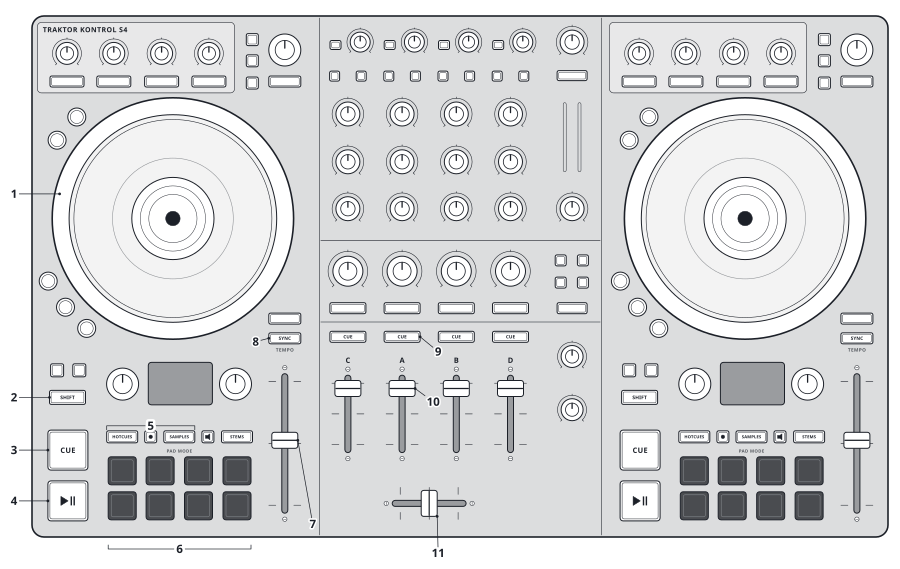

*Figure 42. The Traktor Kontrol S4 MK3's controls (numbered on the left deck and the mixer's A column; the right deck and the B column are the same)*

<!-- devlist 1 Deck -->

1. **Jog**: Touch the top and turn = touch scratch (the bridge program stops the jog motors at start-up)
2. **SHIFT**: Hold it with another control for its second function
3. **CUE**
4. **PLAY/PAUSE**
5. **Pad mode buttons**: `HOTCUES` = HOT CUE, `SAMPLES` → sample switching (the ● between them, mute and `STEMS` are not used)
6. **Pads**: The 8 pads of the current mode. In `HOTCUES`, SHIFT + pad clears a hot cue
7. **TEMPO**: Tempo fader
8. **SYNC**: SHIFT switches the tempo range

<!-- devlist 9 Mixer -->

9. **Headphone CUE (A column)**: Listen to this deck on headphones (toggles with each press)
10. **Channel fader (A column)**: That deck's volume and picture strength
11. **Crossfader**: Deck 1 on the left side, deck 2 on the right

Controls without a number (the FX unit, the browse controls, FLX, REV, GRID, TT, JOG, MASTER, DECK SELECT, MOVE, LOOP, EQ, MIXER FX, the C and D columns and so on) are not used by ReaScratch.

**Traktor Kontrol S3**

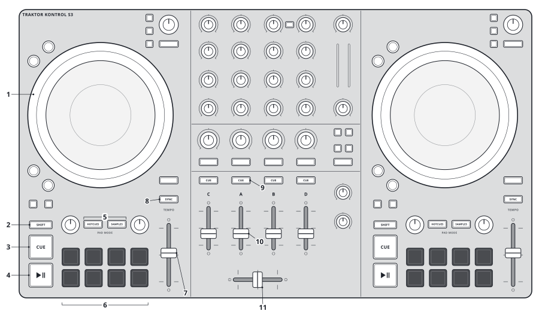

*Figure 43. The Traktor Kontrol S3's controls (numbered on the left deck and the mixer's A column; the right deck and the B column are the same)*

<!-- devlist 1 Deck -->

1. **Jog**: Touch the top and turn = touch scratch
2. **SHIFT**: Hold it with another control for its second function
3. **CUE**
4. **PLAY/PAUSE**
5. **Pad mode buttons**: `HOTCUES` = HOT CUE, `SAMPLES` → sample switching
6. **Pads**: The 8 pads of the current mode. In `HOTCUES`, SHIFT + pad clears a hot cue
7. **TEMPO**: Tempo fader
8. **SYNC**: SHIFT switches the tempo range

<!-- devlist 9 Mixer -->

9. **Headphone CUE (A column)**: Listen to this deck on headphones (toggles with each press)
10. **Channel fader (A column)**: That deck's volume and picture strength
11. **Crossfader**: Deck 1 on the left side, deck 2 on the right

Controls without a number (the browse controls, FLX, REV, GRID, JOG, KEYLOCK, DECK SELECT, MOVE, LOOP, EQ, MIXER FX, the C and D columns and so on) are not used by ReaScratch.

**Traktor Kontrol S2 MK3**

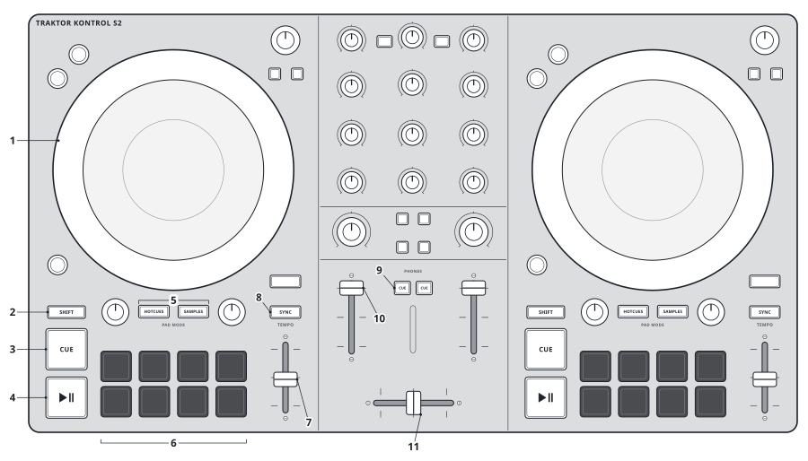

*Figure 44. The Traktor Kontrol S2 MK3's controls (numbered on the left deck and the mixer's left side; the right deck is the same)*

<!-- devlist 1 Deck -->

1. **Jog**: Touch the top and turn = touch scratch
2. **SHIFT**: Hold it with another control for its second function
3. **CUE**
4. **PLAY/PAUSE**
5. **Pad mode buttons**: `HOTCUES` = HOT CUE, `SAMPLES` → sample switching
6. **Pads**: The 8 pads of the current mode. In `HOTCUES`, SHIFT + pad clears a hot cue
7. **TEMPO**: Tempo fader
8. **SYNC**: SHIFT switches the tempo range

<!-- devlist 9 Mixer -->

9. **Headphone CUE (left)**: Listen to this deck on headphones (toggles with each press)
10. **Channel fader (left)**: That deck's volume and picture strength
11. **Crossfader**: Deck 1 on the left side, deck 2 on the right

Controls without a number (the browse controls, FLX, REV, GRID, KEYLOCK, MOVE, LOOP, EQ, the FX knobs, FX SELECT and so on) are not used by ReaScratch.

**Traktor Kontrol S4 MK2**

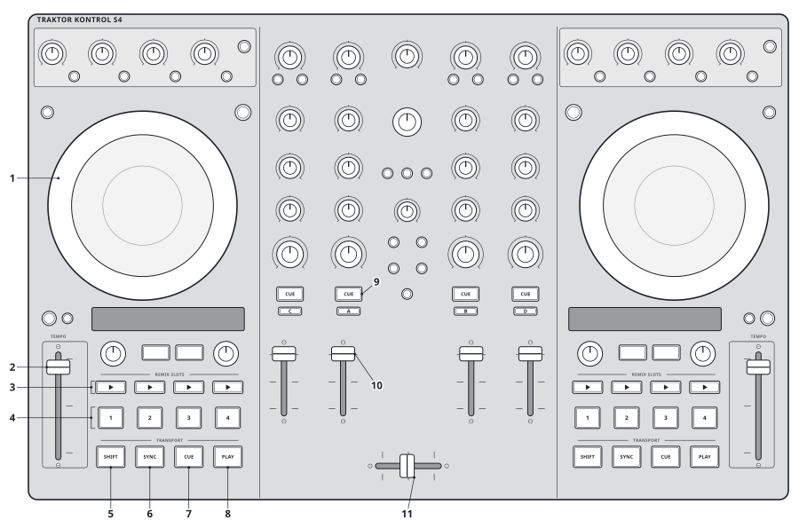

*Figure 45. The Traktor Kontrol S4 MK2's controls (numbered on the left deck and the mixer's A column; the right deck and the B column are the same)*

<!-- devlist 1 Deck -->

1. **Jog**: Touch the top and turn = touch scratch
2. **TEMPO**: Tempo fader
3. **REMIX SLOTS row**: 4 buttons for sample switching (1–4)
4. **HOTCUE row (1–4)**: Hot cues. SHIFT + button clears a hot cue
5. **SHIFT**: Hold it with another control for its second function
6. **SYNC**: SHIFT switches the tempo range
7. **CUE**
8. **PLAY**

<!-- devlist 9 Mixer -->

9. **Headphone CUE (A column)**: Listen to this deck on headphones (toggles with each press)
10. **Channel fader (A column)**: That deck's volume and picture strength
11. **Crossfader**: Deck 1 on the left side, deck 2 on the right

Controls without a number (the FX unit, DECK C, LOAD, FLUX, RESET, the loop knobs, IN, OUT, EQ, FILTER, BROWSE, LOOP RECORDER, the C and D columns and so on) are not used by ReaScratch.

**Traktor Kontrol S2 MK2 · S2 MK1**

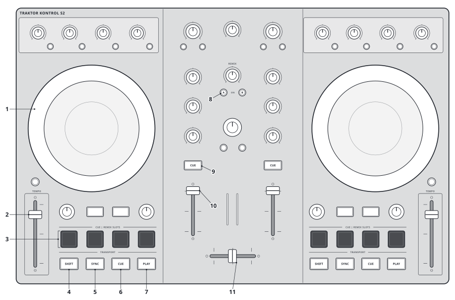

*Figure 46. The Traktor Kontrol S2 MK2's controls (numbered on the left deck and the mixer's left side; the right deck is the same. The S2 MK1 is laid out almost the same)*

<!-- devlist 1 Deck -->

1. **Jog**: Touch the top and turn = touch scratch (on the S2 MK1, how hard the top is pressed decides "touching"; see [“HID controllers (NI Traktor Kontrol S4, S3, S2)”](#hid-controllers-ni-traktor-kontrol-s4-s3-s2))
2. **TEMPO**: Tempo fader
3. **Pads (CUE | REMIX SLOTS 1–4)**: The 4 pads of the current mode. In the hot cue mode, SHIFT + pad clears a hot cue
4. **SHIFT**: Hold it with another control for its second function
5. **SYNC**: SHIFT switches the tempo range
6. **CUE**
7. **PLAY**

<!-- devlist 8 Mixer and centre -->

8. **REMIX ON A**: Each press flips the left deck's pads between hot cues and sample switching (B for the right deck; on the S2 MK1, `SAMPLES` ON A / B)
9. **Headphone CUE (left)**: Listen to this deck on headphones (toggles with each press)
10. **Channel fader (left)**: That deck's volume and picture strength
11. **Crossfader**: Deck 1 on the left side, deck 2 on the right

Controls without a number (the FX unit, FLUX (RESET on the S2 MK1), the loop knobs, IN, OUT, GAIN | FILTER, EQ, the REMIX knob, BROWSE, LOAD and so on) are not used by ReaScratch.

**45 · 46 Numark Party Mix deck 1 / deck 2**

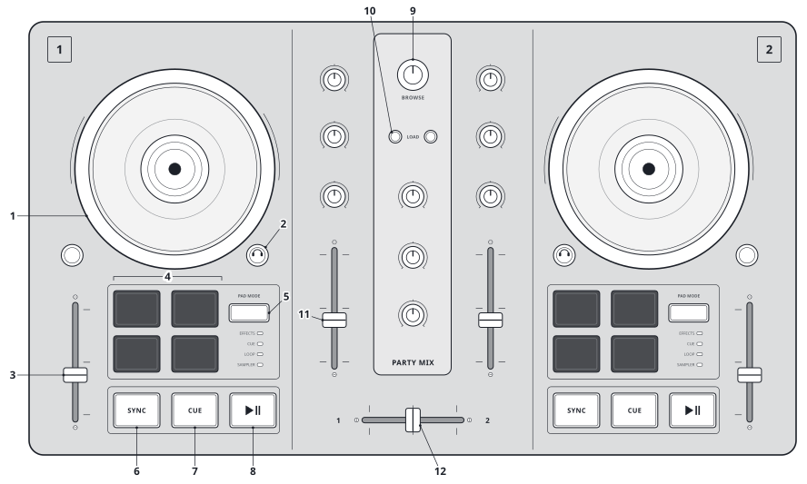

*Figure 47. The original Numark Party Mix's controls (numbered on the left deck and the centre; the right deck has the same controls, with the jog's surroundings and the tempo fader mirrored)*

Decks on ch 1 / ch 2, crossfader on ch 16. From Mixxx's mapping (its mode numbers differ from the Party Mix II's; two mappings made by owners of the original agree).

<!-- devlist 1 Deck -->

1. **Jog**: Top scratch. There is no touch signal, so "touching" means while turning (340 ticks per turn)
2. **Headphone CUE (PFL)**: Listen to this deck on headphones (toggles with each press)
3. **Tempo fader**: 7-bit
4. **Pads**: The 4 pads of the current mode. Clear a hot cue by right-clicking its line on the waveform
5. **PAD MODE**: Each press changes the mode (Cue → HOT CUE, Loop → AUTO LOOP, Sampler → samples, Effects → TOUCH FX)
6. **SYNC**
7. **CUE**
8. **PLAY/PAUSE**

<!-- devlist 9 Mixer -->

9. **BROWSE**: Turn = how much the video effects act on the sound, push = switch the deck the knob works on
10. **LOAD**: Same as the Reloop Buddy (left = deck 1, right = deck 2)
11. **Channel fader**: That deck's volume and picture strength
12. **Crossfader**: Deck 1 on the left side, deck 2 on the right

Controls without a number (SCRATCH, GAIN, TREBLE, BASS, MASTER GAIN, CUE MIX, CUE GAIN) are not used by ReaScratch. There is no SHIFT button. The message Mixxx sends to the unit at start-up is "send back the current knob and fader values", which is probably not needed to receive MIDI (since it is not sent, fader positions are not reflected until you move them). Not yet tested on the real hardware.

**47 · 48 Numark Party Mix II/Live deck 1 / deck 2**

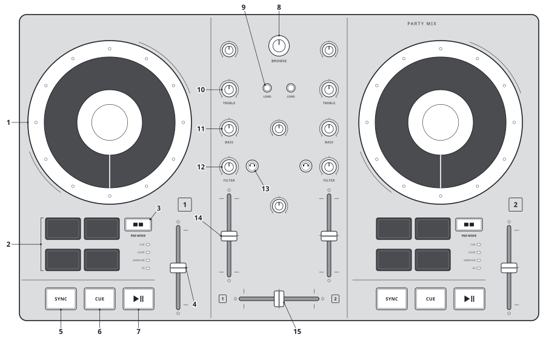

*Figure 48. The Numark Party Mix II's controls (numbered on the left deck and the centre; the right deck is the same. The Party Mix Live adds a speaker on top, with the same controls)*

Same numbers as the Mixtrack (the Party Mix Live is a II with speakers, assumed to use the same numbers). From Mixxx's mapping (a draft not yet merged).

<!-- devlist 1 Deck -->

1. **Jog**: Top = touch scratch (300 ticks per turn)
2. **Pads**: The 4 pads of the current mode
3. **PAD MODE**: Each press changes the mode (Cue → HOT CUE, Loop → AUTO LOOP, Sampler → samples, Effects → TOUCH FX)
4. **Tempo fader**: 7-bit
5. **SYNC**
6. **CUE**
7. **PLAY/PAUSE**

<!-- devlist 8 Mixer -->

8. **BROWSE**: Turn = how much the video effects act on the sound, push = switch the deck the knob works on
9. **LOAD**: Same as the Reloop Buddy (left = deck 1, right = deck 2)
10. **TREBLE**: Filter Morph (HIGH on other controllers)
11. **BASS**: Filter Resonance (LOW on other controllers)
12. **FILTER**: Filter Cutoff
13. **Headphone buttons**: Listen to this deck on headphones (toggles with each press; left = deck 1, right = deck 2)
14. **Channel fader**: That deck's volume and picture strength
15. **Crossfader**: Deck 1 on the left side, deck 2 on the right

Controls without a number (LEVEL, HEADPHONE, MAIN) are not used by ReaScratch. There is no SHIFT button or MID knob. Mixxx keeps sending messages to the unit while running, but that is for the unit's lights and is probably not needed to receive MIDI (from the discussion of the Mixxx mapping draft). Not yet tested on the real hardware.

**49 · 50 Numark DJ2GO2 deck 1 / deck 2, 51 · 52 Numark DJ2GO2 Touch deck 1 / deck 2**

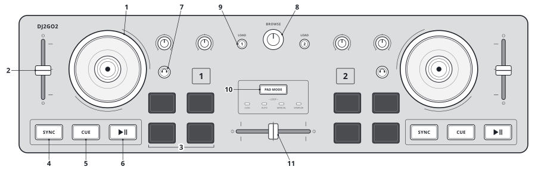

*Figure 49. The Numark DJ2GO2's and DJ2GO2 Touch's controls (both laid out the same; numbered on the left deck and the centre; the right deck has the same controls, mirrored, except that SYNC / CUE / PLAY keep the same order. On the Touch, GAIN is printed LEVEL)*

Decks on ch 1 / ch 2 (pads on ch 5 / ch 6), crossfader on ch 16. The Touch is from Mixxx's mapping, the DJ2GO2 from Numark's official Traktor mapping (Internet Archive).

<!-- devlist 1 Deck -->

1. **Jog**: Top scratch (by touch on the Touch; 236 ticks per turn). The DJ2GO2 (without touch) has no touch signal, so "touching" means while turning (its tick count is assumed to be the Touch's)
2. **Tempo fader**: 7-bit
3. **Pads**: The 4 pads of the current mode. On the Touch, hold `PAD MODE` and press a pad to clear a hot cue
4. **SYNC**
5. **CUE**
6. **PLAY/PAUSE**
7. **Headphone CUE (PFL)**: Listen to this deck on headphones (toggles with each press)

<!-- devlist 8 Centre -->

8. **BROWSE**: Turn = how much the video effects act on the sound, push = switch the deck the knob works on
9. **LOAD 1 · 2**: Same as the Reloop Buddy (1 = deck 1, 2 = deck 2)
10. **PAD MODE**: The pad mode of both decks. Each press changes it (Cue → HOT CUE, Auto Loop → AUTO LOOP, Manual Loop → BOUNCE LOOP, Sampler → samples)
11. **Crossfader**: Deck 1 on the left side, deck 2 on the right

Controls without a number (GAIN, the Touch's LEVEL, MASTER GAIN, CUE GAIN) are not used by ReaScratch. No channel faders or FILTER knob (the Touch's knob in the FILTER position is gain and its MIDI is not used). There is no SHIFT button either. Not yet tested on the real hardware.

**53 · 54 Numark Mixtrack deck 1 / deck 2**

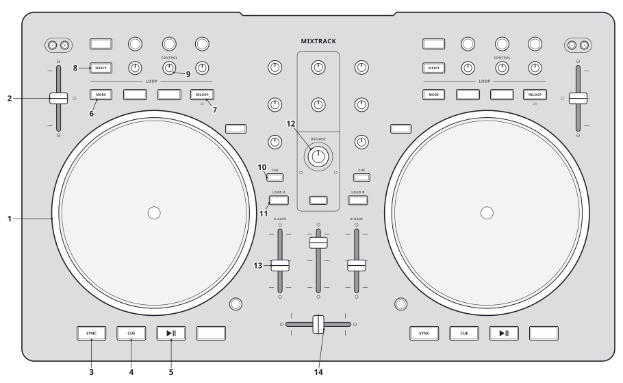

*Figure 50. The Numark Mixtrack's (original) controls (numbered on the left deck and the centre; the right deck is the same)*

Both decks on MIDI channel 1, told apart by number. No pads. From Mixxx's mapping.

<!-- devlist 1 Deck -->

1. **Jog**: Touch scratch (touch the top and turn; 512 ticks per turn)
2. **PITCH fader**: Tempo (7-bit)
3. **SYNC**
4. **CUE**
5. **PLAY/PAUSE**
6. **MODE** (left end of the LOOP row): Loop
7. **RELOOP** (2X): Reloop

<!-- devlist 8 FX (Buddy-style) -->

8. **EFFECT**: The Buddy's FX ON bar (toggles with each press)
9. **CONTROL knob**: The Buddy's FX knob (effect amount). Mixxx's mapping gives it the Flanger's LFO DEPTH number (CC 0x1C); both decks' presets read this knob on the left deck. The original's sources do not say which of the three knobs has this number; from the Mixtrack Pro's mapping notes (the same numbers 0x1B–0x1D, 0x1B = the first knob), it is taken to be the second knob, the first CONTROL

Note (9): What it acts on depends on what you hold (as in the Reloop Buddy's note). While EFFECT is on = that deck's effect amount; nothing held = edge softness. There is no SHIFT and no button for ◀ ▶.

<!-- devlist 10 Mixer -->

10. **Headphone CUE**: Listen to this deck on headphones (toggles with each press)
11. **LOAD A / B**: Load the file selected in the Media Explorer into deck A / B (as on the Reloop Buddy)
12. **BROWSE**: Turn = the headphone Cue mix (while EFFECT is on, that effect's sound amount)
13. **Channel fader**: That deck's volume and picture strength
14. **Crossfader**: Deck 1 on the left side, deck 2 on the right

Controls without a number (PITCH BEND, KEYLOCK, SCRATCH, STUTTER, VIEW, TICK, EQ KILL, SELECT, IN, OUT, TREBLE, MID, BASS, CUE GAIN, CUE MIX, BACK, MASTER GAIN) are not used by ReaScratch. Not yet tested on the real hardware.

**55 · 56 Numark Mixtrack Pro deck 1 / deck 2**

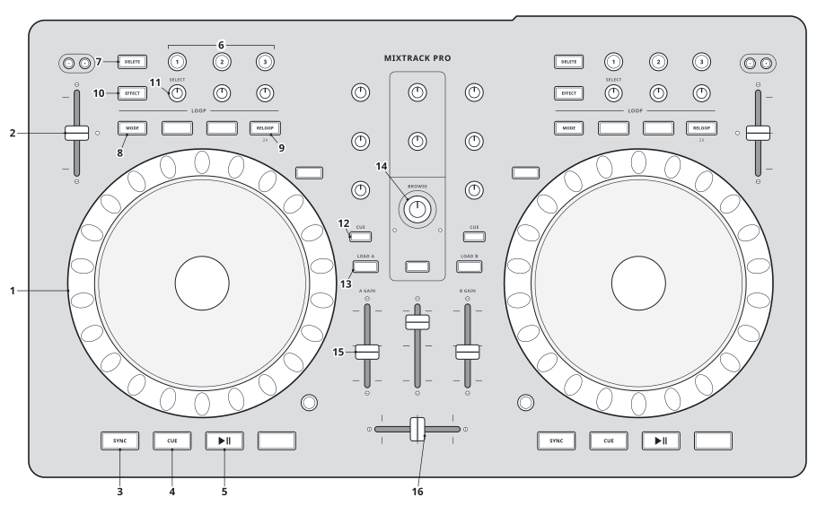

*Figure 51. The Numark Mixtrack Pro's (original) controls (numbered on the left deck and the centre; the right deck is the same)*

Almost the same numbers as the original Mixtrack, both decks on MIDI channel 1, with 3 hot cue buttons. From Mixxx's mapping.

<!-- devlist 1 Deck -->

1. **Jog**: Touch scratch (touch the top and turn; 600 ticks per turn)
2. **PITCH fader**: Tempo (7-bit)
3. **SYNC**
4. **CUE**
5. **PLAY/PAUSE**
6. **HOT CUE 1–3**: Hot cues
7. **DELETE**: Hold it and press a HOT CUE button to clear that hot cue
8. **MODE** (left end of the LOOP row): Loop
9. **RELOOP** (2X): Reloop

<!-- devlist 10 FX (Buddy-style) -->

10. **EFFECT**: The Buddy's FX ON bar (toggles with each press)
11. **SELECT knob**: The Buddy's FX knob (that deck's effect amount). Mixxx's mapping gives it the LFO DEPTH number (deck 1 = CC 0x1B, deck 2 = 0x1E). Mixxx's mapping notes say the first knob (SELECT) has this number

Note (11): What it acts on depends on what you hold (as in the Reloop Buddy's note). While EFFECT is on = that deck's effect amount; nothing held = edge softness. There is no SHIFT and no button for ◀ ▶.

<!-- devlist 12 Mixer -->

12. **Headphone CUE**: Listen to this deck on headphones (toggles with each press)
13. **LOAD A / B**: Load the file selected in the Media Explorer into deck A / B (as on the Reloop Buddy)
14. **BROWSE**: Turn = the headphone Cue mix (while EFFECT is on, that effect's sound amount)
15. **Channel fader**: That deck's volume and picture strength
16. **Crossfader**: Deck 1 on the left side, deck 2 on the right

Controls without a number (PITCH BEND, KEYLOCK, SCRATCH, STUTTER, CONTROL, IN, OUT, TREBLE, MID, BASS, CUE GAIN, CUE MIX, BACK, MASTER GAIN) are not used by ReaScratch. Not yet tested on the real hardware.

**57 · 58 Numark Mixtrack 2 deck 1 / deck 2**

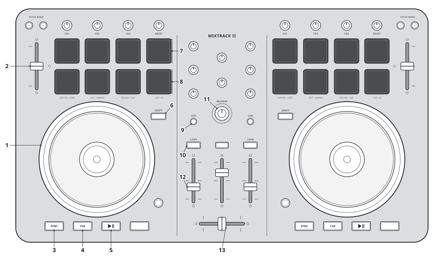

*Figure 52. The Numark Mixtrack II's and Mixtrack Pro II's controls (the same layout; numbered on the left deck and the centre; the right deck is the same. The Pro II has BEATS where FILTER is and TAP where RESET is)*

Both decks on MIDI channel 1, told apart by number. From Mixxx's mapping (MixTrack (Pro) II).

<!-- devlist 1 Deck -->

1. **Jog**: Touch scratch (touch the top and turn; 600 ticks per turn)
2. **PITCH fader**: Tempo (7-bit)
3. **SYNC**
4. **CUE**
5. **PLAY/PAUSE**
6. **SHIFT**: Set to clear a hot cue when held while pressing its pad (on the unit, SHIFT + a bottom-row pad also switches the pad mode)
7. **Top row of pads** (FX, Buddy-style): `FX1` = the Buddy's FX ON bar (toggles with each press), `FX2` / `FX3` = the Buddy's `FX PARAM` ◀ ▶ (effect type). `RESET` (`TAP` on the Pro II) is not used
8. **Bottom row of pads**: What they do depends on the unit's pad mode. LOOP mode = `LOOP IN` loops, `RELOOP` reloops, `1/2X` halves the loop. CUE mode = the left three are hot cues 1–3

<!-- devlist 9 Mixer -->

9. **Headphone CUE**: Listen to this deck on headphones (toggles with each press)
10. **LOAD**: Load the file selected in the Media Explorer into this deck (as on the Reloop Buddy)
11. **BROWSE**: Turn = the headphone Cue mix (while FX1 is on, that effect's sound amount)
12. **Channel fader**: That deck's volume and picture strength. The numbers follow Mixxx's mapping (deck 1 = CC 0x16, deck 2 = 0x07), but their order differs from the other models, so they are doubtful
13. **Crossfader**: Deck 1 on the left side, deck 2 on the right

Controls without a number (PITCH BEND, SCRATCH, STUTTER, SELECT, FILTER (BEATS), the bottom row's `OUT`, the SAMPLE mode, TREBLE, MID, BASS, CUE GAIN, CUE MIX, BACK, MASTER) are not used by ReaScratch. The FX knobs (SELECT) are endless and not read. Not yet tested on the real hardware.

**59 · 60 Numark Mixtrack (Pro) 3 deck 1 / deck 2**

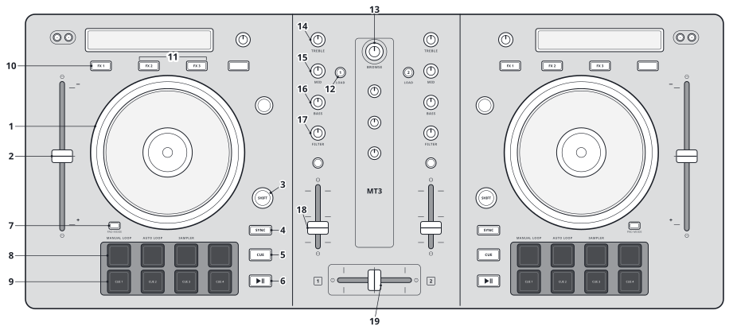

*Figure 53. The Numark Mixtrack 3's and Mixtrack Pro 3's controls (the same layout; numbered on the left deck and the centre; the right deck is the same)*

Decks on ch 2 / ch 3, crossfader on ch 1. From Mixxx's mapping (the Mixtrack 3 and Pro 3 use the same numbers).

<!-- devlist 1 Deck -->

1. **Jog**: Touch scratch (touch the top and turn; 1200 ticks per turn)
2. **PITCH fader**: Tempo (14-bit)
3. **SHIFT**: Hold it with another control for its second function
4. **SYNC**
5. **CUE**
6. **PLAY/PAUSE**
7. **PAD MODE**: Switches the top row's pad mode (MANUAL LOOP, AUTO LOOP, SAMPLER)
8. **Top row of pads**: MANUAL LOOP = `IN` loops, `OFF` reloops, `1/2` halves the loop. AUTO LOOP → AUTO LOOP, SAMPLER → sample switching
9. **Bottom row of pads** (CUE 1–4): Hot cues (SHIFT + pad clears)

<!-- devlist 10 FX (Buddy-style) -->

10. **FX 1**: The Buddy's FX ON bar (toggles with each press)
11. **FX 2 / FX 3**: The Buddy's `FX PARAM` ◀ ▶ (effect type)

<!-- devlist 12 Mixer -->

12. **LOAD 1 / 2**: Load the file selected in the Media Explorer into deck 1 / deck 2 (as on the Reloop Buddy)
13. **BROWSE**: Turn = the headphone Cue mix (while FX 1 is on, that effect's sound amount), push = switch decks
14. **TREBLE**: Filter Morph (echo length with SHIFT)
15. **MID**: How much the video effects act on the sound
16. **BASS**: Filter Resonance (echo feedback with SHIFT)
17. **FILTER**: Filter Cutoff (key with SHIFT)
18. **Channel fader**: That deck's volume and picture strength
19. **Crossfader**: Deck 1 on the left side, deck 2 on the right

Controls without a number (PITCH BEND, the touch strip, BEATS, TAP, WHEEL, the headphone CUE, MASTER GAIN, CUE MIX, CUE GAIN) are not used by ReaScratch. The BEATS knobs are endless and not read. Headphone CUE arrives on channel 1 and cannot be read. There is no knob for the FX knob. Not yet tested on the real hardware.

**61 · 62 Numark Mixtrack Platinum deck 1 / deck 2**

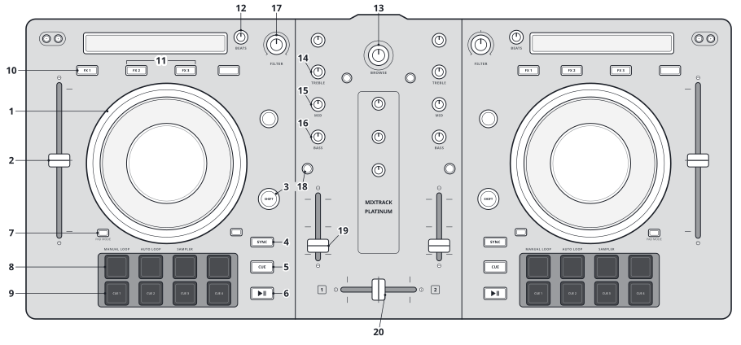

*Figure 54. The Numark Mixtrack Platinum's controls (numbered on the left deck and the centre; the right deck is the same)*

Almost the same numbers as the Mixtrack Pro/Platinum FX; the hot cue pad numbers and the ticks per turn differ.

<!-- devlist 1 Deck -->

1. **Jog**: Touch scratch (touch the top and turn; 1240 ticks per turn)
2. **PITCH fader**: Tempo. Only the upper 7 bits are read (the low-byte number in Mixxx's mapping is doubtful)
3. **SHIFT**: Hold it with another control for its second function
4. **SYNC**: SHIFT switches the tempo range
5. **CUE**
6. **PLAY/PAUSE**
7. **PAD MODE**: Hold it and press a top-row pad to choose the top row's mode
8. **Top row of pads**: AUTO LOOP → AUTO LOOP. In MANUAL LOOP the third pad (`OFF`) loops. SAMPLER is not used (the sample buttons are shared by both decks)
9. **Bottom row of pads** (CUE 1–4): Hot cues (SHIFT + pad clears)

<!-- devlist 10 FX (Buddy-style) -->

10. **FX 1**: The Buddy's FX ON bar (toggles with each press)
11. **FX 2 / FX 3**: The Buddy's `FX PARAM` ◀ ▶ (effect type; see the note below)
12. **BEATS**: The Buddy's FX knob (effect amount; see the note below). Mixxx's mapping has it as Dry/Wet (CC 0x03)

Note (11 · 12): What they act on depends on what you hold (as in the Reloop Buddy's note). While FX 1 is on = that deck's effect amount and type, SHIFT = the amount and type after the mix. Nothing held = edge softness and transition.

<!-- devlist 13 Mixer -->

13. **BROWSE**: Turn = the headphone Cue mix (while FX 1 is on, that effect's sound amount), push = switch decks
14. **TREBLE**: Filter Morph (echo length with SHIFT)
15. **MID**: How much the video effects act on the sound
16. **BASS**: Filter Resonance (echo feedback with SHIFT)
17. **FILTER**: Filter Cutoff (key with SHIFT)
18. **Headphone CUE**: Listen to this deck on headphones (toggles with each press)
19. **Channel fader**: That deck's volume and picture strength
20. **Crossfader**: Deck 1 on the left side, deck 2 on the right

LOAD (ch1 16 / ch2 16) loads the file chosen in the Media Explorer into an empty sample slot. Hold PAD MODE (7) and press LOAD to preview (the same as the `P` key). Controls without a number (PITCH BEND, the touch strip, TAP, WHEEL, LAYER, GAIN, MASTER GAIN, CUE MIX, CUE GAIN) are not used by ReaScratch. Not yet tested on the real hardware.

**63 · 64 Numark Mixtrack Pro/Platinum FX deck 1 / deck 2**

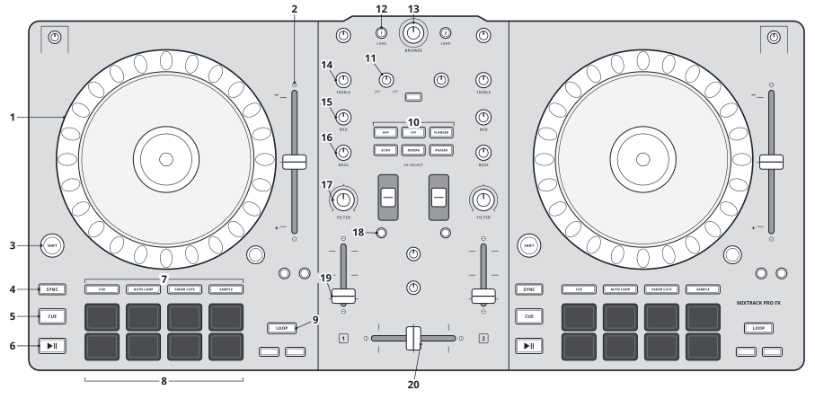

*Figure 55. The Numark Mixtrack Pro FX's and Mixtrack Platinum FX's controls (the same layout; numbered on the left deck and the centre; the right deck is the same. The Platinum FX has a display inside the jog)*

Decks on ch 1 / ch 2, crossfader on ch 16. From Mixxx's mapping.

<!-- devlist 1 Deck -->

1. **Jog**: Touch scratch (touch the top and turn; 1024 ticks per turn)
2. **PITCH fader**: Tempo
3. **SHIFT**: Hold it with another control for its second function
4. **SYNC**: SHIFT switches the tempo range
5. **CUE**
6. **PLAY/PAUSE**
7. **Pad mode buttons**: `CUE` = HOT CUE, `AUTO LOOP` = AUTO LOOP, `SAMPLE` → sample switching. With SHIFT held, `BEATJUMP` → SLICER, `SAMPLE2` → TOUCH FX. `FADER CUTS` is not used
8. **Pads**: The pads of the current mode. In HOT CUE, SHIFT + pad clears a hot cue
9. **LOOP**: Loop

<!-- devlist 10 FX (Buddy-style) -->

10. **The six FX SELECT buttons**: Deck 1 reads the three on ch 9, deck 2 the three on ch 10. Of each three, the first = the Buddy's FX ON bar, the second and third = the Buddy's `FX PARAM` ◀ ▶ (effect type; see the note below). Which three are on ch 9 has not been confirmed in the sources
11. **DRY/WET**: The Buddy's FX knob (effect amount; see the note below). Deck 1's preset only

Note (10 · 11): What they act on depends on what you hold (as in the Reloop Buddy's note). While FX ON is on = that deck's effect amount and type, SHIFT = the amount and type after the mix. Nothing held = edge softness and transition.

<!-- devlist 12 Mixer -->

12. **LOAD 1 / 2**: Load the file selected in the Media Explorer into deck 1 / deck 2 (as on the Reloop Buddy)
13. **BROWSE**: Turn = the headphone Cue mix (while FX ON is on, that effect's sound amount), push = switch decks
14. **TREBLE**: Filter Morph (echo length with SHIFT)
15. **MID**: How much the video effects act on the sound
16. **BASS**: Filter Resonance (echo feedback with SHIFT)
17. **FILTER**: Filter Cutoff (key with SHIFT)
18. **Headphone CUE**: Listen to this deck on headphones (toggles with each press)
19. **Channel fader**: That deck's volume and picture strength
20. **Crossfader**: Deck 1 on the left side, deck 2 on the right

Controls without a number (SCRATCH, PITCH BEND, LEVEL, BEATS, TAP, the FX paddles, the loop 1/2 and x2, MIC, MASTER, CUE GAIN, CUE MIX) are not used by ReaScratch. Not yet tested on the real hardware.

**65 · 66 DDJ-FLX2 deck 1 / deck 2**

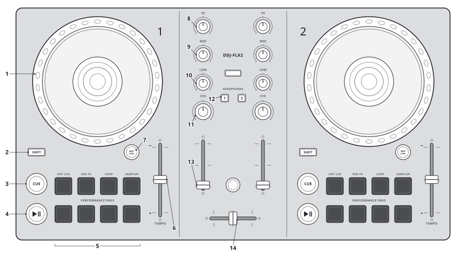

*Figure 56. The DDJ-FLX2's controls (numbered on the left deck and the centre; the right deck is the same)*

Same as the DDJ-FLX4 (same MIDI numbers). There are no loop, BEAT FX, BROWSE or LOAD buttons.

<!-- devlist 1 Deck -->

1. **Jog**: Top = touch scratch, outer ring = nudge (1/4 speed). `SHIFT` + jog makes big jumps. There is no VINYL button (the controller is in VINYL mode from the moment it is connected). The jog is smaller, so the tick count (`Jog ticks per second at 1x`) is `256` (calculated as 460 ticks per turn)
2. **SHIFT**: Hold it with another control for its second function
3. **CUE**
4. **PLAY/PAUSE**
5. **Pads**: The 8 pads of the current mode. To change the mode, press `SHIFT` + `BEAT SYNC`, then the pad with that label (`HOT CUE` = HOT CUE, `PAD FX` → TOUCH FX, `LOOP` → AUTO LOOP, `SAMPLER` → sample switching). In `HOT CUE`, SHIFT + pad clears a hot cue
6. **TEMPO**: Tempo slider
7. **BEAT SYNC**: `SHIFT` + `BEAT SYNC` selects the controller's pad mode, so it does not switch the tempo range (use `Shift`+`Y` on the keyboard)

<!-- devlist 8 Mixer -->

8. **HI**: Filter Morph (echo length with SHIFT)
9. **MID**: How much the video effects act on the sound
10. **LOW**: Filter Resonance (echo feedback with SHIFT)
11. **CFX**: Filter Cutoff (key with SHIFT)
12. **HEADPHONES 1 · 2**: Listen to this deck on headphones (toggles with each press)
13. **Channel fader**: That deck's volume and picture strength
14. **Crossfader**: Deck 1 on the left side, deck 2 on the right

The MIDI numbers are taken from AlphaTheta's official MIDI message list; not yet tested on the real hardware.

**67 · 68 DDJ-FLX4 deck 1 / deck 2**

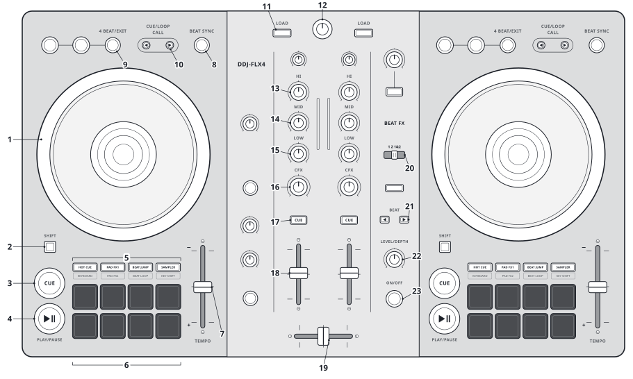

*Figure 57. The DDJ-FLX4's controls (numbered on the left deck and the centre; the right deck is the same)*

<!-- devlist 1 Deck -->

1. **Jog**: Top = touch scratch (switch the controller's VINYL on), outer ring = nudge (1/4 speed). `SHIFT` + jog makes big jumps
2. **SHIFT**: Hold it with another control for its second function
3. **CUE**
4. **PLAY/PAUSE**
5. **Pad mode buttons**: `HOT CUE` = HOT CUE, `PAD FX1` → TOUCH FX, `BEAT JUMP` → SLICER, `SAMPLER` → sample switching. With SHIFT held, `KEYBOARD` → PITCH PLAY, `PAD FX2` → BOUNCE LOOP, `BEAT LOOP` → AUTO LOOP, `KEY SHIFT` → NEURAL MIX
6. **Pads**: The 8 pads of the current mode. In `HOT CUE`, SHIFT + pad clears a hot cue
7. **TEMPO**: Tempo slider
8. **BEAT SYNC**: SHIFT switches the tempo range
9. **4 BEAT/EXIT**: Loop (reloop with SHIFT)
10. **CUE/LOOP CALL ◀ ▶**: Halve / double the loop

<!-- devlist 11 Mixer -->

11. **LOAD**: Same as the Reloop Buddy (SHIFT + LOAD replaces the current sample)
12. **BROWSE**: Turn = the headphone Cue mix (while BEAT FX is on, that effect's sound amount), push = switch decks
13. **HI**: Filter Morph (echo length with SHIFT)
14. **MID**: How much the video effects act on the sound
15. **LOW**: Filter Resonance (echo feedback with SHIFT)
16. **CFX**: Filter Cutoff (key with SHIFT)
17. **Headphone CUE**: Listen to this deck on headphones (toggles with each press; SHIFT hides only the picture)
18. **Channel fader**: That deck's volume and picture strength
19. **Crossfader**: Deck 1 on the left side, deck 2 on the right

<!-- devlist 20 BEAT FX (Buddy-style) -->

20. **CH SELECT (1 · 2 · 1&2)**: Which deck BEAT FX applies to
21. **BEAT ◀ ▶**: The Buddy's `FX PARAM` ◀ ▶ (effect type; see the note below)
22. **LEVEL/DEPTH**: The Buddy's FX knob (effect amount; see the note below)
23. **ON/OFF**: The Buddy's FX ON bar (toggles with each press; SHIFT + ON/OFF turns all effects off while held)

Note (21 · 22): What they act on depends on what you hold (as in the Reloop Buddy's note). While ON/OFF is on = that deck's effect amount and type, SHIFT = the amount and type after the mix. Nothing held = edge softness and transition, holding a pad mode button = the video blend.

Controls without a number (IN, OUT, TRIM, MIC LEVEL, SMART CFX, SMART FADER, MASTER LEVEL, FX SELECT and so on) are not used by ReaScratch. Tested on real hardware only early in development, not yet with current features (⚠︎ until tested again).

**69 · 70 DDJ-FLX6 deck 1 / deck 2**

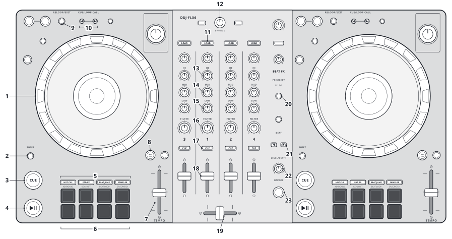

*Figure 58. The DDJ-FLX6's controls (numbered on the left deck, mixer channel 1 and BEAT FX; the right deck is the same)*

Almost the same as the DDJ-FLX4. The mixer has 4 channels (3, 1, 2, 4 from the left); deck 1 uses channel 1 and deck 2 channel 2.

<!-- devlist 1 Deck -->

1. **Jog**: Top = touch scratch (switch the controller's VINYL on), outer ring = nudge (1/4 speed). `SHIFT` + jog makes big jumps. The manufacturer does not publish the tick count (`Jog ticks per second at 1x`), so it is `4000`, from Mixxx's mapping (if the jog is too fast or too slow, change this value)
2. **SHIFT**: Hold it with another control for its second function
3. **CUE**
4. **PLAY/PAUSE**
5. **Pad mode buttons**: `HOT CUE` = HOT CUE, `PAD FX` → TOUCH FX, `BEAT JUMP` → SLICER, `SAMPLER` → sample switching. With SHIFT held, `KEYBOARD` → PITCH PLAY, `KEY SHIFT` → BOUNCE LOOP, `BEAT LOOP` → AUTO LOOP, `SP.SCRATCH` → NEURAL MIX (`KEY SHIFT` and `SP.SCRATCH` sit where the FLX4 has `PAD FX2` and `KEY SHIFT`)
6. **Pads**: The 8 pads of the current mode. In `HOT CUE`, SHIFT + pad clears a hot cue
7. **TEMPO**: Tempo slider
8. **BEAT SYNC**: SHIFT switches the tempo range (note 93)
9. **RELOOP/EXIT**: Loop (reloop with SHIFT; the same number as the FLX4's 4 BEAT/EXIT)
10. **CUE/LOOP CALL ◀ ▶**: Halve / double the loop

<!-- devlist 11 Mixer -->

11. **LOAD** (above channel 1): Same as the Reloop Buddy (SHIFT + LOAD replaces the current sample)
12. **BROWSE**: Turn = the headphone Cue mix (while BEAT FX is on, that effect's sound amount), push = switch decks
13. **HI**: Filter Morph (echo length with SHIFT)
14. **MID**: How much the video effects act on the sound
15. **LOW**: Filter Resonance (echo feedback with SHIFT)
16. **FILTER**: Filter Cutoff (key with SHIFT; the FLX4's CFX)
17. **Headphone CUE**: Listen to this deck on headphones (toggles with each press; SHIFT hides only the picture)
18. **Channel fader**: That deck's volume and picture strength
19. **Crossfader**: Deck 1 on the left side, deck 2 on the right

<!-- devlist 20 BEAT FX (Buddy-style) -->

20. **FX SELECT**: Which deck BEAT FX applies to (the first effect of FX1 = deck 1, of FX2 = deck 2; it does not work on the second and third effects)
21. **BEAT ◀ ▶**: The Buddy's `FX PARAM` ◀ ▶ (effect type; as in the DDJ-FLX4's note)
22. **LEVEL/DEPTH**: The Buddy's FX knob (effect amount; as in the DDJ-FLX4's note)
23. **ON/OFF**: The Buddy's FX ON bar (toggles with each press; SHIFT + ON/OFF turns all effects off while held)

Controls without a number (MERGE FX, IN, OUT, MEMORY, JOG CUTTER, DECK, MASTER, TRIM, CH SELECT, MASTER LEVEL, BOOTH, channels 3 and 4 and so on) are not used by ReaScratch. The MIDI numbers were checked against the official MIDI list (the version preserved on the Internet Archive); not yet tested on the real hardware.

**71 · 72 DDJ-FLX10 deck 1 / deck 2**

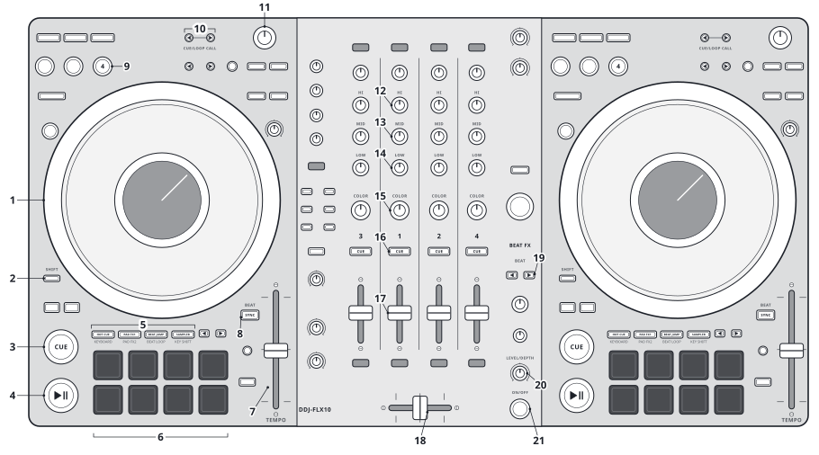

*Figure 59. The DDJ-FLX10's controls (numbered on the left deck, mixer channel 1 and BEAT FX; the right deck is the same)*

Almost the same as the DDJ-FLX4. The mixer has 4 channels (3, 1, 2, 4 from the left); deck 1 uses channel 1 and deck 2 channel 2. Each deck has its own BROWSE knob at its top; pushing it is LOAD.

<!-- devlist 1 Deck -->

1. **Jog**: Top = touch scratch (switch the controller's VINYL on), outer ring = nudge (1/4 speed). `SHIFT` + jog makes big jumps. The manufacturer does not publish the tick count (`Jog ticks per second at 1x`), so it is `7167`, the value measured (in Mixxx) on a real DDJ-1000, whose jog is the same size. If the jog is too fast or too slow, change this value
2. **SHIFT**: Hold it with another control for its second function
3. **CUE**
4. **PLAY/PAUSE**
5. **Pad mode buttons**: `HOT CUE` = HOT CUE, `PAD FX1` → TOUCH FX, `BEAT JUMP` → SLICER, `SAMPLER` → sample switching. With SHIFT held, `KEYBOARD` → PITCH PLAY, `PAD FX2` → BOUNCE LOOP, `BEAT LOOP` → AUTO LOOP, `KEY SHIFT` → NEURAL MIX
6. **Pads**: The 8 pads of the current mode. In `HOT CUE`, SHIFT + pad clears a hot cue
7. **TEMPO**: Tempo slider
8. **BEAT SYNC**: SHIFT switches the tempo range (note 92)
9. **4 BEAT/EXIT**: Loop (reloop with SHIFT)
10. **CUE/LOOP CALL ◀ ▶**: Halve / double the loop
11. **BROWSE** (the knob at the top of the deck): Turn = the headphone Cue mix (while BEAT FX is on, that effect's sound amount; both decks' knobs send the same number, so turning either one does the same), push = LOAD (same as the Reloop Buddy; pushing it with SHIFT held replaces the current sample). There is no push to switch decks

<!-- devlist 12 Mixer -->

12. **HI**: Filter Morph (echo length with SHIFT)
13. **MID**: How much the video effects act on the sound
14. **LOW**: Filter Resonance (echo feedback with SHIFT)
15. **COLOR**: Filter Cutoff (key with SHIFT; the FLX4's CFX)
16. **Headphone CUE**: Listen to this deck on headphones (toggles with each press; SHIFT hides only the picture)
17. **Channel fader**: That deck's volume and picture strength
18. **Crossfader**: Deck 1 on the left side, deck 2 on the right

<!-- devlist 19 BEAT FX (Buddy-style) -->

19. **BEAT ◀ ▶**: The Buddy's `FX PARAM` ◀ ▶ (effect type; as in the DDJ-FLX4's note)
20. **LEVEL/DEPTH**: The Buddy's FX knob (effect amount; as in the DDJ-FLX4's note). Works on the deck 1 preset only
21. **ON/OFF**: The Buddy's FX ON bar (toggles with each press; SHIFT + ON/OFF turns all effects off while held). Works on the deck 1 preset only

Controls without a number (IN, OUT, ACTIVE PART, MIX POINT, SLIP, QUANTIZE, 4 BEAT JUMP, PAGE, KEY SYNC, TEMPO RESET, TRIM, the COLOR FX buttons, FX PART, FX SELECT, CH SELECT, channels 3 and 4 and so on) are not used by ReaScratch. The MIDI numbers were checked against the official MIDI list (the version preserved on the Internet Archive); not yet tested on the real hardware.

**73 · 74 DDJ-REV1 deck 1 / deck 2**

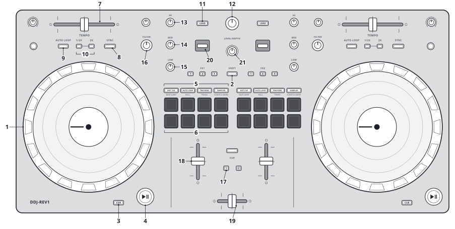

*Figure 60. The DDJ-REV1's controls (numbered on the left deck and the centre; the right deck is the same; its DECK button and the EQ are mirrored)*

Many controls have the DDJ-FLX4's numbers; SHIFT is in the centre (MIDI ch 7). The tempo sliders lie across the top of the decks, and both decks' pads are in the centre (the left 8 are deck 1's).

<!-- devlist 1 Deck -->

1. **Jog**: Top = touch scratch (switch the controller's VINYL on), outer ring = nudge (1/4 speed). `SHIFT` + jog makes big jumps. The manufacturer does not publish the tick count (`Jog ticks per second at 1x`), so it is `400`, from Mixxx's mapping (if the jog is too fast or too slow, change this value)
2. **SHIFT** (centre): Hold it with another control for its second function
3. **CUE**
4. **PLAY/PAUSE**
5. **Pad mode buttons**: `HOT CUE` = HOT CUE, `AUTO LOOP` = AUTO LOOP, `TRACKING` (TRACKING SCRATCH) → PITCH PLAY, `SAMPLER` → sample switching. With SHIFT held, `BEAT JUMP` → SLICER, `ROLL` → BOUNCE LOOP, `TRANS` → TOUCH FX, `SCRATCH BANK` → NEURAL MIX
6. **Pads**: The 8 pads of the current mode. In `HOT CUE`, SHIFT + pad clears a hot cue
7. **TEMPO**: Tempo slider (horizontal)
8. **SYNC**: BEAT SYNC. SHIFT + SYNC does not change the tempo range (use `Shift`+`Y` on the keyboard)
9. **AUTO LOOP**: Loop (reloop with SHIFT)
10. **1/2X · 2X**: Halve / double the loop

<!-- devlist 11 Mixer -->

11. **LOAD**: Same as the Reloop Buddy (SHIFT + LOAD replaces the current sample)
12. **BROWSE**: Turn = the headphone Cue mix (while BEAT FX is on, that effect's sound amount), push = switch decks
13. **HI**: Filter Morph (echo length with SHIFT)
14. **MID**: How much the video effects act on the sound
15. **LOW**: Filter Resonance (echo feedback with SHIFT)
16. **FILTER**: Filter Cutoff (key with SHIFT; the FLX4's CFX)
17. **Headphone CUE (1)**: Listen to this deck on headphones (toggles with each press; SHIFT hides only the picture)
18. **Channel fader**: That deck's volume and picture strength
19. **Crossfader**: Deck 1 on the left side, deck 2 on the right

<!-- devlist 20 FX (Buddy-style) -->

20. **FX1 paddle**: The Buddy's FX ON bar (toggles with each flick). The FX1 paddle = deck 1, the FX2 paddle = deck 2. Select SLOT 1 with the FX's `1` button first
21. **LEVEL/DEPTH**: The Buddy's FX knob (effect amount; as in the DDJ-FLX4's note). It is sent on the number of the FX whose SLOT 1 is on (FX1 = deck 1, FX2 = deck 2)

The ◀ ▶ for the effect type (SHIFT + the FX's `2` and `3` buttons) and SHIFT + paddle to turn all effects off while held are not mapped. Controls without a number (TRIM, the headphone LEVEL, MASTER LEVEL, DECK, the FX's `2` and `3` buttons, MASTER's CUE and so on) are not used by ReaScratch. The MIDI numbers were checked against the official MIDI list (the version preserved on the Internet Archive); not yet tested on the real hardware.

**81 · 82 DDJ-400 deck 1 / deck 2**

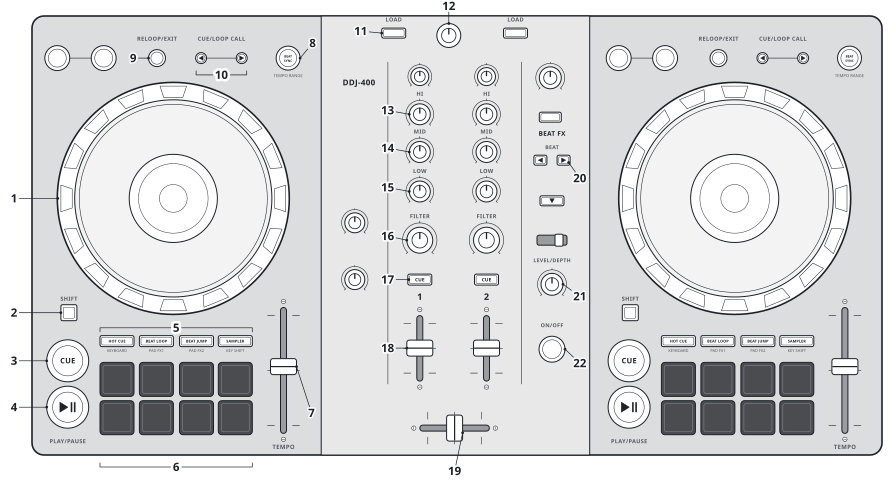

*Figure 61. The DDJ-400's controls (numbered on the left deck and the centre; the right deck is the same)*

The same MIDI numbers as the DDJ-FLX4 (all of them matched in the official MIDI list (the version preserved on the Internet Archive)). The printed mode names and the mixer's layout differ.

<!-- devlist 1 Deck -->

1. **Jog**: Top = touch scratch, outer ring = nudge (1/4 speed). `SHIFT` + jog makes big jumps. The manufacturer does not publish the tick count (`Jog ticks per second at 1x`), so it is `400`, from Mixxx's mapping (if the jog is too fast or too slow, change this value)
2. **SHIFT**: Hold it with another control for its second function
3. **CUE**
4. **PLAY/PAUSE**
5. **Pad mode buttons**: `HOT CUE` = HOT CUE, `BEAT LOOP` → AUTO LOOP, `BEAT JUMP` → SLICER, `SAMPLER` → sample switching. With SHIFT held, `KEYBOARD` → PITCH PLAY, `PAD FX1` → TOUCH FX, `PAD FX2` → BOUNCE LOOP, `KEY SHIFT` → NEURAL MIX
6. **Pads**: The 8 pads of the current mode. In `HOT CUE`, SHIFT + pad clears a hot cue
7. **TEMPO**: Tempo slider
8. **BEAT SYNC**: SHIFT switches the tempo range (printed TEMPO RANGE)
9. **RELOOP/EXIT**: Loop (reloop with SHIFT; the same number as the FLX4's 4 BEAT/EXIT)
10. **CUE/LOOP CALL ◀ ▶**: Halve / double the loop

<!-- devlist 11 Mixer -->

11. **LOAD**: Same as the Reloop Buddy (SHIFT + LOAD replaces the current sample)
12. **BROWSE**: Turn = the headphone Cue mix (while BEAT FX is on, that effect's sound amount), push = switch decks
13. **HI**: Filter Morph (echo length with SHIFT)
14. **MID**: How much the video effects act on the sound
15. **LOW**: Filter Resonance (echo feedback with SHIFT)
16. **FILTER**: Filter Cutoff (key with SHIFT; the FLX4's CFX)
17. **Headphone CUE**: Listen to this deck on headphones (toggles with each press; SHIFT hides only the picture)
18. **Channel fader**: That deck's volume and picture strength
19. **Crossfader**: Deck 1 on the left side, deck 2 on the right

<!-- devlist 20 BEAT FX (Buddy-style) -->

20. **BEAT ◀ ▶**: The Buddy's `FX PARAM` ◀ ▶ (effect type; as in the DDJ-FLX4's note)
21. **LEVEL/DEPTH**: The Buddy's FX knob (effect amount; as in the DDJ-FLX4's note). Works on the deck 1 preset only
22. **ON/OFF**: The Buddy's FX ON bar (toggles with each press; SHIFT + ON/OFF turns all effects off while held). Works on the deck 1 preset only

BEAT FX sends the same numbers whatever CH SELECT is set to, so it cannot pick a deck. Controls without a number (IN/4BEAT, OUT, TRIM, HEADPHONES MIXING and LEVEL, MASTER LEVEL and CUE, FX SELECT, CH SELECT and so on) are not used by ReaScratch. Not yet tested on the real hardware.

**83 · 84 DDJ-800 deck 1 / deck 2**

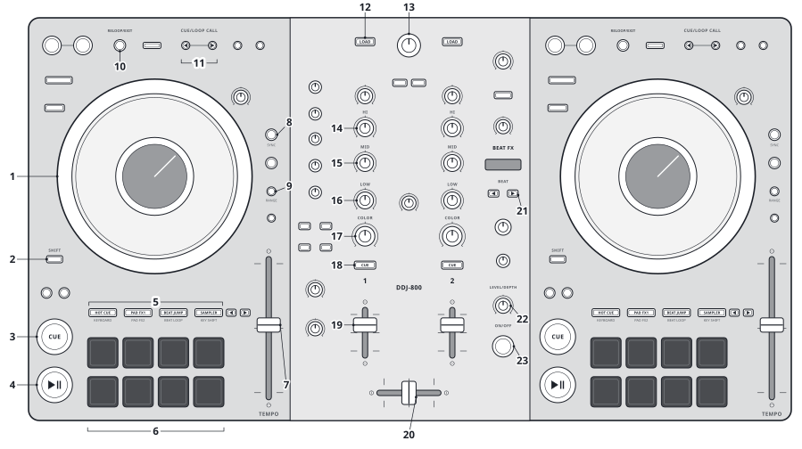

*Figure 62. The DDJ-800's controls (numbered on the left deck and the centre; the right deck is the same)*

Almost the same as the DDJ-FLX4. The tempo range is switched with its own TEMPO RANGE button.

<!-- devlist 1 Deck -->

1. **Jog**: Top = touch scratch (switch the controller's VINYL on), outer ring = nudge (1/4 speed). `SHIFT` + jog makes big jumps. The manufacturer does not publish the tick count (`Jog ticks per second at 1x`), so it is `7167`, assumed to be the same as the DDJ-1000's. If the jog is too fast or too slow, change this value
2. **SHIFT**: Hold it with another control for its second function
3. **CUE**
4. **PLAY/PAUSE**
5. **Pad mode buttons**: `HOT CUE` = HOT CUE, `PAD FX1` → TOUCH FX, `BEAT JUMP` → SLICER, `SAMPLER` → sample switching. With SHIFT held, `KEYBOARD` → PITCH PLAY, `PAD FX2` → BOUNCE LOOP, `BEAT LOOP` → AUTO LOOP, `KEY SHIFT` → NEURAL MIX
6. **Pads**: The 8 pads of the current mode. In `HOT CUE`, SHIFT + pad clears a hot cue
7. **TEMPO**: Tempo slider
8. **BEAT SYNC**
9. **TEMPO RANGE**: Switches the tempo range (note 96)
10. **RELOOP/EXIT**: Loop (reloop with SHIFT; the same number as the FLX4's 4 BEAT/EXIT)
11. **CUE/LOOP CALL ◀ ▶**: Halve / double the loop

<!-- devlist 12 Mixer -->

12. **LOAD**: Same as the Reloop Buddy (SHIFT + LOAD replaces the current sample)
13. **BROWSE**: Turn = the headphone Cue mix (while BEAT FX is on, that effect's sound amount), push = switch decks
14. **HI**: Filter Morph (echo length with SHIFT)
15. **MID**: How much the video effects act on the sound
16. **LOW**: Filter Resonance (echo feedback with SHIFT)
17. **COLOR**: Filter Cutoff (key with SHIFT; the FLX4's CFX)
18. **Headphone CUE**: Listen to this deck on headphones (toggles with each press; SHIFT hides only the picture)
19. **Channel fader**: That deck's volume and picture strength
20. **Crossfader**: Deck 1 on the left side, deck 2 on the right

<!-- devlist 21 BEAT FX (Buddy-style) -->

21. **BEAT ◀ ▶**: The Buddy's `FX PARAM` ◀ ▶ (effect type; as in the DDJ-FLX4's note)
22. **LEVEL/DEPTH**: The Buddy's FX knob (effect amount; as in the DDJ-FLX4's note). Works on the deck 1 preset only
23. **ON/OFF**: The Buddy's FX ON bar (toggles with each press; SHIFT + ON/OFF turns all effects off while held). Works on the deck 1 preset only

Controls without a number (IN, OUT, QUANTIZE, DELETE, MEMORY, SLIP, SLIP REVERSE, JOG ADJUST, KEY SYNC, MASTER TEMPO, SEARCH, PAGE, TRIM, MIC, the SOUND COLOR FX buttons, HEADPHONES, MASTER, BOOTH, FX SELECT, CH SELECT and so on) are not used by ReaScratch. The MIDI numbers were checked against the official MIDI list (the version preserved on the Internet Archive); not yet tested on the real hardware.

**85 · 86 DDJ-1000 deck 1 / deck 2**

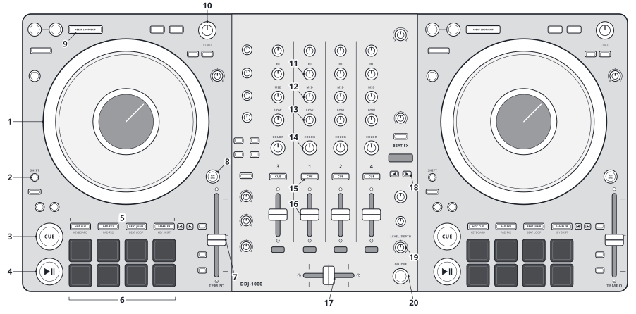

*Figure 63. The DDJ-1000's controls (numbered on the left deck, mixer channel 1 and BEAT FX; the right deck is the same)*

Almost the same as the DDJ-FLX4. The mixer has 4 channels (3, 1, 2, 4 from the left); deck 1 uses channel 1 and deck 2 channel 2. Each deck has its own BROWSE knob at its top; pushing it is LOAD.

<!-- devlist 1 Deck -->

1. **Jog**: Top = touch scratch (switch the controller's VINYL on), outer ring = nudge (1/4 speed). `SHIFT` + jog makes big jumps. The manufacturer does not publish the tick count (`Jog ticks per second at 1x`), so it is `7167`, from Mixxx's mapping (this value was measured on real hardware). If the jog is too fast or too slow, change this value
2. **SHIFT**: Hold it with another control for its second function
3. **CUE**
4. **PLAY/PAUSE**
5. **Pad mode buttons**: `HOT CUE` = HOT CUE, `PAD FX1` → TOUCH FX, `BEAT JUMP` → SLICER, `SAMPLER` → sample switching. With SHIFT held, `KEYBOARD` → PITCH PLAY, `PAD FX2` → BOUNCE LOOP, `BEAT LOOP` → AUTO LOOP, `KEY SHIFT` → NEURAL MIX
6. **Pads**: The 8 pads of the current mode. In `HOT CUE`, SHIFT + pad clears a hot cue
7. **TEMPO**: Tempo slider
8. **BEAT SYNC**: SHIFT switches the tempo range (note 92)
9. **4 BEAT LOOP/EXIT**: Loop (reloop with SHIFT)
10. **BROWSE** (the knob at the top of the deck): Turn = the headphone Cue mix (while BEAT FX is on, that effect's sound amount; both decks' knobs send the same number, so turning either one does the same), push = LOAD (same as the Reloop Buddy; pushing it with SHIFT held replaces the current sample). There is no push to switch decks

<!-- devlist 11 Mixer -->

11. **HI**: Filter Morph (echo length with SHIFT)
12. **MID**: How much the video effects act on the sound
13. **LOW**: Filter Resonance (echo feedback with SHIFT)
14. **COLOR**: Filter Cutoff (key with SHIFT; the FLX4's CFX)
15. **Headphone CUE**: Listen to this deck on headphones (toggles with each press; SHIFT hides only the picture)
16. **Channel fader**: That deck's volume and picture strength
17. **Crossfader**: Deck 1 on the left side, deck 2 on the right

<!-- devlist 18 BEAT FX (Buddy-style) -->

18. **BEAT ◀ ▶**: The Buddy's `FX PARAM` ◀ ▶ (effect type; as in the DDJ-FLX4's note)
19. **LEVEL/DEPTH**: The Buddy's FX knob (effect amount; as in the DDJ-FLX4's note). Works on the deck 1 preset only
20. **ON/OFF**: The Buddy's FX ON bar (toggles with each press; SHIFT + ON/OFF turns all effects off while held). Works on the deck 1 preset only

Loop halve and double are not mapped. Controls without a number (IN, OUT, QUANTIZE, SLIP, SLIP REVERSE, DECK, BACK, VIEW, JOG ADJUST, MEMORY, SEARCH, PAGE, MASTER TEMPO, KEY SYNC, KEY RESET, TRIM, the SOUND COLOR FX buttons, FX SELECT, CH SELECT, channels 3 and 4 and so on) are not used by ReaScratch. The MIDI numbers were checked against the official MIDI list (the version preserved on the Internet Archive); not yet tested on the real hardware.

**75 · 76 DDJ-REV5 deck 1 / deck 2**

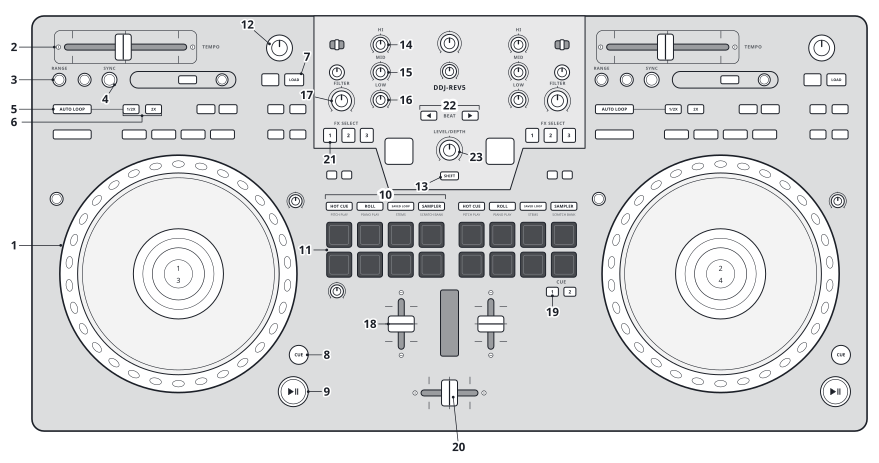

*Figure 64. The DDJ-REV5's controls (numbered on the left deck and the centre; the right deck is the same)*

Almost the same as the DDJ-FLX4. Top touch (note 13), SYNC (note 10), TEMPO RANGE (note 8) and headphone CUE (note 7) differ. The pads sit in the lower part of the mixer, and there is one SHIFT, in the middle of the mixer.

<!-- devlist 1 Deck -->

1. **Jog**: Top = touch scratch (switch the controller's VINYL on with SHIFT + KEY LOCK), outer ring = nudge (1/4 speed). `SHIFT` + jog makes big jumps
2. **TEMPO**: Tempo slider (lying across the top of the deck)
3. **RANGE (TEMPO RANGE)**: Switches the tempo range
4. **SYNC**
5. **AUTO LOOP**: Loop (reloop with SHIFT)
6. **1/2X · 2X**: Halve / double the loop
7. **LOAD**: Same as the Reloop Buddy (SHIFT + LOAD replaces the current sample)
8. **CUE**
9. **PLAY/PAUSE**

<!-- devlist 10 Pads -->

10. **Pad mode buttons**: `HOT CUE` = HOT CUE, `ROLL` → BOUNCE LOOP, `SAVED LOOP` → AUTO LOOP, `SAMPLER` (in this mode the pads do nothing). With SHIFT held, `PITCH PLAY` = PITCH PLAY, `PIANO PLAY` → SLICER, `STEMS` → TOUCH FX, `SCRATCH BANK` → NEURAL MIX
11. **Pads**: The 8 pads of the current mode. In `HOT CUE`, SHIFT + pad clears a hot cue

<!-- devlist 12 Mixer -->

12. **BROWSE**: Turn = the headphone Cue mix (while an effect is on, that effect's sound amount), push = switch decks (the knob is at the deck's top right)
13. **SHIFT**: Hold it with another control for its second function (shared by both decks)
14. **HI**: Filter Morph (echo length with SHIFT)
15. **MID**: How much the video effects act on the sound
16. **LOW**: Filter Resonance (echo feedback with SHIFT)
17. **FILTER**: Filter Cutoff (key with SHIFT)
18. **Channel fader**: That deck's volume and picture strength
19. **Headphone CUE (1)**: Listen to this deck on headphones (toggles with each press; SHIFT hides only the picture)
20. **Crossfader**: Deck 1 on the left side, deck 2 on the right

<!-- devlist 21 FX (Buddy-style) -->

21. **FX SELECT 1**: The Buddy's FX ON bar (FX slot 1 on / off; toggles with each press)
22. **BEAT ◀ ▶**: The Buddy's `FX PARAM` ◀ ▶ (effect type)
23. **LEVEL/DEPTH**: The Buddy's FX knob (slot 1's LEVEL; effect amount)

Note (Buddy-style FX): deck 2 uses the same controls on the right (FX2). What they act on is as in the DDJ-FLX4's note: it depends on what you hold.

Controls without a number (AUTO BPM TRANSITION, BACK, SLIP, CENSOR, KEY − / +, STEMS, VOCAL to DRUMS, DECK, JOG FEEL, TRIM, LOCK ON, PARAMETER 1, SAMPLER VOLUME and so on) are not used by ReaScratch. From the official MIDI list; not yet tested on the real hardware.

**77 · 78 DDJ-200 deck 1 / deck 2**

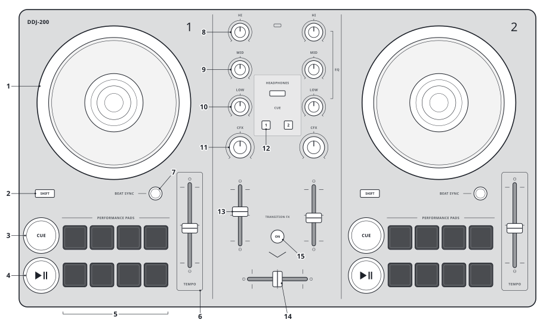

*Figure 65. The DDJ-200's controls (numbered on the left deck and the centre; the right deck is the same)*

Same numbers as the DDJ-FLX4 (official MIDI list, version preserved on the Internet Archive). There are no loop, BEAT FX, BROWSE or LOAD buttons.

<!-- devlist 1 Deck -->

1. **Jog**: Top = touch scratch, outer ring = nudge (1/4 speed). `SHIFT` + jog makes big jumps. The jog is small, so the tick count (`Jog ticks per second at 1x`) is `71` (from Mixxx's 128 ticks per turn)
2. **SHIFT**: Hold it with another control for its second function
3. **CUE**
4. **PLAY/PAUSE**
5. **Pads**: 8 pads, HOT CUE only (no SAMPLER). SHIFT + pad clears a hot cue
6. **TEMPO**: Tempo slider
7. **BEAT SYNC**: SHIFT switches the tempo range (`TEMPO RANGE`)

<!-- devlist 8 Mixer -->

8. **HI**: Filter Morph (echo length with SHIFT)
9. **MID**: How much the video effects act on the sound
10. **LOW**: Filter Resonance (echo feedback with SHIFT)
11. **CFX**: Filter Cutoff (key with SHIFT)
12. **HEADPHONES CUE 1**: Listen to this deck on headphones (toggles with each press; SHIFT hides only the picture; 2 for deck 2)
13. **Channel fader**: That deck's volume and picture strength
14. **Crossfader**: Deck 1 on the left side, deck 2 on the right
15. **TRANSITION FX ON**: Video effect on/off

Controls without a number (HEADPHONES MASTER) are not used by ReaScratch. Not yet tested on the real hardware.

**79 · 80 DDJ-RB deck 1 / deck 2**

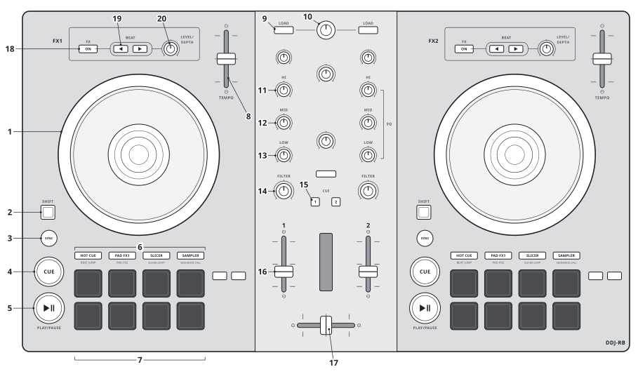

*Figure 66. The DDJ-RB's controls (numbered on the left deck and the centre; the right deck is the same)*

Same numbers as the DDJ-SB3 (official MIDI list, version preserved on the Internet Archive). Pad modes and loops are not added. Not yet tested on the real hardware.

<!-- devlist 1 Deck -->

1. **Jog**: Top = touch scratch, outer ring = nudge (1/4 speed). `SHIFT` + jog makes big jumps
2. **SHIFT**: Hold it with another control for its second function
3. **SYNC**
4. **CUE**
5. **PLAY/PAUSE**
6. **Pad mode buttons**: Switch the controller's own mode. ReaScratch reads only the pads of the `HOT CUE` and `SAMPLER` modes (ReaScratch's pad modes are not added)
7. **Pads**: In `HOT CUE`, hot cues (SHIFT + pad clears); in `SAMPLER`, sample switching
8. **TEMPO**: Tempo slider. There is no KEYLOCK, so switch the tempo range with `Shift` + `Y` on the keyboard

<!-- devlist 9 Mixer -->

9. **LOAD**: Same as the Reloop Buddy (SHIFT + LOAD replaces the current sample)
10. **BROWSE**: Turn = the headphone Cue mix (while an effect is on, that effect's sound amount). Pushing it is not read
11. **HI**: Filter Morph (echo length with SHIFT)
12. **MID**: How much the video effects act on the sound
13. **LOW**: Filter Resonance (echo feedback with SHIFT)
14. **FILTER**: Filter Cutoff (key with SHIFT)
15. **Headphone CUE (1)**: Listen to this deck on headphones (toggles with each press; SHIFT hides only the picture)
16. **Channel fader**: That deck's volume and picture strength
17. **Crossfader**: Deck 1 on the left side, deck 2 on the right

<!-- devlist 18 FX1 (Buddy-style) -->

18. **FX (ON)**: The Buddy's FX ON bar (toggles with each press; SHIFT turns all effects off while held)
19. **BEAT ◀ ▶**: The Buddy's `FX PARAM` ◀ ▶ (effect type)
20. **LEVEL/DEPTH**: The Buddy's FX knob (effect amount)

Note (Buddy-style FX): deck 2 uses the same controls on the right (FX2). What they act on is as in the DDJ-FLX4's note: it depends on what you hold.

Controls without a number (TRIM, MASTER LEVEL, HEADPHONES LEVEL, CUE MASTER, 4 BEAT, IN, OUT and so on) are not used by ReaScratch.

**87 · 88 DDJ-SB deck 1 / deck 2, 89 · 90 DDJ-SB2 deck 1 / deck 2**

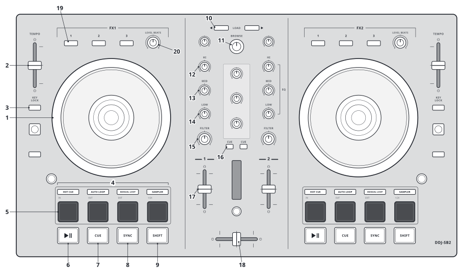

*Figure 67. The DDJ-SB2's controls (the DDJ-SB is laid out the same, without TRIM, DECK and PAD TRANS; numbered on the left deck and the centre; the right deck is the same, with its TEMPO column on the right edge)*

Same numbers as the DDJ-SB3 (official MIDI lists, versions preserved on the Internet Archive). Pad modes and loops are not added. If decks 3/4 are selected on the DDJ-SB2, switch back to decks 1/2 with the `DECK` button. Not yet tested on the real hardware.

<!-- devlist 1 Deck -->

1. **Jog**: Top = touch scratch (switch the controller's VINYL on), outer ring = nudge (1/4 speed). `SHIFT` + jog makes big jumps
2. **TEMPO**: Tempo slider
3. **KEY LOCK**: SHIFT + KEY LOCK switches the tempo range
4. **Pad mode buttons**: Switch the controller's own mode. ReaScratch reads only the pads of the `HOT CUE` and `SAMPLER` modes (ReaScratch's pad modes are not added)
5. **Pads**: 4 pads. In `HOT CUE`, hot cues (SHIFT + pad clears); in `SAMPLER`, sample switching
6. **PLAY/PAUSE**
7. **CUE**
8. **SYNC**
9. **SHIFT**: Hold it with another control for its second function

<!-- devlist 10 Mixer -->

10. **LOAD**: Same as the Reloop Buddy (SHIFT + LOAD replaces the current sample). The left button is deck 1, the right one deck 2
11. **BROWSE**: Turn = the headphone Cue mix (while an effect is on, that effect's sound amount), push = switch decks
12. **HI**: Filter Morph (echo length with SHIFT)
13. **MID**: How much the video effects act on the sound
14. **LOW**: Filter Resonance (echo feedback with SHIFT)
15. **FILTER**: Filter Cutoff (key with SHIFT)
16. **Headphone CUE**: Listen to this deck on headphones (toggles with each press; SHIFT hides only the picture)
17. **Channel fader**: That deck's volume and picture strength
18. **Crossfader**: Deck 1 on the left side, deck 2 on the right

<!-- devlist 19 FX1 (Buddy-style) -->

19. **FX1 button 1**: The Buddy's FX ON bar (toggles with each press; SHIFT turns all effects off while held)
20. **LEVEL**: The Buddy's FX knob (effect amount). There is no ◀ ▶

Note (Buddy-style FX): deck 2 uses the same controls on the right (FX2). What they act on is as in the DDJ-FLX4's note: it depends on what you hold.

Controls without a number (TRIM, DECK, PAD TRANS, FX1 buttons 2 · 3, MASTER LEVEL, HEADPHONES MIX, HEADPHONES LEVEL, FILTER FADE and so on) are not used by ReaScratch.

**91 · 92 DDJ-SB3 / SX deck 1 / deck 2**

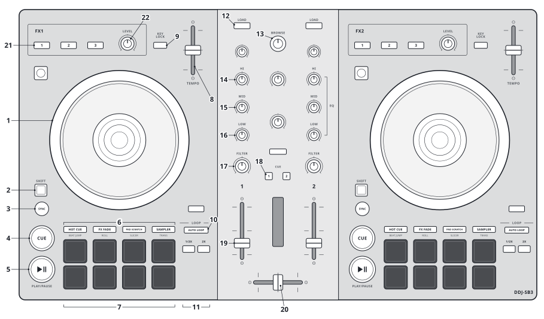

*Figure 68. The DDJ-SB3's controls (numbered on the left deck and the centre; the right deck is the same)*

Almost the same as the DDJ-FLX4. Pads are on ch 8 for deck 1 and ch 9 for deck 2; SHIFT + pad is the number + 8 (clear). Tempo range is SHIFT + KEYLOCK. SB3 from the official MIDI list (version preserved on the Internet Archive), SX from Mixxx's mapping. Tick count: `400` for SB3 / SX, same as the FLX4. Not yet tested on the real hardware.

<!-- devlist 1 Deck -->

1. **Jog**: Top = touch scratch (switch the controller's VINYL on), outer ring = nudge (1/4 speed). `SHIFT` + jog makes big jumps
2. **SHIFT**: Hold it with another control for its second function
3. **SYNC**
4. **CUE**
5. **PLAY/PAUSE**
6. **Pad mode buttons**: `HOT CUE` = HOT CUE, `FX FADE` (FADE MIX in the MIDI list) → FILTER TYPE, `PAD SCRATCH` → NEURAL MIX, `SAMPLER` → sample switching. With SHIFT held, `BEAT JUMP` → AUTO LOOP, `ROLL` → BOUNCE LOOP, `SLICER` = SLICER, `TRANS` → TOUCH FX
7. **Pads**: The 8 pads of the current mode. In `HOT CUE`, SHIFT + pad clears a hot cue
8. **TEMPO**: Tempo slider
9. **KEY LOCK**: SHIFT + KEY LOCK switches the tempo range
10. **AUTO LOOP**: Loop (reloop with SHIFT)
11. **1/2X · 2X**: Halve / double the loop

<!-- devlist 12 Mixer -->

12. **LOAD**: Same as the Reloop Buddy (SHIFT + LOAD replaces the current sample)
13. **BROWSE**: Turn = the headphone Cue mix (while an effect is on, that effect's sound amount), push = switch decks
14. **HI**: Filter Morph (echo length with SHIFT)
15. **MID**: How much the video effects act on the sound
16. **LOW**: Filter Resonance (echo feedback with SHIFT)
17. **FILTER**: Filter Cutoff (key with SHIFT)
18. **Headphone CUE**: Listen to this deck on headphones (toggles with each press; SHIFT hides only the picture)
19. **Channel fader**: That deck's volume and picture strength
20. **Crossfader**: Deck 1 on the left side, deck 2 on the right

<!-- devlist 21 FX1 (Buddy-style) -->

21. **FX1 button 1**: The Buddy's FX ON bar (toggles with each press; SHIFT turns all effects off while held)
22. **FX1 LEVEL**: The Buddy's FX knob (effect amount). There is no ◀ ▶

Note (Buddy-style FX): deck 2 uses the same controls on the right (FX2). What they act on is as in the DDJ-FLX4's note: it depends on what you hold.

Controls without a number (DECK, FX1 buttons 2 · 3, TRIM, MASTER LEVEL, HEADPHONES LEVEL, MASTER and so on) are not used by ReaScratch.

**DDJ-SX** (the same preset)

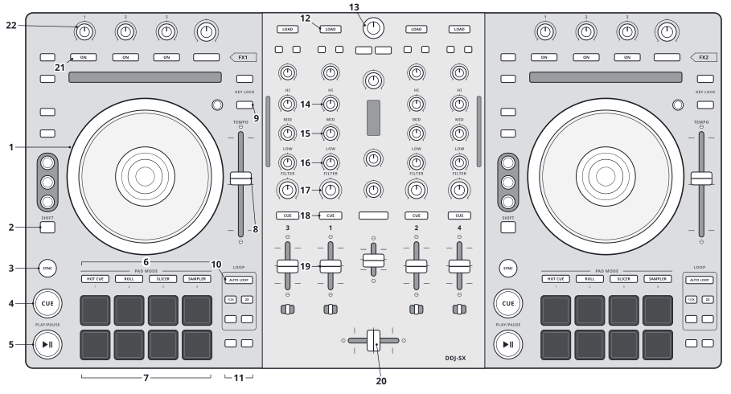

*Figure 69. The DDJ-SX's controls (numbered on the left deck (DECK 1) and mixer channel 1; the right deck (DECK 2) and channel 2 are the same)*

The DDJ-SX uses the same preset and is read with the SB3's numbers. Select DECK 1 on the left deck and DECK 2 on the right.

<!-- devlist 1 Deck -->

1. **Jog**: Top = touch scratch (set the controller's JOG MODE to VINYL), outer ring = nudge (1/4 speed). `SHIFT` + jog makes big jumps
2. **SHIFT**: Hold it with another control for its second function
3. **SYNC**
4. **CUE**
5. **PLAY/PAUSE**
6. **Pad mode buttons**: Same numbers as the SB3's buttons in the same places (the SX's `HOT CUE`, `ROLL`, `SLICER`, `SAMPLER` = the SB3's `HOT CUE`, `FX FADE`, `PAD SCRATCH`, `SAMPLER`; what they do is the SB3's item 6 above). But SHIFT + SAMPLER sends a different number and does not switch to TOUCH FX
7. **Pads**: The 8 pads of the current mode. In `HOT CUE`, SHIFT + pad clears a hot cue
8. **TEMPO**: Tempo slider
9. **KEY LOCK**: SHIFT + KEY LOCK switches the tempo range
10. **AUTO LOOP**: Loop (reloop with SHIFT)
11. **1/2X · 2X**: Halve / double the loop

<!-- devlist 12 Mixer -->

12. **LOAD**: Same as the Reloop Buddy (SHIFT + LOAD replaces the current sample)
13. **BROWSE**: Turn = the headphone Cue mix (while an effect is on, that effect's sound amount), push = switch decks
14. **HI**: Filter Morph (echo length with SHIFT)
15. **MID**: How much the video effects act on the sound
16. **LOW**: Filter Resonance (echo feedback with SHIFT)
17. **FILTER**: Filter Cutoff (key with SHIFT)
18. **Headphone CUE**: Listen to this deck on headphones (toggles with each press; SHIFT hides only the picture)
19. **Channel fader**: That deck's volume and picture strength
20. **Crossfader**: Deck 1 on the left side, deck 2 on the right

<!-- devlist 21 FX1 (Buddy-style) -->

21. **FX1's first ON**: The Buddy's FX ON bar (toggles with each press; SHIFT turns all effects off while held)
22. **FX1's first knob**: The Buddy's FX knob (effect amount). There is no ◀ ▶

Note (Buddy-style FX): deck 2 uses the same controls on the right (FX2). What they act on is as in the DDJ-FLX4's note: it depends on what you hold.

Controls without a number (NEEDLE SEARCH, GRID ADJUST, GRID SLIDE, SLIP, BEATS, TAP, PARAMETER1, channels 3 · 4 and so on) are not used by ReaScratch.

**93 · 94 DDJ-SX3 deck 1 / deck 2**

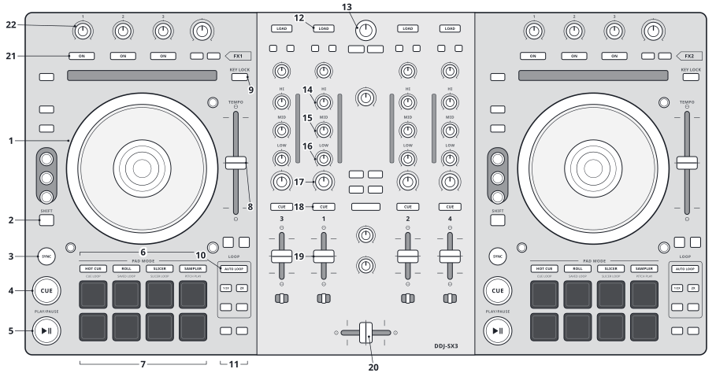

*Figure 70. The DDJ-SX3's controls (numbered on the left deck (DECK 1) and mixer channel 1; the right deck (DECK 2) and channel 2 are the same)*

Almost the same numbers as the DDJ-SB3 / SX; the SYNC number differs (93). From the official MIDI list (version preserved on the Internet Archive). Tick count `1138`, from Mixxx's 2048 ticks per turn for the DDJ-SX. Not yet tested on the real hardware.

<!-- devlist 1 Deck -->

1. **Jog**: Top = touch scratch (switch the controller's VINYL on), outer ring = nudge (1/4 speed). `SHIFT` + jog makes big jumps
2. **SHIFT**: Hold it with another control for its second function
3. **SYNC**
4. **CUE**
5. **PLAY/PAUSE**
6. **Pad mode buttons**: `HOT CUE` = HOT CUE, `ROLL` → BOUNCE LOOP, `SLICER` = SLICER, `SAMPLER` → sample switching. With SHIFT held, `CUE LOOP` → AUTO LOOP, `SAVED LOOP` → NEURAL MIX, `SLICER LOOP` → TOUCH FX, `PITCH PLAY` = PITCH PLAY
7. **Pads**: The 8 pads of the current mode. In `HOT CUE`, SHIFT + pad clears a hot cue
8. **TEMPO**: Tempo slider
9. **KEY LOCK**: SHIFT + KEY LOCK switches the tempo range
10. **AUTO LOOP**: Loop (reloop with SHIFT)
11. **1/2X · 2X**: Halve / double the loop

<!-- devlist 12 Mixer -->

12. **LOAD**: Same as the Reloop Buddy (SHIFT + LOAD replaces the current sample)
13. **BROWSE**: Turn = the headphone Cue mix (while an effect is on, that effect's sound amount), push = switch decks
14. **HI**: Filter Morph (echo length with SHIFT)
15. **MID**: How much the video effects act on the sound
16. **LOW**: Filter Resonance (echo feedback with SHIFT)
17. **CFX**: Filter Cutoff (key with SHIFT)
18. **Headphone CUE**: Listen to this deck on headphones (toggles with each press; SHIFT hides only the picture)
19. **Channel fader**: That deck's volume and picture strength
20. **Crossfader**: Deck 1 on the left side, deck 2 on the right

<!-- devlist 21 FX1 (Buddy-style) -->

21. **FX1's first ON**: The Buddy's FX ON bar (toggles with each press; SHIFT turns all effects off while held)
22. **FX1's first knob**: The Buddy's FX knob (effect amount). There is no ◀ ▶

Note (Buddy-style FX): deck 2 uses the same controls on the right (FX2). What they act on is as in the DDJ-FLX4's note: it depends on what you hold.

Controls without a number (NEEDLE SEARCH, CENSOR, KEY UP / DOWN, SLIP, QUANTIZE, FLIP, BEATS, CH ASSIGN, PARAMETER1, the SOUND COLOR FX buttons, channels 3 · 4 and so on) are not used by ReaScratch.

**95 · 96 CDJ-2000NXS2 (MIDI ch 1) / (MIDI ch 2)**

*Figure 71. The CDJ-2000NXS2's controls (one player = one deck)*

Connect the CDJ to the computer over USB and put it in MIDI mode with `BROWSE/SEARCH` → `LINK` → `CONTROL MODE` → `USB-MIDI`. Hold `MENU/UTILITY` → `MIDI CHANNEL` and set the first player to 1 and the second to 2. Windows needs the player's driver.

<!-- devlist 1 Left side and jog -->

1. **Jog**: Touch the top and turn to scratch (set `JOG MODE` to VINYL). Turning the side nudges while playing and moves the position while stopped
2. **PLAY/PAUSE**
3. **CUE**
4. **TRACK SEARCH**: Previous / next sample
5. **DIRECTION**: `REV` = `REVERSE` (each press toggles reverse play), `SLIP REV` = `SLIP REVERSE` (reverse while held)
6. **HOT CUE**: A–H are hot cues 1–8 (store if empty)
7. **CALL/DELETE and BANK**: Hold `HOT CUE CALL/DELETE` and press a hot cue to clear it. `BANK` switches between A–D and E–H
8. **IN/CUE**: `LOOP IN` = loop
9. **RELOOP/EXIT**: Exit / go back to the loop
10. **SLIP**
11. **QUANTIZE**

<!-- devlist 12 Round the screen and right side -->

12. **Screen (waveform)**: `NEEDLE SEARCH` = while stopped, go to the touched position
13. **CUE/LOOP CALL ◀ ▶**: Recall memory cues
14. **DELETE**: Delete a memory cue
15. **MEMORY**: Store a memory cue
16. **Rotary selector**: How much the video effects act on the sound
17. **TOUCH/BRAKE**: Brake length
18. **RELEASE/START**: Start-up length
19. **SYNC**
20. **TEMPO ±6/±10/±16/WIDE**: TEMPO RANGE (tempo range)
21. **TEMPO**: Tempo slider

Controls without a number (4/8 BEAT, OUT, SEARCH, TIME MODE, MASTER, MASTER TEMPO, TEMPO RESET, the buttons above the screen and so on) are not used by ReaScratch. There is no crossfader or volume fader, so use the keyboard or another controller (the preset only sets the crossfader side and leaves the channel and CC as they were).

In MIDI mode the jog sends "turning speed" as 7 bits (steps of about 0.06x), so the movement is coarser than on the FLX4 or Buddy. The numbers come from the MIDI message list in the player's manual; not yet tested on the real hardware.

**97 · 98 CDJ-3000/3000X (MIDI ch 1) / (MIDI ch 2)**

*Figure 72. The CDJ-3000's controls (one player = one deck; the CDJ-3000X has the same controls in the same order)*

Connect the CDJ to the computer over USB and put it in MIDI mode with `SOURCE` → `SOFTWARE CONTROL`. Hold `MENU` (`UTILITY`) → `MIDI Channel` and set the first player to 1 and the second to 2. Windows needs the player's driver.

Same mapping as the CDJ-2000NXS2 (including loops, memory cues, SLIP, REVERSE and so on; there is no `RELEASE/START` knob). The MIDI numbers differ (top touch, hot cues, SYNC, TEMPO RANGE), so it is a separate preset.

<!-- devlist 1 Left side and jog -->

1. **Jog**: Touch the top and turn to scratch (set `JOG MODE` to VINYL). Turning the side nudges while playing and moves the position while stopped
2. **PLAY/PAUSE**
3. **CUE**
4. **TRACK SEARCH**: Previous / next sample
5. **DIRECTION**: `REV` = `REVERSE` (each press toggles reverse play), `SLIP REV` = `SLIP REVERSE` (reverse while held)
6. **IN/CUE**: `LOOP IN` = loop
7. **RELOOP/EXIT**: Exit / go back to the loop
8. **CALL/DELETE**: Hold it and press a hot cue to clear it
9. **SLIP**
10. **QUANTIZE**
11. **HOT CUE A–H**: Hot cues 1–8 (store if empty)

<!-- devlist 12 Round the screen and right side -->

12. **Screen (waveform)**: `NEEDLE SEARCH` = while stopped, go to the touched position
13. **Rotary selector**: How much the video effects act on the sound
14. **TOUCH/BRAKE**: Brake length
15. **CUE/LOOP CALL ◀ ▶**: Recall memory cues
16. **DELETE**: Delete a memory cue
17. **MEMORY**: Store a memory cue
18. **BEAT SYNC**: SYNC
19. **TEMPO ±6/±10/±16/WIDE**: TEMPO RANGE (tempo range)
20. **TEMPO**: Tempo slider

Controls without a number (OUT, BEAT LOOP, BEAT JUMP, SEARCH, TIME/A.CUE, JOG ADJUST, MASTER, KEY SYNC, MASTER TEMPO, TEMPO RESET, the buttons above the screen and so on) are not used by ReaScratch. There is no crossfader or volume fader, so use the keyboard or another controller.

The numbers come from the official MIDI message lists of the CDJ-3000 and the CDJ-3000X (the numbers used are the same on both); not yet tested on the real hardware.

**99 · 100 XDJ-RX3 / XZ deck 1 / deck 2**

Put the unit in MIDI mode (on the XDJ-XZ, PC Control mode via `BROWSE` → `MIDI` → `LOAD`). The jog works like a DDJ, the buttons use the CDJ numbers (PLAY/PAUSE, CUE, SYNC, TEMPO RANGE). LOAD (ch1 81 / ch2 81) loads the file chosen in the Media Explorer into an empty sample slot. Hold a PAD MODE button (5) and press LOAD to preview (the same as the `P` key). From the official MIDI list (RX3); not yet tested on the real hardware.

**XDJ-RX3**

*Figure 73. The XDJ-RX3's controls (numbered on the left deck and the centre; the right deck is the same)*

<!-- devlist 1 Deck -->

1. **Jog**: Top = touch scratch, outer ring = nudge. `SHIFT` + jog makes big jumps
2. **SHIFT**: Hold it with another control for its second function
3. **CUE**
4. **PLAY/PAUSE**
5. **PAD MODE buttons**: `HOT CUE` = HOT CUE, `BEAT LOOP` → AUTO LOOP, `SLIP LOOP` → BOUNCE LOOP, `BEAT JUMP` → SLICER. With SHIFT held (EXTENSION 1–4) → TOUCH FX, PITCH PLAY, NEURAL MIX, FILTER TYPE
6. **Pads**: The 8 pads of the current mode. In `HOT CUE`, SHIFT + pad clears a hot cue
7. **TEMPO**: Tempo slider
8. **BEAT SYNC**: SYNC
9. **TEMPO ±6/±10/±16/WIDE**: TEMPO RANGE (tempo range)
10. **RELOOP/EXIT**: Exit / go back to the loop
11. **CUE/LOOP CALL ◀ ▶**: Halve / double the loop

<!-- devlist 12 Mixer -->

12. **Rotary selector**: BROWSE
13. **HI**: Filter Morph (echo length with SHIFT)
14. **MID**: How much the video effects act on the sound
15. **LOW**: Filter Resonance (echo feedback with SHIFT)
16. **COLOR**: Filter Cutoff (key with SHIFT)
17. **Crossfader**: Deck 1 on the left side, deck 2 on the right (ch 5)

4 BEAT (loop) is set to the number of the XDJ-XZ's 4/8 BEAT button (10 in the XDJ-XZ drawing below). Controls without a number (IN, OUT, DELETE, MEMORY, SLIP, QUANTIZE, DIRECTION, TRACK SEARCH, SEARCH, JOG MODE, TRIM, the headphone CUE, the channel faders, SOUND COLOR FX, BEAT FX and so on) are not used by ReaScratch.

**XDJ-XZ**

The same mapping as the XDJ-RX3, plus the 4/8 BEAT button (10).

*Figure 74. The XDJ-XZ's controls (numbered on the left deck and the centre; the right deck is the same. Deck 1 is the mixer's channel 1)*

<!-- devlist 1 Deck -->

1. **Jog**: Top = touch scratch, outer ring = nudge. `SHIFT` + jog makes big jumps
2. **SHIFT**: Hold it with another control for its second function
3. **CUE**
4. **PLAY/PAUSE**
5. **PAD MODE buttons**: `HOT CUE` = HOT CUE, `BEAT LOOP` → AUTO LOOP, `SLIP LOOP` → BOUNCE LOOP, `BEAT JUMP` → SLICER. With SHIFT held (EXTENSION 1–4) → TOUCH FX, PITCH PLAY, NEURAL MIX, FILTER TYPE
6. **Pads**: The 8 pads of the current mode. In `HOT CUE`, SHIFT + pad clears a hot cue
7. **TEMPO**: Tempo slider
8. **BEAT SYNC**: SYNC
9. **TEMPO ±6/±10/±16/WIDE**: TEMPO RANGE (tempo range)
10. **4/8 BEAT**: Loop
11. **RELOOP/EXIT**: Exit / go back to the loop
12. **CUE/LOOP CALL ◀ ▶**: Halve / double the loop

<!-- devlist 13 Mixer -->

13. **Rotary selector**: BROWSE
14. **HI**: Filter Morph (echo length with SHIFT)
15. **MID**: How much the video effects act on the sound
16. **LOW**: Filter Resonance (echo feedback with SHIFT)
17. **COLOR**: Filter Cutoff (key with SHIFT)
18. **Crossfader**: Deck 1 on the left side, deck 2 on the right (ch 5)

Controls without a number (IN/CUE, OUT, DELETE, MEMORY, SLIP, DIRECTION, TRACK SEARCH, SEARCH, JOG MODE, TRIM, the headphone CUE, the channel faders, channels 3 and 4, SOUND COLOR FX, BEAT FX, MIC and so on) are not used by ReaScratch.

**101 · 102 Reloop Buddy deck 1 / deck 2**

*Figure 75. The Reloop Buddy's controls (the left deck and the centre; the right deck is the same, mirrored)*

<!-- devlist 1 Deck -->

1. **Jog**: Touch scratch (press the top and turn). Turning the side without touching the top nudges to match beats while playing (pitch bend) and moves the position while stopped. Coasting right after you let go is ignored. `SHIFT` + jog makes big jumps
2. **LOOP knob**: Turn = length, press = loop (with SHIFT, move 1 beat / reloop)
3. **Tempo fader**: Bottom = +
4. **Pads**: Eight pads for the current mode. Starts in `HOT CUE` when the project opens. There is no mode for choosing samples (use the `F1`–`F8` keys or the `1`–`8` buttons at the bottom of the screen)
5. **PERFORMANCE MODES (the mode button)**: Hold it and press the pad with the mode's label to choose one of 8 modes (the `SAMPLER` label = FILTER TYPE, the `NEURAL MIX` label = PITCH PLAY, the `LOOPER` label = NEURAL MIX; see [“Pad modes”](pad-modes-loops-filter-and-effects.md#pad-modes) above)
6. **SYNC**: With SHIFT, changes the tempo range
7. **CUE**: With SHIFT, freeze
8. **PLAY**: With SHIFT, plays / stops both decks at once
9. **SHIFT**: Hold with another control to use its second function

<!-- devlist 10 Mixer and centre -->

10. **HIGH**: Filter Morph (with SHIFT, echo length)
11. **LOW**: Filter Resonance (with SHIFT, echo feedback)
12. **FILTER**: Filter Cutoff (with SHIFT, key). After switching SHIFT on or off, 10–12 take effect only once the knob reaches the current value
13. **FX ON bar**: That deck's video effect on/off (with SHIFT, temporarily turns off all effects)
14. **FX knob**: The effect amount (see the note below)
15. **FX PARAM ◀ ▶**: The effect type (see the note below)
16. **Volume fader**: That deck's volume and picture strength
17. **Crossfader**: Deck 1 on the left side, deck 2 on the right
18. **BROWSE**: Turn = the headphone Cue mix (with the bar or a pad held, that effect's sound amount). Turn with SHIFT = the sound of the effect after the mix (with the bar on, that deck's overall sound multiplier)
19. **LOAD A / B**: Load the file chosen in the Media Explorer into deck A / B (SHIFT + LOAD replaces the current sample; see [“Loading with the LOAD button (from the Media Explorer)”](basic-use.md#loading-with-the-load-button-from-the-media-explorer)). Hold the mode button (5) and press LOAD to preview (see [“Previewing a Media Explorer file (P key)”](basic-use.md#previewing-a-media-explorer-file-p-key))
20. **Headphone button**: Listen to this deck on headphones (toggles with each press; with SHIFT, hides only the picture)

Note (14, 15): The FX knob sets an amount and `FX PARAM` ◀ ▶ picks a type. The FX knob takes effect only when turned near or past the current value, so the value never jumps (until then, the screen shows where to turn it). The amounts of the deck's effect and the effect after the mix are remembered for each type: changing the type restores that type's amount (when REAPER starts: Mirror 25%, Kaleidoscope 20%, Shift RGB 30%, Strobe 74%, VHS 30%, the others 100%). What they act on depends on what you hold: nothing = the transition (◀ ▶ picks, hold to scroll fast; the FX knob softens its edges); SHIFT = the video effect after the mix; the mode button = the video blend (◀ ▶ picks, the FX knob sets the key threshold, SHIFT + ◀ ▶ turns the blend-with-transitions combination on or off); the bar on = that deck's video effect; a TOUCH FX pad held = that pad's strength (◀ ▶ too).

On Windows it needs the driver described under [“Troubleshooting”](troubleshooting.md) below. The buttons light up in the hot cue colours and so on (see [“Button lights”](#button-lights) below). The jog, pads, LOOP knob, filter, FX and LOAD were tested on real hardware. Many SHIFT combinations (CUE, PLAY, jog, FX ON, headphones, HIGH / LOW / FILTER) and the TOUCH FX, PITCH PLAY and FILTER TYPE modes have not been tested on real hardware yet.

**103 · 104 Reloop Ready deck 1 / deck 2**

*Figure 76. The Reloop Ready's controls (numbered on the left deck and the centre; the right deck is the same, except that its TEMPO is on the other side, both next to the mixer)*

<!-- devlist 1 Deck -->

1. **Jog**: Touch scratch (as on the Reloop Buddy). `SHIFT` + jog makes big jumps
2. **LOOP knob**: Turn = length, press = loop (with SHIFT, move 1 beat / reloop; the SHIFT side arrives on the pad channel, ch 5 / 6)
3. **TEMPO**: Like the Buddy, + (faster) at the bottom, at its maximum value
4. **Pads**: The 8 pads of the current mode. Starts in `HOT CUE` when the project opens
5. **MODE**: Hold it and press a pad to choose one of 8 modes (Hotcue → HOT CUE, AutoLoop → AUTO LOOP, ManualLoop → SLICER, Sampler → FILTER TYPE, Pitch → PITCH PLAY, ScratchBank → NEURAL MIX, LoopRoll → BOUNCE LOOP, BeatGrid → TOUCH FX)
6. **SYNC**: With SHIFT, changes the tempo range
7. **CUE**: With SHIFT, freeze
8. **PLAY**: With SHIFT, plays / stops both decks at once

<!-- devlist 9 FX UNIT (Buddy-style) -->

9. **FX1 ON**: The Buddy's FX ON bar (that deck's video effect on/off; with SHIFT, temporarily turns off all effects). For the right deck, FX1 ON of the right FX UNIT 2
10. **FX2 ON · FX3 ON**: The Buddy's `FX PARAM` ◀ ▶ (the effect type; ch 9, notes 1 / 2 = the second and third buttons of the left FX UNIT 1; the right deck uses these two as well)
11. **LEVEL**: The Buddy's FX knob (the effect amount). SHIFT + FX knob has no number of its own, so the unit's SHIFT is used

<!-- devlist 12 Mixer and centre -->

12. **HIGH**: Filter Morph (with SHIFT, echo length)
13. **LOW**: Filter Resonance (with SHIFT, echo feedback)
14. **FILTER**: Filter Cutoff (with SHIFT, key)
15. **Headphone CUE**: Listen to this deck on headphones (toggles with each press; with SHIFT, hides only the picture)
16. **Channel fader**: That deck's volume and picture strength
17. **Crossfader**: Deck 1 on the left side, deck 2 on the right
18. **BROWSE**: As on the Reloop Buddy (turn = the headphone Cue mix, turn with SHIFT = the sound of the effect after the mix)
19. **LOAD**: Load the file chosen in the Media Explorer into deck A / B (SHIFT + LOAD replaces the current sample)
20. **SHIFT**: Hold with another control to use its second function (one, in the centre)

Same mapping as the Reloop Buddy, with the same MIDI numbers (checked against Mixxx's mapping). The differences are the SHIFT side of 2 and items 5, 10 and 11 above (from an unmerged Mixxx mapping draft). What 9–11 act on depends on what you hold (as in the Reloop Buddy's note). The tempo fader's direction was checked on real hardware by the author of the Mixxx mapping for the Ready, and by ear on real hardware for the Buddy. On Windows it probably needs Reloop's driver like the Buddy. Not yet tested on the real hardware.

Controls without a number (GAIN, VINYL, KEY LOCK, PARAMETER ◀ ▶, FX2 ON and FX3 ON of the right FX UNIT 2 and so on) are not used by ReaScratch.

**105 · 106 Reloop Mixage deck 1 / deck 2**

*Figure 77. The Reloop Mixage's controls (numbered on the left deck and the centre; the right deck is the same, mirrored)*

<!-- devlist 1 Deck -->

1. **Jog**: Top scratch (touch)
2. **TEMPO**: Tempo (pitch bend). Deck 1 only (deck 2's pitch bend arrives on channel 2 and cannot be read)
3. **SHIFT**: Hold it with another control for its second function
4. **LOOP**: Loop
5. **RELOOP**: Reloop
6. **LENGTH knob**: The loop length. Turn with SHIFT = move the loop
7. **FX SEL**: The Buddy's `FX PARAM` ◀ (the right deck's FX SEL is ▶). `SHIFT` + press = the type of the effect after the mix
8. **FX ON**: The Buddy's FX ON (that deck's video effect on/off). `SHIFT` + FX ON = all effects off while held (that deck)
9. **AMOUNT**: The Buddy's FX knob (the effect amount). `SHIFT` + turn = filter Cutoff
10. **SYNC**
11. **CUE**
12. **PLAY**
13. **SHIFT + SYNC, CUP, CUE, PLAY**: Hot cues 1–4

<!-- devlist 14 Mixer and centre -->

14. **HIGH**: Filter Morph
15. **MID**: How much the video effects act on the sound
16. **LOW**: Filter Resonance
17. **Headphone CUE**: Listen to this deck on headphones
18. **Channel fader**: That deck's volume and picture strength
19. **Crossfader**: Deck 1 on the left side, deck 2 on the right
20. **TRAX**: BROWSE (turn, push)
21. **LOAD ◀ ▶**: LOAD (◀ = deck 1, ▶ = deck 2)

Both decks on MIDI channel 1, told apart by number. What 7–9 act on depends on what you hold (as in the Reloop Buddy's note). From Mixxx's mapping (one mapping for the Interface Edition, MK2 and Controller Edition); not yet tested on the real hardware.

Controls without a number (GAIN, DRY/WET, pitch − / +, the two buttons above the jog, MASTER, PHONES, CUEMIX and so on) are not used by ReaScratch.

**107 · 108 Reloop Mixon 4 deck 1 / deck 2**

*Figure 78. The Reloop Mixon 4's controls (numbered on the left deck, the mixer's CHANNEL 1 and the centre; the right deck and CHANNEL 2 are the same, with the TEMPO and the SYNC / CUE / PLAY column mirrored to the outer edge)*

<!-- devlist 1 Deck -->

1. **Jog**: Top scratch (CC 6) and touch
2. **TEMPO**: Tempo (pitch bend)
3. **LOOP knob**: Turn = length, push = AUTO LOOP
4. **AUTO LOOP**: The auto loop button
5. **SYNC**
6. **CUE**
7. **PLAY/PAUSE**
8. **SHIFT**: SHIFT + pad clears a hot cue
9. **Pad mode buttons**: 8 modes (the second ones with SHIFT). HOT CUE, LOOP ROLL → BOUNCE LOOP, SAMPLER → samples, SLICER, CUE LOOP → AUTO LOOP, SAVED LOOPS → NEURAL MIX, PITCH PLAY, SLICER LOOP → TOUCH FX
10. **Pads**: The 8 pads of the current mode (ch 1 / ch 2)

<!-- devlist 11 EFFECT UNIT (Buddy-style) -->

11. **ON (the first)**: The Buddy's FX ON
12. **ON (the second and third)**: The Buddy's `FX PARAM` ◀ ▶ (FX ON 2 / 3)
13. **The first knob**: The Buddy's FX knob (the effect amount)

<!-- devlist 14 Mixer and centre -->

14. **HIGH**: Filter Morph
15. **MID**: How much the video effects act on the sound
16. **LOW**: Filter Resonance
17. **FILTER**: Filter Cutoff
18. **Headphone CUE**: Listen to this deck on headphones
19. **Channel fader**: That deck's volume and picture strength
20. **Crossfader**: ch 11. Deck 1 on the left side, deck 2 on the right
21. **TRAX**: BROWSE (turn, push)

Decks on ch 5 / ch 6 (pads on ch 1 / ch 2). What 11–13 act on depends on what you hold (as in the Reloop Buddy's note). Numbers from Reloop's official MIDI map (version preserved on the Internet Archive). The jog tick count and tempo direction are not in the documents and are provisional. LOAD (ch5 2 / ch6 2) loads the file chosen in the Media Explorer into an empty sample slot (there is no SHIFT + LOAD). Hold a pad mode button (9) and press LOAD to preview (the same as the `P` key). The SHIFT combinations other than 8 and 9 above are not mapped. Not yet tested on the real hardware.

Controls without a number (GAIN, the effect unit's other knobs, TAP, PARAM − / +, the three buttons left of the jog, CHANNEL 3 / 4, the MASTER column's knobs and so on) are not used by ReaScratch.

**109 · 110 Reloop Mixon 8 Pro deck 1 / deck 2**

*Figure 79. The Reloop Mixon 8 Pro's controls (numbered on the left deck, the mixer's CHANNEL 1 and the centre; the right deck and CHANNEL 2 are the same, with the TEMPO and the SYNC / CUE / PLAY column mirrored to the outer edge)*

<!-- devlist 1 Deck -->

1. **Jog**: Top scratch (CC 6, 64-centre values) and touch
2. **TEMPO**: Tempo (pitch bend)
3. **PITCH RANGE**: Changes the tempo range
4. **AUTO LOOP**: The auto loop button
5. **SYNC**
6. **CUE**
7. **PLAY/PAUSE**
8. **SHIFT**: Hold it with another control for its second function (SHIFT + pad clears a hot cue; turn BROWSE with SHIFT = the headphone Cue mix, push = which deck BROWSE works on, A / B)
9. **Pad mode buttons**: hot cue → HOT CUE, roll → BOUNCE LOOP, slicer → SLICER, sampler → samples, saved loop → AUTO LOOP, pitch play → PITCH PLAY, stems → NEURAL MIX, instant FX → TOUCH FX. Which button sends which mode is not known
10. **Pads**: The 8 pads of the current mode (ch 5 / ch 6)
11. **The FX UNIT's first knob**: The FX wet/dry = that deck's video effect amount

<!-- devlist 12 Mixer and centre -->

12. **LOAD**: Load the file chosen in the Media Explorer into deck A / B
13. **HIGH**: Filter Morph
14. **MID**: How much the video effects act on the sound
15. **LOW**: Filter Resonance
16. **Headphone CUE**
17. **FILTER**: Filter Cutoff
18. **Channel fader**: That deck's volume and picture strength
19. **Crossfader**: ch 15. Deck 1 on the left side, deck 2 on the right
20. **BROWSE**: Turn, push

Almost the same numbers as the Reloop Buddy (decks ch 1 / ch 2, jog CC 6, touch, PLAY, CUE, SYNC, channel fader, headphone CUE, crossfader ch 15, HOT CUE pads on ch 5 / ch 6). The differences: the jog uses 64-centre values and the tempo is pitch bend. No official MIDI list from Reloop could be found, so the numbers come from a mapping file published by a djay (DJ app) user. The jog tick count and tempo direction are provisional. The pad modes come from the same mapping file. The number of FX ON (the paddle) is not in any document, so it is not mapped (you can check it in the `Learn` tab of setup). Not yet tested on the real hardware.

Controls without a number (GAIN, the FX UNIT's other knobs and buttons, KEY SYNC, IN, OUT, PARAM ◀ ▶, CHANNEL 3 / 4, the MASTER column's knobs and so on) are not used by ReaScratch.

**111 · 112 Reloop Touch deck 1 / deck 2**

*Figure 80. The Reloop Touch's controls (numbered on the left deck, the mixer's CH1 and the centre; the right deck and CH2 are the same, with the TEMPO and the SYNC / CUE / PLAY column mirrored to the outer edge. The right FADER EFFECTS UNIT is printed FX 1, FX 2, FX 3, VIDEO FX, but ReaScratch reads it by position: its first fader and ON from the left are 10 and 11)*

<!-- devlist 1 Deck -->

1. **Jog**: Top scratch (CC 96, 64-centre values) and touch
2. **TEMPO**: Tempo (pitch bend). The reverse of the Beatmix: the maximum value is on the slow side
3. **SHIFT**: Hold it with another control for its second function. SHIFT adds 64 to the pad number (clears a hot cue)
4. **XCODER**: The loop knob (turn, push)
5. **SYNC**
6. **CUE**
7. **PLAY/PAUSE**
8. **PAD MODE**: Hold it and press pad 1–8 to pick a mode (as on the Buddy: Hot Cue → HOT CUE, Roll → BOUNCE LOOP, Slicer → SLICER, Sampler → FILTER TYPE, Cue Loop → AUTO LOOP, Saved Loop → NEURAL MIX, Beat Jump → TOUCH FX, Key Cue → PITCH PLAY)
9. **Pads**: The 8 pads of the current mode

<!-- devlist 10 FADER EFFECTS UNIT (Buddy-style) -->

10. **The first fader from the left (DRY/WET; printed VIDEO TRANS.)**: The Buddy's FX knob (the effect amount)
11. **The first ON from the left**: The Buddy's FX ON. SHIFT + FX ON = all effects off while held
12. **The second ON from the left (printed FX 1)**: The Buddy's `FX PARAM` ◀ (the right unit's second ON from the left, printed FX 2, is ▶)

<!-- devlist 13 Mixer and centre -->

13. **HIGH**: Filter Morph
14. **LOW (MID)**: Filter Resonance
15. **FILTER (LOW)**: Filter Cutoff (set the unit's EQ mode to FILTER; in 3-band mode the same knob is LOW)
16. **CH1**: Headphone CUE (note 60)
17. **Channel fader**: That deck's volume and picture strength
18. **Crossfader**: ch 6. Deck 1 on the left side, deck 2 on the right
19. **BROWSE**: Turn and push both work

Almost the same numbers as the Reloop Beatmix 2/4 (decks ch 2 / ch 3, jog CC 96, touch, PLAY, CUE, SYNC, tempo (pitch bend), channel fader, crossfader ch 6). From Reloop's official Traktor mapping (version preserved on the Internet Archive). The jog values and the tempo direction come from the same mapping. The tick count is assumed to be the same as the Beatmix. What 10–12 act on depends on what you hold (as in the Reloop Buddy's note). Not yet tested on the real hardware.

LOAD (ch2 57 / ch3 57) loads the file chosen in the Media Explorer into an empty sample slot. SHIFT + LOAD is the preview (the same as the `P` key). Controls without a number (the touchscreen, PITCH BEND ◀ ▶, MODE, SLIP, DECK 3, the FADER EFFECTS UNIT's second fader from the left and its third and fourth faders and ONs, PARAM, GAIN, CH3, CH4, MASTER, CUE VOL, CUE MIX and so on) are not used by ReaScratch.

**113 · 114 Reloop Beatpad deck 1 / deck 2**

*Figure 81. The Reloop Beatpad's controls (numbered on the left deck and the centre; on the right deck the knobs and the upper button row are mirrored, the rest is the same)*

<!-- devlist 1 Deck -->

1. **Jog**: Top scratch (touch). Set the controller's jog mode to Vinyl with `JOG SCRATCH`
2. **PITCH**: Tempo fader (pitch bend)
3. **LOOP SIZE**: The loop knob (turn = length)
4. **LOOP**: Loop (press)
5. **SHIFT**: Hold it with another control for its second function
6. **SYNC**
7. **JUMP**: CUE (see the note below)
8. **PLAY**: SHIFT + PLAY plays in reverse while held
9. **FX ON**: Video effect on/off
10. **Pad mode buttons**: `CUE` → HOT CUE, `BOUNCE LOOP` → AUTO LOOP, `INSTANT FX` → TOUCH FX, `SAMPLER` → sample switching (Mixxx's mapping calls the second button LOOP)
11. **Pads**: The 4 pads of the current mode. In `HOT CUE`, SHIFT + pad clears a hot cue
12. **FILTER**: Filter Cutoff
13. **FX PARAM**: The FX knob (effect amount)

<!-- devlist 14 Mixer -->

14. **HIGH**: Filter Morph
15. **MID**: How much the video effects act on the sound
16. **LOW**: Filter Resonance
17. **Headphone button**: Listen to this deck on headphones (SLIP with SHIFT)
18. **Channel fader**: That deck's volume and picture strength
19. **BROWSE**: Turn = how much the video effects act on the sound, push = switch the deck the knob works on, SHIFT + turn = the headphone Cue mix
20. **Crossfader** (ch 5): Deck 1 on the left side, deck 2 on the right

Note (7): CUE is note 0x5F. In Mixxx's mapping 0x5F is the `JUMP` button (0x5E is `CUE`). In the official MIDI list (v1.2) this number is `CuePlay` and 0x5E is `MainCue` (not checked on the real hardware).

LOAD 1 / 2 (ch1 98 / ch2 98) loads the file chosen in the Media Explorer into an empty sample slot. Hold a pad mode button (10) and press LOAD to preview (the same as the `P` key). Controls without a number (GAIN, JOG SCRATCH (used only to set up), JOG SEEK, FX SELECT, PITCH BEND, SET, REC, MASTER, PHONES, CUE MIX, AUX) are not used by ReaScratch. For the Beatpad, the official MIDI list and Mixxx's mapping disagree in places (such as the jog CC); Mixxx's is used. Tick count from the official list's 600 ticks per turn. Not yet tested on the real hardware.

**115 · 116 Reloop Beatpad 2 deck 1 / deck 2**

*Figure 82. The Reloop Beatpad 2's controls (numbered on the left deck and the centre; the right deck is the same)*

Reloop's Beatpad 2 MIDI list covers only the pads, mode buttons and EQ; the rest uses the Beatpad's numbers.

<!-- devlist 1 Deck -->

1. **Jog**: Top scratch (touch). Set the controller's jog mode to Vinyl
2. **PITCH**: Tempo fader (pitch bend)
3. **SHIFT**: Hold it with another control for its second function
4. **SYNC**
5. **JUMP**: CUE (as in the Beatpad's note)
6. **PLAY**
7. **Pad mode buttons**: Each of the 8 modes (printed on the upper and lower lines) arrives as its own number. `HOT CUE` = HOT CUE, `AUTO LOOP` = AUTO LOOP, `TOUCH FX` = TOUCH FX, `SLICER` = SLICER, `SAMPLER` → sample switching, `BOUNCE LOOP` = BOUNCE LOOP, `JOG FX` → NEURAL MIX, `SLICE LOOP` → PITCH PLAY (how the unit picks the lower-line modes is not checked on the real hardware)
8. **Pads**: The 8 pads of the current mode (ch 3 / ch 4). In `HOT CUE`, SHIFT + pad clears a hot cue

<!-- devlist 9 Mixer -->

9. **HIGH**: Filter Morph
10. **LOW [MID]**: With the controller's EQ mode on FILTER (LOW) = filter Resonance; in 3-band mode (MID) = how much the video effects act on the sound
11. **FILTER [LOW]**: In FILTER mode = filter Cutoff; in 3-band mode (LOW) = filter Resonance
12. **Headphone CUE**: Listen to this deck on headphones
13. **Channel fader**: That deck's volume and picture strength
14. **Crossfader** (ch 5): Deck 1 on the left side, deck 2 on the right

LOAD 1 / 2 (ch1 98 / ch2 98) loads the file chosen in the Media Explorer into an empty sample slot (not in Reloop's official list; assumed to be the same as the Beatpad). Hold a pad mode button (7) and press LOAD to preview (the same as the `P` key). Controls without a number (GAIN, PITCH − / +, SET, LIBRARY, BROWSE, MASTER, PHONES, CUE MIX, AUX) are not used by ReaScratch. Not yet tested on the real hardware.

**117 · 118 Reloop Beatmix 2/4 deck 1 / deck 2**

*Figure 83. The Reloop Beatmix 2's controls (numbered on the left deck and the centre; the right deck is the same. The Beatmix 4 has a 4-channel mixer and is otherwise the same)*

Decks on ch 2 / ch 3. Numbers from Reloop's official MIDI map (version preserved on the Internet Archive).

<!-- devlist 1 Deck -->

1. **Jog**: Top scratch (CC 96, 800 ticks per turn), touch
2. **FX 1**: The FX knob (Buddy-style; no ◀ ▶)
3. **BEATS**: The loop knob (turn, push)
4. **PITCH − / +**: `SHIFT` + `PITCH −` = FX ON (Buddy-style)
5. **Tempo fader**: Pitch bend
6. **SHIFT**: Hold it with another control for its second function
7. **SYNC**
8. **CUP**: SHIFT + CUP switches the tempo range
9. **CUE**
10. **PLAY**
11. **PAD MODE A · B**: HOT CUE in the pads' blue mode (A; SHIFT + pad clears) and sample switching in the red mode (B). In the violet mode (both mode buttons together) the top row is hot cues and the bottom row samples
12. **Pads**: The 8 pads of the current mode

<!-- devlist 13 Mixer -->

13. **TRAX**: BROWSE (Buddy-style: turn = the headphone Cue mix; while FX ON is on, that effect's sound amount; push = switch the deck the knob works on)
14. **Headphone CUE**: Listen to this deck on headphones
15. **Channel fader**: That deck's volume and picture strength
16. **Crossfader** (ch 6): Deck 1 on the left side, deck 2 on the right

The notes the unit sends when FX knobs 1–3 leave 0 are not used. LOAD 1 / 2 (ch2 80 / ch3 80) loads the file chosen in the Media Explorer into an empty sample slot. SHIFT + LOAD (ch2 64 / ch3 64) replaces the slot in use. Controls without a number (FX 2, FX 3, GAIN, HIGH, MID, LOW, BACK, the SAMPLER fader, MASTER, PHONES, CUE MIX) are not used by ReaScratch. Not yet tested on the real hardware.

**119 · 120 Reloop Terminal Mix 2/4 deck 1 / deck 2**

*Figure 84. The Reloop Terminal Mix 4's controls (numbered on the left deck and the centre; the right deck is the same. The Terminal Mix 2 has a 2-channel mixer and is otherwise the same)*

From Mixxx's mapping. No headphone CUE.

<!-- devlist 1 Deck -->

1. **Jog**: Top scratch (touch), outer ring = nudge (1/4 speed)
2. **Tempo fader**: Pitch bend
3. **RANGE**: Switches the tempo range
4. **SHIFT**: Hold it with another control for its second function
5. **SYNC**
6. **CUE**
7. **PLAY**
8. **FX 1's ON**: FX ON (Buddy-style)
9. **FX 2 / FX 3's ON**: ◀ ▶ (Buddy-style)
10. **BEATS**: The FX knob (Buddy-style; DRY/WET in Mixxx's mapping)
11. **LOOP**: Turn = loop length, SHIFT + push = RELOOP/EXIT
12. **IN**: Loop (press)
13. **MOVE**: Turn to move the loop
14. **The HOT CUE row**: Hot cues 1–4 (5–8 are the next numbers in Mixxx's mapping; which control on the unit sends them is not checked on the real hardware)
15. **The SAMPLER row**: Samples 1–4

<!-- devlist 16 Mixer -->

16. **HIGH**: Filter Morph
17. **MID**: How much the video effects act on the sound
18. **LOW**: Filter Resonance
19. **FILTER**: Filter Cutoff
20. **Channel fader**: That deck's volume and picture strength
21. **Crossfader**: Deck 1 on the left side, deck 2 on the right
22. **TRAX**: BROWSE (Buddy-style: turn = the headphone Cue mix; while FX ON is on, that effect's sound amount)

LOAD (ch1 50 / ch2 50) loads the file chosen in the Media Explorer into an empty sample slot. SHIFT + LOAD is the preview (the same as the `P` key). Controls without a number (KEYLOCK, TAP, OUT, VINYL, DECK, GAIN, the headphone buttons, CRATES, VIEW, BACK, PREP, MASTER, BOOTH, PHONES, CUE MIX, SAMPLER VOL) are not used by ReaScratch. Not yet tested on the real hardware.

**121 · 122 Reloop Terminal Mix 8 deck 1 / deck 2**

*Figure 85. The Reloop Terminal Mix 8's controls (numbered on the left deck and the centre; the right deck is the same)*

From Reloop's official MIDI map and Mixxx's mapping.

<!-- devlist 1 Deck -->

1. **Jog**: With the `JOG` button (VINYL) on, the top scratches; with it off, the outer ring nudges
2. **Tempo fader**: Pitch bend
3. **SHIFT**: Hold it with another control for its second function
4. **SYNC**
5. **CUE**
6. **PLAY**
7. **Pad mode buttons**: `CUE` → HOT CUE, `LOOP` → AUTO LOOP, `SMPL` → sample switching, `SLICE` → SLICER. With SHIFT held (MODE 1–4) → BOUNCE LOOP, TOUCH FX, PITCH PLAY, NEURAL MIX
8. **Pads**: The 8 pads of the current mode (ch 5 / ch 6). SHIFT + pad clears a hot cue
9. **FX 1's knob**: The FX knob (Buddy-style)
10. **FX1**: FX 1's ON = FX ON (Buddy-style)
11. **FX2 · FX3**: FX 2 / FX 3's ON = ◀ ▶ (Buddy-style)
12. **LOOP SIZE (BEATS)**: The loop knob (turn = length, push = loop, with SHIFT move by a beat / reloop)

<!-- devlist 13 Mixer -->

13. **HIGH**: Filter Morph (echo length with SHIFT)
14. **MID**: How much the video effects act on the sound
15. **LOW**: Filter Resonance (echo feedback with SHIFT)
16. **FILTER**: Filter Cutoff (key with SHIFT)
17. **Headphone CUE**: Listen to this deck on headphones
18. **Channel fader**: That deck's volume and picture strength
19. **Crossfader**: Deck 1 on the left side, deck 2 on the right
20. **TRAX**: BROWSE (Buddy-style)

LOAD (ch1 16 / ch2 16) loads the file chosen in the Media Explorer into an empty sample slot. SHIFT + LOAD (ch1 80 / ch2 80) replaces the slot in use. Hold a pad mode button (7) and press LOAD to preview (the same as the `P` key). Controls without a number (DECK FX ASSIGN, the ON under LOOP SIZE, STUTTER, DECK, GAIN, AREA, VIEW, BACK, PREPARE, MASTER, BOOTH, PHONES, CUE MIX, SAMPLER VOL) are not used by ReaScratch. Not yet tested on the real hardware.

**0 Custom**

Set up by hand using the table below.

**123 FLX4 Emu test (loopMIDI deck 2)**

For development (only when connecting `tools/flx4_emu.py`, which is not in the kit; not for normal use).

### Manual mapping (Custom)

Set each parameter to match your controller (the setup screen's `Jog` and `Touch & buttons` tabs; what each one means is also in the tables of [“3. Jog”](jsfx-reascratch-parameter-reference.md#3-jog) and [“4. Touch and buttons”](jsfx-reascratch-parameter-reference.md#4-touch-and-buttons)).

| Parameter | What to set / guide values |
|---|---|
| **MIDI channel** | The channel the controller sends on (on DJ controllers often the deck number) |
| **Jog CC number** | CC number of the jog / knob (FLX4: 34, APC40 TRACK KNOB 1 / 5: 48 / 52) |
| **Jog CC mode** | How the jog values are read (8 modes; listed below the table) |
| **Jog ticks per second at 1x** | Ticks per second that correspond to 1x playback. Smaller values move faster. - DDJ-FLX4: `400` - DDJ-FLX2: `256` - Coarse encoders (about 24 clicks per turn): `20`–`40` - The APC40's `TRACK KNOB` (`Absolute knob turned`): `120` |
| **Fine ring CC** | CC number for fine adjustment (FLX4 outer ring: 33). 0 turns it off |
| **Touch note** | Note number of the top touch sensor (FLX4: 54). Set to `0` on controllers without touch. |
| **Auto release (ms)** | Without touch (`Touch note` = 0), the grace time from when movement stops to when it counts as "hand off". `0` freezes where it stopped (hold); stop it with the `Release note` button. |
| **PLAY note / CUE note / Release note** | Note numbers of each button (FLX4: PLAY 11, CUE 12 / APC40: Play 91, Record 93). Release note 0 = off |
| **Encoder smoothing (ms)** | Time (ms) to estimate a rotary encoder's turning speed and move smoothly. `0` for jogs; `100`–`150` recommended for encoders. |

The 8 **Jog CC mode** modes:

- **Relative 64-centre (FLX4)**: DJ controllers from Pioneer and others (64 = still, 65 = +1, 63 = −1)
- **Relative two's complement**: many encoders (such as the Reloop Buddy's jog; 1–63 positive, 127–65 negative)
- **Relative sign bit**: 0–63 positive, 64–127 negative
- **Absolute 7-bit**: ordinary knobs and faders (0–127 sets the position directly)
- **Absolute 14-bit**: high-resolution knobs (a pair of CC n and n+32)
- **Speed (CDJ MIDI)**: CDJ-2000NXS2 MIDI mode. The value is the turning speed (64 = still, 65–127 forward at 0.06–4x, 63–0 backward). Moves only while the top is touched, and the `Fine ring CC` (the side) is also read as speed
- **Platter position (Denon)**: Denon DJ Prime 4 Computer Mode. Receives the platter position (14-bit, 0–16383) as `Jog CC number` (high) and the CC +22 (low), and reads the difference from the previous position as the amount turned
- **Absolute knob turned (APC40)**: uses a knob that sends absolute values 0–127 (the APC40's `TRACK KNOB`) as a jog. The difference from the previous value is read as the amount turned, and when it nears an end (below 20 or above 107) the knob's value is sent back to 64, so you can keep turning in the same direction

The numbers for pad modes, loops, the filter, BROWSE, CDJ buttons and so on are entered on the setup screen's `More` tab (group 13 of the parameter reference).

> **Checking the input**
> When you move a knob on the controller and the `midi` lamp on the JSFX screen lights up, MIDI is reaching REAPER. If it does not light, check that the controller's input is enabled in `Options` > `Preferences` > `Audio` > `MIDI Inputs`.

### Check by touch / make a preset (setup `Learn` tab)

You can check whether your controller matches its preset, or build settings for a controller that has no preset (presets marked ⚠︎ have not been tested on the real hardware yet).

1. In `Preset`, choose the controller to check (for controllers without a preset, a similar model or `Custom`). Open the `Learn` tab of the setup screen.
2. In `The controller's deck:`, choose which deck of the controller this is (`deck 1` = left, `deck 2` = right) and press `Start`.
3. Follow the on-screen steps one control at a time: PLAY → CUE → SHIFT → touch the top of the jog and rock it back and forth a little → hold the top and turn exactly one full turn clockwise → turn the side without touching the top → move the tempo fader from end to end and stop at the + end → channel fader → crossfader → headphone CUE → pads (1–8 in order in HOT CUE mode) → SHIFT + pad 1 → pads (1–8 in order in SAMPLER mode) → FX ON (switch the button or paddle on once) → FX knob (the FX amount, wet / dry) from end to end → the button that steps the FX back (FX PARAM ◀, BEAT ◀ or a spare FX button) → the button that steps it forward (▶). It advances to the next step when you stop moving the control. Use `Skip` for controls the controller does not have, and `Done` after the last pad if it has fewer than 8. To redo, use `Again` (this step) or `Back` (the step before). While a step is waiting, MIDI does not reach the deck (pressing pads does not set cues).
4. At the end a list appears. ✓ = same as the preset, ✗ = differs (for example `tempo direction: preset Reversed (+ = high), here Normal (+ = low)`), – = skipped steps or steps with nothing to compare.
5. `Apply` puts the measured values into this deck (`Preset` becomes `Custom`; skipped steps keep their values). Enter a name and press `Save` to write it to `Data/ReaScratch_controllers/<controller name>.reascratch-preset` in the REAPER resource folder (saving one deck rewrites only that deck's part of the file; saving both decks in turn puts them together in one file). Saved presets can be chosen from `user presets` to the right of the `Preset` search box.

- Saving and `user presets` work while the video sync script (`reascratch_video_sync.lua`) is running.
- The written file contains the measured values, the comparison results and some of the MIDI received. Send it to the author and it can be added as a built-in preset.
- On controllers that send the jog as speed or platter position, like CDJs and Denon, the ticks per turn are not counted.

---

### Button lights

With many presets, ReaScratch lights the controller's pads and buttons.

- **Pads:** hot cues in the same colour as their waveform lines, the sample in use in green, other loaded samples in dim white. On controllers with pad modes, only the pads of the current mode light up, in colours that change by mode (AUTO LOOP = green with the current loop brighter, TOUCH FX = a colour for each effect, FILTER TYPE = yellow with the chosen one brighter, and so on). The mode buttons light for the current mode too
- **Buttons:** PLAY (while playing), CUE (while stopped), SYNC (while on), headphone CUE (while on)
- **Controllers with colour lights:** Reloop Buddy, Ready, Mixon 8 Pro and Mixon 4; DDJ-800, DDJ-1000, DDJ-FLX10, DDJ-REV5, DDJ-SX3, XDJ-RX3 and XDJ-XZ; Hercules Inpulse 500; Denon DJ Prime 4, SC5000 and SC6000; APC40 mkII (the mkI has three colours: green, red and orange)
- **On/off-only controllers:** controllers that cannot show colours (DDJ-FLX4, DDJ-FLX2, DDJ-400 and others, Numark, the other Hercules and so on) light the pads that have a hot cue
- **Controllers that do not light:** CDJs (no way to light them over MIDI)
- **When REAPER closes:** if the video sync script is running, all lights are turned off as REAPER closes (Windows; how it works is in the paragraph below)
- **NI Traktor Kontrol connected over HID:** the bridge program lights them (see `ReaScratch LED` under [“HID controllers”](#hid-controllers-ni-traktor-kontrol-s4-s3-s2) below)

To get the lights working:

1. In REAPER's settings (`Options` > `Preferences` > `Audio` > `MIDI Outputs`), enable the controller as an **output** as well. With reset disabled (so REAPER does not send reset messages), the lights do not go out when REAPER stops.
2. Run `reascratch_setup.lua` again. The `scratch engine` track's MIDI output is set to the output that matches the `Preset` (an output that contains every word of the preset name, for example "APC40" and "mkII"; the maker's name and words in brackets may be missing). If no output matches, it is the first output whose name contains a DJ controller name (Buddy, DDJ, APC40, Mixtrack, Inpulse and so on). While the video sync script runs, changing `Preset` also moves the output to the matching one within about 2 seconds
3. Set `Preset` to that controller

If buttons do not light, or unrelated buttons light, check in the `scratch engine` track's routing window that the MIDI hardware output is the same controller as the `Preset` (sending to a different device lights whatever buttons have matching numbers; to use two controllers at once, see "Two controllers at once" below). The APC40 mkII and Reloop Buddy were tested on real hardware. The others come from official MIDI lists or Mixxx's mappings and have not been tested on the real hardware yet. When ReaScratch starts, it switches the APC40 into Ableton Live mode and clears all previous lights before lighting its own.

When REAPER closes, all lights go off (Windows). REAPER closes its MIDI outputs first when it quits, so `reascratch_lights_off.ps1`, which starts with the video sync script, opens the outputs after REAPER has closed and turns the lights off. If the video sync script is not running, or if you stop it by running it again, the lights stay on.

### Two controllers at once (e.g. Reloop Buddy + APC40 mkII)

You can use two controllers at the same time, for example the jog and pads on the Buddy and the effect knobs and faders on the APC40.

1. Enable both as MIDI inputs and outputs in REAPER (`Options` > `Preferences` > `Audio` > `MIDI Inputs` and `MIDI Outputs`)
2. On each deck's setup page, set `Preset` to the first controller (e.g. deck A `Reloop Buddy deck 1`, deck B `deck 2`) and `2nd controller` on the `Jog` tab to the second one (e.g. `APC40 mkII deck 1` / `deck 2`)
3. While the video sync runs, three tracks appear within about 2 seconds, "controller 2 in", "lights 1" and "lights 2", and the routing changes (running `reascratch_setup.lua` again does the same)
   - The `scratch engine` tracks (A and B) take only the first controller as input; the second one's MIDI arrives from "controller 2 in" on MIDI bus 2
   - The lights go to the first controller from "lights 1" and to the second from "lights 2". The input and output devices are found by the presets' names ("Reloop", "Buddy", ...)
4. Set `2nd controller` back to `none` and the three tracks go away; the routing is as before (all MIDI inputs)

- Controls both have (PLAY, CUE, tempo, LOAD, jog, crossfader, filter, hot cue and sample pads) work from either. The crossfader follows whichever was moved last. The pads light on both
- A deck has one pad mode. With an APC40 mkII as the second controller, the mode is switched with the Buddy's mode button (the APC40's `DEVICE` buttons turn effects on and off, as described below). The modes in the order of the Buddy's printed buttons: HOT CUE, AUTO LOOP, TOUCH FX, FILTER TYPE (the Buddy's SAMPLER button), SLICER, BOUNCE LOOP, PITCH PLAY (the Buddy's NEURAL MIX button), NEURAL MIX = memory cues and held moves (the Buddy's LOOPER button). The APC40 always has NEURAL MIX's controls on its grid's 4th and 5th rows, so in mode 8 its top two rows' 8 pads pick the video blend (Add, Subtract, Multiply, Overlay, Soft light, Hard light, Luma key, Chroma key; the same pad again = Mix; one blend for both decks). There is no SAMPLER mode: on the Buddy, switch samples with the keys, the mouse or the APC40
- The second controller keeps its preset's settings (the setup page edits the first one's only)
- The Reloop Buddy and APC40 mkII together were tested on real hardware

With the APC40 mkII as the second controller, it works as the Buddy's helper:

- The APC40's crossfader becomes the effect boost (far left = none, far right = every effect that is on pushed toward full, picture and sound). Switch decks with the Buddy's crossfader
- `SCENE LAUNCH` 1–5 choose the page of the clip grid (the current page lights up)
  - 1: as before (hot cues, samples, memory cues and so on)
  - Pressing the current page's button again turns that page's effect on or off (2 = no transition and the last one, 3 / 4 = that deck's video effect, 5 = Off and the last type after the mix)
  - 2: video blends and transitions. From the top row: the 9 blends (Mix to Chroma key), no transition, then the 29 transitions. The bottom right button turns the blend-with-transitions combination on or off. The current choices light up brightly
  - 3, 4, 5: the video effect types for deck A, deck B, and after the mix. The top two rows hold Off and the 15 types. On a deck's page, pressing the chosen type again turns it on or off; on the after-the-mix page it switches to Off. The bottom three rows are the video effect LFO (an oscillation synced to the beat): row 3 the shape (Sine to Saw up), row 4 the rate (1/4 beat to 8 beats), row 5 the depth (far left = none, 8 steps). To prevent accidental changes, the LFO settings change only when a pad is pressed with `SHIFT` held (a pad alone only shows a message on screen). While the depth is greater than 0, the lit pads in the depth row blink. Pages 3 and 5 set deck A's (the effect after the mix follows deck A's oscillation), page 4 deck B's
- The 8 `DEVICE` buttons (`◀` to `DETAIL VIEW`): turn the effects of the 8 DEVICE knobs above (the type chosen for each knob) on or off. The knobs keep their amounts. They light up while on
- `CLIP STOP` 1–8: triggers the corresponding effect while held (at the amount that deck remembers for the type; 100% at first). Acts on the selected deck
- `TRACK KNOB` 1 / 5 (the `PAN` page): the sound amount of the video effect chosen on deck A / B (the knob's ring shows the value)
- `TRACK KNOB` 1–8 (pages 2–5): the page's detailed settings (the rings show the values)
  - Page 2: 1 = the transition edge softness, 2 = the key threshold, 3 = the camera moves' blur, 4 = overshoot, 5 = shake
  - Pages 3–5: 1 = the chosen type's amount, 2 = its sound amount, 3 = the LFO depth, 4 / 5 = settings of that type only (Tint's dark and light colours, the Strobe step)
- Track faders 1 / 5: that deck's picture strength (the sound stays)
- Master fader: lowers the overall volume and picture brightness together (all the way down = silent and black). Set the amount after the mix with page 5's knob 1
- The faders take effect only once they reach the current value, so nothing jumps after a change elsewhere
- `RECORD` = REAPER's record, `STOP ALL CLIPS` = stop both decks (as printed)
- `METRONOME` = ReaScratch's metronome on/off (the same as the `N` key; when `Metronome follows` is `Each deck`, both decks switch, each its own). It lights while deck A's metronome is on. This is because REAPER's own metronome cannot be heard while the decks play ([“Listening to a metronome while you play”](listening-to-a-metronome-while-you-play.md))
- `MASTER`: both decks. While you hold it (it lights up), `PLAY`, `CUE` and `SYNC` on the APC40 and the Buddy act on both decks (`PLAY` stops both if either is playing, and plays both if both are stopped). The knobs still act on one deck
- `SHIFT` + `MASTER`: blackout. Press it to instantly cut all sound and video; press again to bring them back (`MASTER` stays lit during the blackout; the master fader stays where it is)
- `SESSION`: saves the REAPER project. If the project has never been saved, it is not saved; a message appears at the bottom of the screen instead (so no save dialog pops up during a set).

### HID controllers (NI Traktor Kontrol S4, S3, S2)

The Traktor Kontrol S4 MK3, S4 MK2, S3, S2 MK3, S2 MK2 and S2 MK1 do not send MIDI; they communicate using a different protocol called HID. ReaScratch can only read MIDI, so keep the bridge program in the `HID bridge` folder running while you play. It reads the HID data and turns it into MIDI with the DDJ-FLX4's numbers. No manufacturer driver is needed (the S4 needs its power adapter). The numbers come from Mixxx's mappings, and none of the models has been tested on the real hardware yet. Model differences:

- **S3, S4 MK2, S2 MK2, S2 MK1**: the jog ticks per turn are Mixxx's values (768 on the S3, 1024 on the others). If they do not match, start the program with `--s3-ticks` or `--mk2-ticks` followed by a number.
- **S2 MK2, S2 MK1**: 4 pads. Each press of the `SAMPLES` button switches the pads between hot cues and sample switching
- **S4 MK2**: the 4 pads of the `HOTCUE` row are hot cues; the 4 of the `REMIX` row switch samples
- **S2 MK1**: top touch arrives as pressure, so "touching" is decided from the value stored in the unit (set at the factory). If that cannot be read, the value right after connecting is taken as "not touching" (in that case, do not touch the jogs while connecting)

**Windows**

1. Install loopMIDI (<https://www.tobias-erichsen.de/software/loopmidi.html> ) and create one port (keep the default name `loopMIDI Port`)
2. Connect the controller over USB and double-click `HID bridge\ReaScratch-HID-Bridge.exe`. If the black window shows `MIDI out: loopMIDI Port` (followed by a number) and `connected: Traktor Kontrol S4 MK3` (the name of your controller), it is running. If a warning stops it from starting, see “If a warning stops it from starting” below. Keep the window open while you play.
3. In REAPER's "MIDI Inputs" settings, enable `loopMIDI Port`, set the `Preset` of `scratch engine` to `HID bridge (NI S2/S3/S4) deck 1`, and deck B to `deck 2`
4. To light the buttons, create one more port in loopMIDI and name it `ReaScratch LED`. In REAPER's settings, enable `ReaScratch LED` **as an output only**, with the input disabled (loopMIDI sends back whatever it receives, so with the input enabled the lights come back as button presses; `reascratch_setup.lua` warns you if the input is enabled). Then run `reascratch_setup.lua` again and the `scratch engine` output becomes `ReaScratch LED`. At start-up the bridge shows `lights from: ReaScratch LED` (without the port, it says it will not use the button lights and runs without them)

**Mac**

1. Install Python 3 (<https://www.python.org/downloads/> )
2. Connect the controller and double-click `HID bridge/run_mac.command` (the first time, it installs the parts it needs into `.venv` in the same folder, which takes a little while. If it will not open, right-click → "Open"). A virtual MIDI port `ReaScratch HID Bridge` appears
3. In REAPER's "MIDI Inputs" settings, enable `ReaScratch HID Bridge`; the presets are the same as on Windows. The bridge also creates the virtual port `ReaScratch LED` for the button lights, so enable it in REAPER **as an output**
4. On a Mac it cannot be used at the same time as Traktor (quit Traktor first). To build a single program that runs without Python, use `build_mac.command`

**If a warning stops it from starting**

`ReaScratch-HID-Bridge.exe` and the `.command` files are not signed (signing needs a paid certificate). So when you open them for the first time after downloading, Windows or macOS may show a warning and block them. The exe is just `hid_bridge.py` (in the same folder) packed into a single program, and the `.command` is a short script that runs that `hid_bridge.py`.

- **Windows "Windows protected your PC" (blue SmartScreen window)**: press `More info` and a `Run anyway` button appears; press it. It will not appear again
- **To prevent it on Windows in advance**: before extracting the zip, right-click the zip → `Properties` → tick `Unblock` next to `Security: This file came from another computer…` at the bottom → `OK`. Extract it after that and the files inside will not trigger the warning.
- **Your antivirus deleted or quarantined it**: Python programs turned into exes with PyInstaller are sometimes wrongly flagged by antivirus software. Restore it from the quarantine list and add the `HID bridge` folder to the exclusions. If you would rather not use the exe, install Python and run the same thing with `python hid_bridge.py` (needs `pip install hidapi mido python-rtmidi`)
- **Mac "cannot be opened because the developer cannot be verified" / "Apple could not verify … is free of malware"**: right-click the `.command` (or Control-click) → `Open` → `Open` in the confirmation. If that does not work on macOS 15 (Sequoia) or later, double-click once and close the warning, then press `Open Anyway` near the bottom of `System Settings` → `Privacy & Security`
- **To allow everything at once on a Mac**: in Terminal, type `xattr -dr com.apple.quarantine ` (with a space at the end), drag the `HID bridge` folder onto the Terminal window and press Enter. The "downloaded" mark is removed from every file in the folder and the warnings stop. The same works for the included `tools/allintra_ffmpeg.command`

**Sending a report (for testers)**

The HID bridge has not been tried on any of these controllers yet, and it has never been run on a Mac. If you own one, a report file made with the steps below would help a lot.

1. Connect the controller and quit Traktor
2. Double-click `HID bridge/report_mac.command` on a Mac or `HID bridge/report_windows.cmd` on Windows (on a Mac, the first run does the same setup as `run_mac.command`)
3. When it says `connected`, within 15 seconds turn both jogs (touching the top, then the side), press `PLAY` and `CUE` on both decks, and move the tempo faders and the crossfader
4. `hid_bridge_report.txt` appears in the same folder. Attach it to a GitHub issue or the forum thread

The report contains the OS and Python package versions, the self-check result, the MIDI port names and a summary of the data the controller sent. It contains no username or folder path. Nothing is sent to the controller (the lights and motors are left alone). If the controller is not found or cannot be opened, that result is saved too, so please send it anyway.

**Other notes**

- The left deck is deck A (MIDI channel 1) and the right deck is deck B (channel 2). The S4 MK3's deck C/D switching is not used.
- The lights are PLAY, CUE, SYNC, headphone CUE, SHIFT, the pad mode buttons and the pads (hot cue colours, samples). Colours become the closest one the controller can show. Change the name of the port that receives the lights with `--led-port name`, and leave the lights alone with `--no-lights`
- The tempo fader direction (which end is +) is unknown. If it is reversed, start the program with `--tempo-invert` (on Windows, in a Command Prompt: `ReaScratch-HID-Bridge.exe --tempo-invert`). If the jog is too fast or too slow, change the count per turn with `--s4-ticks` (default 2880) or `--s2-ticks` (default 600)

---

← [JSFX (ReaScratch) parameter reference](jsfx-reascratch-parameter-reference.md)   |   [Contents](../README.md#documentation)   |   [Two decks with layered video (deck B)](two-decks-with-layered-video-deck-b.md) →
