[ReaScratch](../README.md) › JSFX (ReaScratch) parameter reference

<!-- Generated by tools/make_docs.py from manual/ReaScratch_manual_en.md. Edit that file and build again -->

## JSFX (ReaScratch) parameter reference

**Contents**

- [Reading the screen](#reading-the-screen)
- [1. Preset](#1-preset)
- [2. Sample and playback](#2-sample-and-playback)
- [3. Jog](#3-jog)
- [4. Touch and buttons](#4-touch-and-buttons)
- [5. Sound (how grains are made)](#5-sound-how-grains-are-made)
- [6. Crossfader](#6-crossfader)
- [7. Hot cues](#7-hot-cues)
- [8. Spin and brake (setup `Spin & brake` tab)](#8-spin-and-brake-setup-spin--brake-tab)
- [9. Beat-quantized jumps (setup `Beat` tab)](#9-beat-quantized-jumps-setup-beat-tab)
- [10. Samples (setup `Samples` tab)](#10-samples-setup-samples-tab)
- [11. Decks and video blending (setup `Video` tab)](#11-decks-and-video-blending-setup-video-tab)
- [12. Video effects (setup `FX` tab)](#12-video-effects-setup-fx-tab)
- [13. Controller numbers and other settings (the setup screen's `More` tab and REAPER's parameter list)](#13-controller-numbers-and-other-settings-the-setup-screens-more-tab-and-reapers-parameter-list)
- [Display only (values to look at; they appear in REAPER's parameter list, and the small windows and lamps at the top right of the screen show the same information)](#display-only-values-to-look-at-they-appear-in-reapers-parameter-list-and-the-small-windows-and-lamps-at-the-top-right-of-the-screen-show-the-same-information)

`scratch engine` is **the track's name**; `ReaScratch` (`reascratch.jsfx`) on it is **the plug-in that makes the sound**. Press the **[FX]** button of the `scratch engine` track to open the JSFX window, where you adjust the sound and the feel.

How it works: a "read position (head)" moves through the loaded WAV; grains of a few tens of ms are cut from that position and always played at normal speed, overlapped. The jog only moves the head, so the pitch does not change however fast you move it.

### Reading the screen

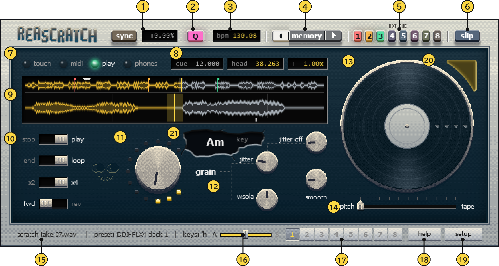

*Figure 7. The front screen (for playing). The numbers match the list under the figure*

1. **sync and the tempo window**
2. **Q (quantize)**
3. **bpm**
4. **◀ memory ▶ (memory cues)**
5. **HOT CUE 1–8**
6. **slip**
7. **Lamps**
8. **Small windows**
9. **Waveforms (two rows)**
10. **Switches**
11. **grain (grain length)**
12. **jitter, jitter off, wsola, smooth**
13. **Record**
14. **pitch ─ tape**
15. **Bottom strip**
16. **Crossfader**
17. **Samples 1–8**
18. **help**
19. **setup**
20. **Metronome**
21. **key**

Press the **[FX]** button of the `scratch engine` track to open the ReaScratch screen. It has two sides, **the front (for playing)** and **the back (setup, the controller settings)**; switch with the button at the bottom right (bottom left in the left-handed layout).

**Front** (a retro hardware look with a silver frame and a black panel. The light comes from straight above and parts cast their shadows straight down).

- **Lamps** (the row above the waveforms): each has its own colour. `touch` = mustard (counted as touching), `midi` = orange (lights when MIDI arrives), `play` = green (set to run at 1x when your hand is off), `phones` = cerulean blue (this deck is on the headphones; click to toggle)
- **Three small windows at the top right**: `cue` (the CUE point in seconds), `head` (the current read position in seconds), `+1.00x` (how fast the read position moves: 1 = normal, 0 = stopped, negative = backwards)
- **Waveforms** (two rows): the upper row is the whole track; the lower row zooms in on about 1 second around the read position (head). The glowing vertical line is the head; in the lower row the head always stays in the middle and the waveform flows past. The waveform spreads symmetrically above and below its centre line; the played part is mustard and the unplayed part grey. The faint box in the upper row is the range shown in the lower row, the faint band around the head in the lower row is the grain length, and the thin line is the CUE point. **Drag the upper row to search, drag the lower waveform to scratch, and right-click to set the CUE point there**
- **The record on the right** (on the left in the left-handed layout): grab and turn it to scratch (see “Without a controller” above). The white triangles lined up on the record show the angle of the read position, pointing straight up at the start of the track (the triangles point clockwise = forward). The record is always shown. The corner at the top right of the record (top left in the left-handed layout) is the metronome's black window: while the metronome is on its rim glows in the lamp colour, glowing brighter for a moment each time a click sounds on this deck's beats. Click it to turn the metronome on/off (see [“Listening to a metronome while you play”](listening-to-a-metronome-while-you-play.md))
- **The `key` window above the word `grain`**: the track's key (such as `Am`). The window is shaped like a hole where the panel has broken away; the key is shown large towards the left, and `key` in small text at the top right (the other way round in the left-handed layout). With the key knob turned, the key is in the lamp colour and the small text at the top right shows the semitones, like `+2`. Click it for KEY SYNC (match the other deck's key; “Musical key and KEY SYNC” under [“Features”](features.md)), `Shift`+click to go back to the sample's own key
- **The long bar under the record, `pitch ─ tape`**: sets how far the pitch follows the speed. `pitch` on the left (0) = grains whose pitch never changes, as before; `tape` on the right (1) = tape style (like a record: faster is higher, backwards plays in reverse, stopped is silent). Values in between give a proportional mix of the two; for example, at 0.5 double speed sounds half an octave higher (it is still a single sound, not two sounds blended). Drag the handle left/right (hold Shift for fine steps); double-click or right-click resets it to 0. It can also be set with `Pitch mode (tape)` on the setup side
- **Switches on the left** (one column): the words on either side of each switch show its two states. `stop / play` (stops / runs at 1x when your hand is off), `end / loop` (stops at the end / returns to the start), `x2 / x4` (number of overlapping grains), `fwd / rev` (direction of the grains when you move backwards). Hover over a switch to see its full name and description in the strip at the bottom
- **The big knob in the middle, `grain`**: grain length. The dots around it form a C shape, rising clockwise from the bottom right, through the bottom, left and top, to the top right
- **Knobs on the right** (two pairs rising to the right, stacked into a parallelogram; names at each knob's top left): `jitter` and `jitter off` (wobble when stopped), `wsola` (aligning the joins), `smooth` (how smoothly the head follows the jog). The ones joined by lines are the ones related to `grain`
- **Crossfader in the bottom strip** (`A ─handle─ B`): shows the crossfader position received over MIDI (it cannot be moved on screen). The groove lights up as far as this deck is audible, and the letter on this deck's side (A or B) is shown darker. When an envelope fader (a pattern's cuts, for example) has closed the sound, a faint "shadow handle" moves that far towards the closed side
- **Bottom strip**: normally shows the preset name; hover over a control to see its value and description. While a pattern is playing (triggered from a PATTERN pad or placed on an envelope lane), its name appears right after the deck name, as in `pattern (lane): Baby`. `help` at the bottom right (or the `?` key) shows the key list and notes from the author (click anywhere, or press `Esc` or `?`, to close it; while it is shown, the controls under it do not respond). `setup` to its right switches to the back (setup) side
- **Buttons and small windows at the top (above the frame)**:
  - `slip`: SLIP mode on/off (toggles with each press; while on, it sits slightly lower and glows blue)
  - `Q`: quantize on/off (glows pink while on). With a BPM, the lower waveform shows a line at every beat whether quantize is on or off; each bar's first beat (every 4 beats from the beat grid) is thicker and brighter, and the loop's two ends are in the lamp colour
  - `bpm`: the BPM at the current tempo (hover to see the sample's original BPM in the bottom strip). When the label reads `bpm?`, the sample's BPM has decimals and does not match its length: it is often a little off, so tap the tempo or type it. While playing, clicking the `bpm` box on the beat taps the tempo (like `T`); while stopped, or with Shift+click, you type the BPM
  - Tempo window (`+0.00%`): drag left/right or use the wheel to change it; right-click or double-click resets to 0%
  - `sync`: SYNC on/off (glows orange while on)

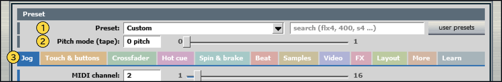

*Figure 8. The upper part of the setup screen (the back)*

1. **Preset (controller)**
2. **Pitch mode (tape)**
3. **Tabs**

**Back (setup)** (a screen listing the settings)

- Settings are shown as "name: value box  min ─slider─ max". Colours mark their roles (grey = preset, blue = jog (the part you turn), orange = touch and buttons, green = crossfader, purple = hot cues, teal = spin and brake, red = beat, brown = samples, indigo = video blending, crimson = video effects, yellow-green = layout, reddish brown = the controller's numbers (`More`), dark grey = checking the controller (`Learn`)). The lower part is switched with 12 tabs.
- `Preset` (choosing the controller) and `Pitch mode (tape)` (the same as the `pitch ─ tape` bar on the front) are here too. `Lamp colour` (the colour of the read position line and the lit numbers: yellow / blue) is on the `Layout` tab.

Controls (front and back):

- Drag knobs up/down and sliders left/right. They move relative to the current value, so a click alone never makes the value jump. **Hold Shift while dragging for 1/10 steps**
- Switches and choices change when you click and release
- Mouse wheel: one step at a time (10 steps with Shift)
- **Double-click or right-click**: resets the control to its default (only right-clicking the waveform sets the CUE point instead)

Screen size: drag the edge of the plug-in window to enlarge it and the screen is scaled up by whole numbers (2x, 3x, …) and centred in the window (in-between scales are not used, so the pixels stay crisp).

The WAV to play is chosen not on screen but by the import script (`reascratch_import_video.lua`).

The parameters fall into the following 13 groups. The names in the tables are the former parameter names; the setup screen shows shorter ones (for example `Hot cue pad MIDI channel` → `Pad MIDI channel:`). The controller number settings are not sliders, so they do not appear in REAPER's parameter list.

### 1. Preset

| Parameter | Default | What it does |
|---|---|---|
| **Preset** | Custom | Loads a complete set of settings for a controller (jog, touch and buttons, crossfader, pads, tempo, video effect knob and so on) in one go. To keep values you changed by hand when you reopen the project, set it back to `Custom` |
| **Lamp colour** | Yellow | Colour of the read position line, the grain ring dots, the loop end lines, the lit numbers and the like (yellow / blue). The lamps keep their own colours. Switched on the setup screen's `Layout` tab |
| **Layout** | Right-handed | The layout of the front page. `Left-handed` swaps left and right, with the record on the left (with two decks side by side, the records are on the outside). When you make deck B, deck A starts as `Left-handed`. The setup screen's `Layout` tab |

### 2. Sample and playback

| Parameter | Default | What it does |
|---|---|---|
| **Sample file** | (empty).wav | The WAV to play (in `Data/ReaScratch_samples/`). The import script chooses it for you. If it shows `ERR`, import again |
| **Untouched transport** | Stop | What happens while your hand is off the jog. `Stop` = stops, silent; `Play` = runs at 1x. Toggled by the controller's PLAY button. Opening a project or loading the FX always starts at `Stop`, whatever value was saved |
| **Cue position (s)** | 0 | Where the CUE button (`C` key) returns to (seconds). Set by pressing CUE while stopped, right-clicking the waveform, or `Shift`+`C`. On import it is set where the sound starts (5 ms before the first sample over −45 dB in the first 30 s); the file and video are not cut |
| **At end of sample** | Loop to start | What happens at the end. `Stop (silent)` = silent if you reach the end with your hand off (if you are touching, the last grain keeps sounding and you can pull back); `Loop to start` = go back to the start (pulled back past the start, it carries on from the end). With a BPM, see below the table |

**At end of sample**: When a BPM is set, it loops from the CUE (or the start of the sample if there is none) to the first bar line after the end of the sample. From the end of the sample to that bar line is silence, and the video holds its last frame (so the loop is a whole number of bars and the beat stays in time). A BPM entered later changes the loop length immediately.

### 3. Jog

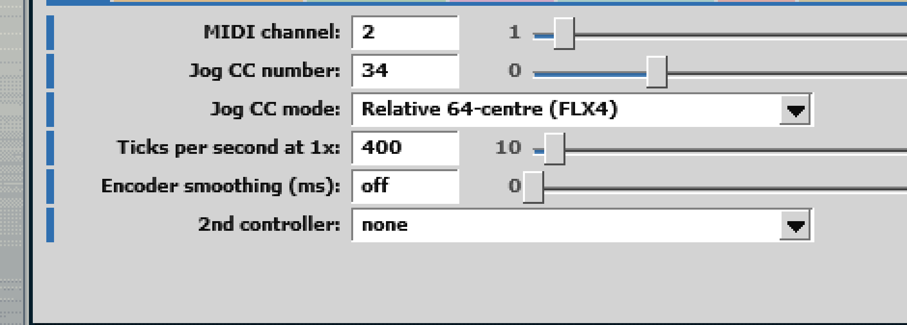

*Figure 9. The Jog tab of the setup screen*

| Parameter | Default | What it does |
|---|---|---|
| **MIDI channel (deck)** | 2 | The MIDI channel to listen to. On DJ controllers the deck number is often the channel |
| **Jog CC number** | 34 | The CC number of the jog / knob |
| **Jog CC mode** | Relative 64-centre (FLX4) | How the jog values are read (8 modes): 3 relative (64-centre / two's complement / sign bit), 2 absolute (7-bit / 14-bit), CDJ speed, Denon platter position, and an absolute knob that can be turned endlessly. For the mode names and details, see [“Controller setup and MIDI mapping”](controller-setup-and-midi-mapping.md) |
| **Jog ticks per second at 1x** | 400 | How many jog ticks per second correspond to normal speed. The smaller the value, the further the same turn moves |
| **Encoder smoothing (ms)** | 0 | For rotary encoders. Estimates the turning speed from the spacing of the ticks and moves smoothly at that speed for this long. 0 moves directly with each tick (for DJ jogs) |
| **2nd controller** | none | The preset of a second controller (for example Reloop Buddy + APC40 mkII). See [“Two controllers at once”](controller-setup-and-midi-mapping.md#two-controllers-at-once-eg-reloop-buddy--apc40-mkii) |
| **Head smoothing (ms)** | 15 | (Not on the setup screen: the `smooth` knob on the front page.) Smooths the jog input. Larger = the head lags behind more (hides jitter); smaller = more direct. The actual delay is about 1.5 times this value (about 24 ms at the default). In tape mode, a value that is too small makes the pitch flutter |

### 4. Touch and buttons

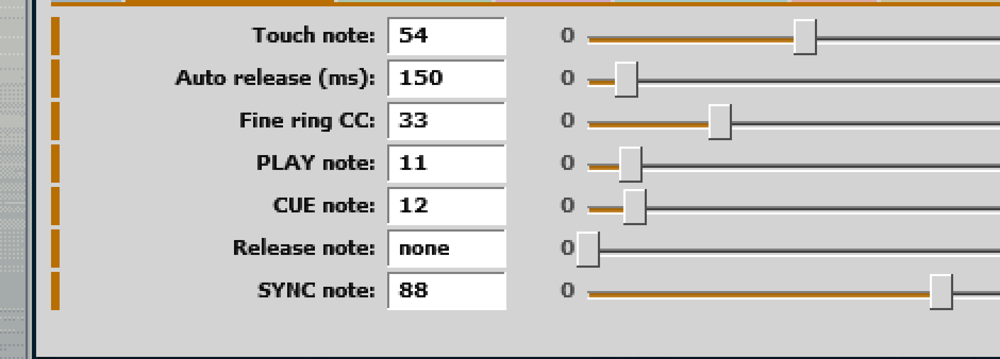

*Figure 10. The Touch & buttons tab of the setup screen*

| Parameter | Default | What it does |
|---|---|---|
| **Touch note (0=none)** | 54 | Note number of the platter's touch sensor. 0 gives no-touch mode (counted as touching only while turning). With a number set, turning the side without touching the top nudges the pitch while playing (about 0.18 s per turn) and moves the position while stopped. Turning in the 0.15 s after you let go is ignored |
| **Auto release (ms, 0=hold)** | 150 | In no-touch mode, how long after the turning stops before it counts as "hand off". 0 freezes on the spot and keeps sounding (hold) when you stop; stop it with the `Release note` button |
| **Fine ring CC (0=none)** | 33 | A CC for fine adjustment (the outer ring on the FLX4, for example). Moves at 1/4 of the jog's speed. 0 turns it off |
| **PLAY note** | 11 | Note number of the button that toggles `Untouched transport` |
| **CUE note** | 12 | Note number of the CUE button (works like a CDJ; both press and release are read) |
| **Release note (0=none)** | 0 | Note number of a button that ends a hold and goes silent. 0 turns it off |
| **Cue (headphones: this deck on channels 5/6)** | Off | Listen to this deck on headphones (Cue). Also toggled by clicking the `phones` lamp or the `H` key. Not on the setup screen; it is in REAPER's parameter list. See [“Listening to a deck on headphones (Cue)”](listening-to-a-deck-on-headphones-cue.md) |
| **Cue button note (deck channel; -1 = none)** | −1 | Note number of the button that toggles Cue (on the channel of `Mixer MIDI channel`, where 0 = the deck's channel; −1 = not used). Presets set it to the headphone CUE button (Reloop Buddy: 27; DDJ-FLX4, FLX2 and others: 84; without the button: −1) |

### 5. Sound (how grains are made)

| Parameter | Default | What it does |
|---|---|---|
| **Grain length (ms)** | 50 | Grain length. Shorter = more mechanical and grainy; longer = smoother and closer to the original (and the repeat cycle when stopped gets longer too) |
| **Overlap (grains)** | 4 | How many grains overlap at once (2 or 4). 4 is smoother, 2 is lighter |
| **Grain direction** | Always forward | Direction of the grains when moving backwards. `Always forward` = grains always play forward (words stay intelligible when you pull back); `Follow motion` = grains play in reverse too (a real backspin sound) |
| **WSOLA search (ms, 0=off)** | 10 | Searches ±this much for a start point where the new grain's waveform matches the continuation of the previous grain. Reduces phase mismatch at the joins (a flanger-like smear). 0 turns it off |
| **Freeze jitter (ms)** | 8 | While the head stands still, shifts each grain's start point randomly by up to this much. Breaks up the buzzing repeat when stopped |
| **Jitter off above (x)** | 0.15 | Above this speed (1 = normal) the jitter is turned off, so the sound does not get muddy while moving |
| **Pitch mode (0=pitch-locked, 1=tape)** | 0 | 0 = grains (the pitch does not change), 1 = tape style (the read speed becomes the pitch; silent when stopped); in between, the proportion by which the pitch follows the speed (0.5 gives half an octave up at double speed). Above 0, moving backwards also plays the sound in reverse. More below the table |

**Pitch mode**: In between, the grain is read at "speed to the power of this value". Jumps from CUE and hot cues are crossfaded over 5 ms. Above 0, it reads with 6-point interpolation and removes the low rumble from slow movement and direction changes (up to 50 Hz when stopped, 5 Hz at 1x and above). Grain alignment (WSOLA) and jitter get weaker the closer it is to 1, and stop at 1.

### 6. Crossfader

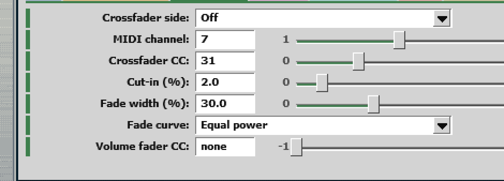

*Figure 11. The Crossfader tab of the setup screen*

| Parameter | Default | What it does |
|---|---|---|
| **Crossfader side** | Off | Which side of the crossfader this deck is on. `Left (deck 1 side)` cuts when the fader goes to the right end; `Right (deck 2 side)` cuts at the left end. `Off` does not use the crossfader |
| **Crossfader MIDI channel** | 7 | MIDI channel of the crossfader (on the DDJ-FLX4 the mixer section uses 7) |
| **Crossfader CC (LSB = CC+32 if sent)** | 31 | CC number of the crossfader (DDJ-FLX4: 31). Controllers that also send CC+32 (14-bit) are read in finer steps |
| **Cut-in (% from closed end)** | 2 | How far from the closed end the sound starts (the gap). Smaller = the sound comes in right next to the end |
| **Fade width (%, 0=instant)** | 30 | Distance from where the sound starts to full volume. 0 opens and closes instantly (a sharp curve for scratching). Larger values change smoothly |
| **Volume fader CC (mixer channel; -1 = none)** | -1 | CC number of the deck's volume (channel) fader (on the channel of `Mixer MIDI channel`, where 0 = the deck's channel; Reloop Buddy: 28, DDJ-FLX4 and DDJ-FLX2: 19). Pulling it down lowers the sound and, with two decks, fades that deck's picture. The `9` / `0` keys move it too. -1 = not used |
| **Fade curve** | Equal power | How the volume changes. `Linear` or `Equal power` (no dip in the middle when mixing two decks). On the setup `Crossfader` tab |

Switching between cut and pass uses a crossfade of about 1 ms to avoid clicks. Until crossfader MIDI has been received, it is treated as "open".

### 7. Hot cues

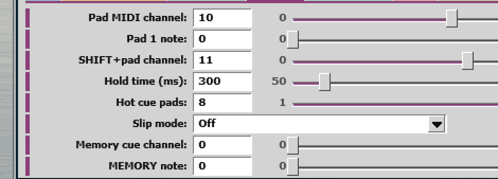

*Figure 12. The Hot cue tab of the setup screen*

| Parameter | Default | What it does |
|---|---|---|
| **Hot cue pad MIDI channel (0=none)** | 10 | MIDI channel of the pads (DDJ-FLX4 HOT CUE mode: 8 for deck 1, 10 for deck 2). 0 = not used |
| **Hot cue pad 1 note (pads 2-8 = +1..+7)** | 0 | Note number of pad 1. Pads 2–8 are the next 7 numbers (DDJ-FLX4: 0–7, Reloop Buddy: 20–27) |
| **Number of hot cue pads (the pad 1 note and the next ones)** | 8 | How many pads, starting from pad 1, are used for hot cues (1–8). Use fewer on controllers with 4 pads, or where the following numbers belong to other buttons (such as the other deck's pads). Presets set this |
| **Hot cue SHIFT+pad channel (clear, 0=none)** | 11 | MIDI channel of SHIFT + pad (clear) (DDJ-FLX4: 9 for deck 1, 11 for deck 2). 0 = not used |
| **Hot cue hold time (ms)** | 300 | Pressing longer than this counts as "held" (returns to where you were on release). Shorter presses "jump and keep playing" |
| **Slip mode** | Off | When on, from the moment you start scratching or press a hot cue while playing, playback keeps running in the background at 1x; when you let go, it jumps to that position and keeps playing. Toggled by the `slip` button at the top right, the `S` key, or the setup `Hot cue` tab. More below the table |
| Hot cue 1–8 (s, -1=empty) | -1 | Stored positions (seconds). -1 = empty. Not shown on screen; saved in the project (1–4 are sliders 42–45, 5–8 are 110–113; remembered per sample) |
| **Memory cue MIDI channel (0=none)** | 0 | MIDI channel of the memory cue buttons. 0 = not used (off by default, because the DDJ-FLX4 has no dedicated buttons) |
| **Memory cue MEMORY note (CALL back / next / DELETE = +1..+3)** | 0 | Note number of MEMORY (store). CALL (back), CALL (next) and DELETE (clear) are the next 3 numbers |

**Slip mode**: Scratching can be with the jog, record, waveform or the `X` key. A hot cue jumps to the background position and keeps playing when released after being held longer than `Hot cue hold time`. The background position is shown as a faint line on the waveform. Starting from a stopped state behaves as when off (a hot cue returns to the position before you pressed and stops; a scratch stays where it is). A short hot cue press, or pressing PLAY while holding, also keeps playing from the hot cue as when off. While on, the spin after letting go (`Spin on release`) does not happen. The CUE button and searching on the upper waveform end the background playback. When switching samples while on (and playing), samples you are not using also run in the background and play from that much further on when you come back (if you switch while scratching, it counts from the background position).

Memory cue positions are not parameters; they are saved in the project as the JSFX's saved data (up to 32). They survive running `reascratch_setup.lua` again (when setup reloads the JSFX, it carries over the parameter values, saved data and envelopes as they are).

### 8. Spin and brake (setup `Spin & brake` tab)

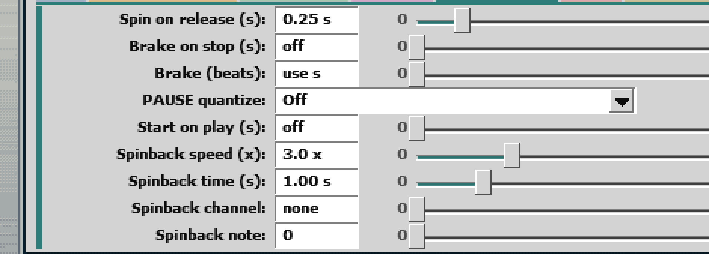

*Figure 13. The Spin & brake tab of the setup screen*

| Parameter | Default | What it does |
|---|---|---|
| **Spin on release (s to lose 1.8x, 0=off)** | 0.25 | If you let go while turning hard (touch or mouse button), the record keeps spinning with that momentum, then slows at a steady rate back to 1x (or a stop with `stop`); for rewinds. The value is the seconds to lose the momentum of one turn per second (1.8x). It only acts when your hand's speed differs from the destination by 1x or more. Touching again, CUE, a hot cue or a search stops it. 0 turns it off |
| **Brake on stop (s from 1x to still, 0=off)** | 0 | When you stop with the PLAY button (`Space`), it slows at a steady rate instead of stopping at once (a turntable brake). The value is the seconds from 1x to standstill. CUE, hot cues, memory cues and the end of the track stop at once. Pressing PLAY during the brake goes back to playing |
| **Brake on stop in beats** | 0 | Sets the brake length in beats (0–4, in steps of 0.25): the slowdown from the current speed to standstill takes this many of this deck's beats (still in time when tempo or SYNC changes the speed). While 0, or without a BPM, the seconds value above is used. `Brake (beats)` in setup |
| **PAUSE quantize** | Off | With quantize (`Q`) on, makes stopping with the PLAY button wait for the beat (`1 beat`, `1/2 beat (8th)`, `1/4 beat (16th)`). The grid is the other deck's beat if that deck is playing, otherwise this deck's. More below the table |
| **Start on play (s from still to 1x, 0=off)** | 0 | When you play with the PLAY button, it speeds up at a steady rate from standstill to 1x (motor start-up). The value is the seconds to reach 1x |
| **Spinback speed (x backward)** | 3 | How fast the spinback (`B` key or the MIDI button below) throws backwards (times normal speed) |
| **Spinback time (s to stop)** | 1 | Seconds for the spinback to slow to a stop. After it stops, the deck is stopped |
| **Spinback MIDI channel (0=none)** | 0 | MIDI channel of the spinback button. 0 = not used (off by default, because the DDJ-FLX4 has no dedicated button) |
| **Spinback note** | 0 | Note number of the spinback button |

**PAUSE quantize**: A press up to 0.03 s after a grid line stops at once. With a brake, the brake starts at the grid line. Pressing PLAY again while waiting keeps playing without stopping (touching, searching or CUE also cancel it). On a loop shorter than the grid step, it stops when the loop returns to its start.

The pitch follows the bar at the bottom (`pitch ─ tape`). Towards `pitch` the pitch does not change and the grains slowly advance and stop; for the pitch-dropping slowdown effect, move the bar towards `tape`. Touching again, or CUE, a hot cue or a search, ends the slowdown and the spinback.

### 9. Beat-quantized jumps (setup `Beat` tab)

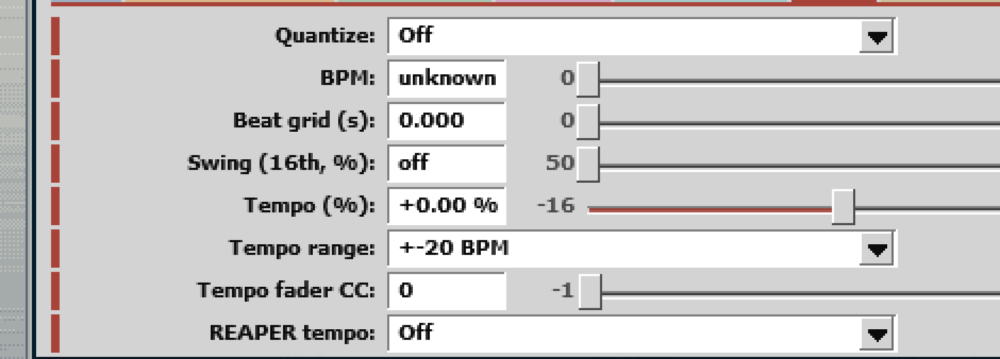

*Figure 14. The Beat tab of the setup screen*

| Parameter | Default | What it does |
|---|---|---|
| **Quantize (jumps wait for the next beat)** | Off | When On, hot cues, memory cue CALL, the return on releasing a held hot cue, and CUE wait for the next beat before jumping while playing. Immediate while stopped, touching or searching. Also toggled by the `Q` key and the `Q` button at the top. More below the table |
| **BPM (0=unknown)** | 0 | The sample's BPM. Quantize does not work while it is 0. Estimated and entered automatically on import. Also entered by tapping along with the beat while playing: the `T` key, or clicks on the front page's `bpm` box (tap tempo, from the 4th tap). More below the table |
| **Beat grid (s, any beat)** | 0 | The position (seconds) of any one beat in the sample. Beats line up from here at the BPM's spacing. `Shift`+`T` sets it to the current read position. In setup, the wheel moves it by 1 ms (10 ms with Shift) |
| **Tempo (%)** | 0 | Playback speed (%). The pitch does not change (even with `Pitch mode` towards tape). The picture stretches at the same rate. Changed by the DDJ-FLX4 tempo slider, the `↑` `↓` `PageUp` `PageDown` keys, or the window at the top of the screen. Changing it by hand turns SYNC off |
| **Tempo range** | ±20 BPM | How far from the sample's BPM the ends of the tempo slider are, in BPM (7 ranges, ±5 to ±60 BPM) or in % (±8%, ±16%, ±50%). `Shift`+`Y` or `SHIFT` + `BEAT SYNC` on the DDJ-FLX4 cycles within the % ranges or within the BPM ranges. SYNC can go up to ±50%. More below the table |
| **Sync (follow the other deck's BPM)** | Off | While on, keeps following the other deck's BPM (including its tempo). The beat positions are lined up when you turn it on and when you start playing with it on (see below the table). Near double or half BPM, it matches at double or half. The `sync` button, the `Y` key, or `BEAT SYNC` on the DDJ-FLX4 (not on the setup screen) |
| **Swing (16th, %; 50 = straight, 67 = triplet)** | 50 | While playing, delays the off-beat 16ths (swing). 50 = straight, 67 = triplet. Based on the BPM and the beat position (`Beat grid`). Envelope patterns placed later and patterns played from the PATTERN pads also follow this swing if it is above 50. See [“Fitting the swing”](scratching-from-envelopes-patterns.md#fitting-the-swing) |
| **Tempo fader CC (deck channel; LSB = CC+32; 128 = pitch bend; -1=none)** | 0 | CC number of the tempo slider (on the deck's MIDI channel; CC+32 is read as the low byte for finer steps. DDJ-FLX4: 0). 128 = pitch bend (Reloop controllers; see below the table). -1 = not used. When the slider starts to take effect: also below the table |
| **SYNC note (note+8 = tempo range; 0=none)** | 88 | Note number of the SYNC button (on the deck's MIDI channel; DDJ-FLX4 `BEAT SYNC`: 88). This number + 8 switches the tempo range (`SHIFT` + `BEAT SYNC`: 96). 0 = not used. On the setup `Touch & buttons` tab |
| **REAPER tempo** | Off | Sync with REAPER's own tempo (per deck): **SYNC follows REAPER** or **REAPER follows this deck** (the difference is below the table). One deck cannot do both |

**Quantize**: Jumps land on the same spot within the beat, so the beat is not broken. A press up to 0.03 s after a beat jumps immediately (pressing slightly late does not make you wait a whole beat). If the other deck is playing, pressing PLAY while stopped waits for the start of its next bar (every 4 beats from its beat grid) before playback starts (press again while waiting to cancel; if the other deck is stopped, playback starts immediately). The value order is On = 0, Off = 1 (in older projects this slot held the record-display setting).

**Sync**: The beat positions can be off by up to one audio block because of the order in which the decks are processed.

**BPM**: A clip of 20 seconds or less (a drum loop, for example) gets the tempo that fits a whole number of beats into its length. Since a loop plays at the speed determined by its length, decimal BPMs are kept. When a BPM with decimals does not fit the sample's length, the front page's label reads `bpm?`. In setup, the mouse wheel moves it by 0.1 (by 1 with Shift). Click the front page's `bpm` box while stopped, or Shift+click it, to type it (Enter = set, Esc = cancel; it is the sample's BPM, whatever the tempo).

**Tempo range**: The BPM ranges are ±5, ±10, ±15, ±20, ±30, ±40 and ±60 BPM (with a 131 BPM sample at ±20 BPM, the ends are exactly 111 and 151 BPM). With the % ranges, for samples with a known BPM the ends are rounded to the nearest whole BPM (131 BPM at ±16% gives ±21 BPM). For samples without a BPM, the BPM ranges act as ±16%. On the DDJ-FLX2, `SHIFT` + `BEAT SYNC` selects the pad mode, so it does not switch the range.

**Tempo fader CC**: 128 (pitch bend) is used by the Reloop Mixon 4, Beatmix 2/4, Mixon 8 Pro, Touch, Terminal Mix, Beatpad and Beatpad 2. When the slider position differs from the current tempo (after SYNC, after a key change, after changing the range, right after opening), it has no effect until the slider passes the current tempo's position (soft takeover). From then on the slider takes over and SYNC turns off.

**REAPER tempo**:

- **SYNC follows REAPER**: the `SYNC` button follows REAPER's tempo instead of the other deck (half / double time too). While REAPER plays, the deck is put on REAPER's beat when SYNC goes on, when the deck starts and when REAPER starts.
- **REAPER follows this deck**: while this deck plays and is louder than the other on the crossfader, REAPER's tempo is set to this deck's BPM (including its tempo; while the video sync runs. In a project with a beats timebase the kit's tracks are set to time).

### 10. Samples (setup `Samples` tab)

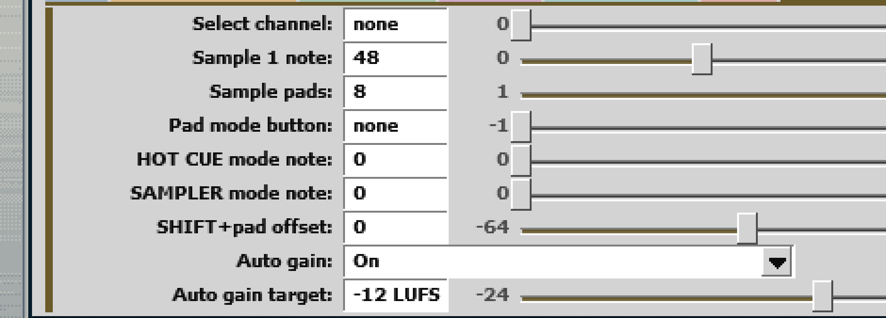

*Figure 15. The Samples tab of the setup screen*

| Parameter | Default | What it does |
|---|---|---|
| **Sample select MIDI channel (0=none)** | 0 | MIDI channel of the pads that choose samples. 0 = not used (the DDJ-FLX4 preset uses Deck 1 = 8, Deck 2 = 10) |
| **Pad mode button note (deck channel; -1 = no pad modes)** | -1 | Note number of the pad mode button (on the deck channel; Reloop Buddy: 32). Hold it and press a pad to change mode (8 modes; see [“Pad modes”](pad-modes-loops-filter-and-effects.md#pad-modes)). -1 = no modes (the DDJ-FLX4 and others whose pads send different numbers per mode use `Pad modes by notes`) |
| **HOT CUE mode note / SAMPLER mode note** | 0 / 0 | The note number that arrives on the pad channel for mode button + pad (Reloop Buddy: `HOT CUE` = 0, the `SAMPLER` label = 11). In the Buddy preset the `SAMPLER` label is FILTER TYPE (no mode for choosing samples). Other modes: below the table |
| **SHIFT+pad note offset (0 = the pad notes on the SHIFT channel)** | 0 | How much is added to the pad's number for SHIFT + pad (Reloop Buddy: 8, giving 28–35 on the same channel). 0 = the same numbers as the pads (the DDJ-FLX4 and others where SHIFT changes the channel). Negative values are allowed (APC40 mkI: −1) |
| **Sample select note of slot 1 (2-8 = +1..+7)** | 48 | Note number of the pad for sample 1. Samples 2–8 are the next 7 notes (DDJ-FLX4 `SAMPLER` mode: 48–55) |
| **Number of sample select pads (the sample 1 note and the next ones)** | 8 | How many samples, starting from sample 1, can be chosen with pads (1–8). Same idea as the number of hot cue pads |
| **Auto gain** | On | Brings each sample to the target loudness (see below) |
| **Auto gain target** | -12 LUFS | The loudness the samples are brought to (-24 to -6 LUFS; higher = louder) |
| Sample file 2 – Sample file 8 | (empty).wav | Audio files of samples 2–8 (sample 1 is `Sample file`). The import script fills them in. Empty samples point to the contentless `(empty).wav` |
| Sample slot (1-8) | 1 | The sample in use. Read and written by the import script and the video sync script |
| Clear sample cues | 0 | Used by the import script to clear a replaced sample's CUE, hot cues, memory cues and BPM (no need to touch it) |

**HOT CUE mode note / SAMPLER mode note**: The numbers of the other modes are in the `Pad modes` group of the setup screen's `More` tab (group 13 of the parameter reference). The settings keep the names of earlier modes: `AUTO LOOP mode note`, `TOUCH FX mode note`, `SLICER mode note` and `BOUNCE LOOP mode note` pick the mode of that name, `MEMORY mode note` picks PITCH PLAY, `FILTER TYPE mode note` picks NEURAL MIX, and `VIDEO FX mode note` picks a mode that chooses video effects (pads 1–8 keep video effects 1–8 on; pressing the lit one again turns it off).

**Auto gain**: Like auto gain in DJ software, each sample's loudness is measured when it is imported or loaded (measured according to the ITU-R BS.1770 / EBU R128 broadcast loudness standards), and while it plays, the deck's gain is adjusted to reach the target loudness. Switching samples keeps about the same loudness. Gain is increased only until the sample's peak reaches -1 dBFS (to prevent clipping), so quiet samples may remain below the target.

- It works before the effects, the channel volume and the crossfader (the monitor (Cue) sound gets the same level)
- Samples imported with an older kit (before auto gain) have not been measured yet. Running setup again measures every sample of both decks (about a second each)
- The values are saved in the project for each sample. In the setup screen's `Samples` tab, you can turn it on / off and set the target for each deck

Each sample's position, CUE, hot cues, memory cues and BPM are saved in the project as the JSFX's saved data.

### 11. Decks and video blending (setup `Video` tab)

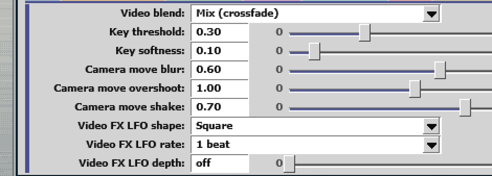

*Figure 16. The Video tab of the setup screen*

| Parameter | Default | What it does |
|---|---|---|
| **Video blend** | Mix | How deck B's picture is layered over deck A's (while the crossfader is between the ends). 0–8 are blends, 9–37 transitions. How each looks: “Blends and transitions” below. Deck A's setting is used |
| **Key threshold** | 0.30 | The key's threshold. With `Luma key`, parts darker than this become see-through. With `Chroma key`, how green a part must be to become see-through (0.3 is standard) |
| **Key softness** | 0.10 | For `Luma key`, the width of the soft edge between see-through and solid |
| **Camera move blur** | 0.60 | How strong the camera moves' motion blur is. It is made by layering pictures from just before and after the move's position. 0 = no blur |
| **Camera move overshoot** | 1.00 | How far a camera move goes past its end and comes back. 1 = normal, 0 = no overshoot, 2 = a big bounce |
| **Camera move shake** | 0.70 | How strong the shake is in `Shake cut` and when `Drop bounce` lands. The colours split with the shake |
| **Video FX LFO shape** | Square | The shape of the wave that raises and lowers this deck's video effect amounts with the beat: `Sine`, `Triangle`, `Square` (on for the first half of each cycle), `Saw down` (full on the beat, then fading), `Saw up`. All are full on the beat |
| **Video FX LFO rate** | 1 beat | The length of one cycle (1/4 to 8 beats). A deck without a BPM runs as if at 120 BPM |
| **Video FX LFO depth** | off | How far the amounts go down (0 = off, 1 = all the way to 0). Applies to the chosen effect, the FX knobs, the echo and bitcrusher faders, the vibrato fader's picture and sound, and the pads (not Strobe). The mixed picture's effect uses deck A's setting |
| Deck | A | Whether this JSFX is deck A or deck B (set by setup; not shown on screen) |

The three Camera move values can also be automated; the three Video FX LFO values cannot. All six values are saved with the project.

On the Reloop Buddy, turning the FX knob while holding the mode button changes `Key threshold` (it takes effect when the blend is `Luma key` or `Chroma key`). Turning the FX knob with nothing held changes `Key softness` (this is the same value as the transition edge softness).

#### Blends and transitions

The images in the table below were taken with the test pattern on deck A and the 3D model on deck B (the picture of a sound-only sample, as a still with a green square added at the bottom left to show the `Chroma key`). The blends are at the crossfader's middle; the transitions are 40 % of the way from A's end. From `Zoom` on, the two pictures are never on screen together at a single place, so each is shown at 40 % (left) and 60 % (right). `Picture in picture` and `PiP to corner` were shot with deck A's and B's pictures swapped, so that the 3D model is in the small window. All other settings are at their defaults (`Key threshold` 0.30, `Key softness` 0.10 and so on).

| Kind | Look |
|---|---|
| Before blending | Left: deck A alone; right: deck B alone |
| Mix | An ordinary crossfade |
| Add | Adds the two pictures' brightness (brighter) |
| Subtract | Subtracts B from A (darker) |
| Multiply | Multiplies the two (darker; B's black stays black) |
| Overlay | B's light parts lighten A and its dark parts darken A. A's white and black stay as they are, and B shows only in A's mid-tones (in the sample, A's background is white, so it looks almost like A alone) |
| Soft light | B gently lightens or darkens A. As with Overlay, A's white and black stay as they are |
| Hard light | B's light parts lighten A and its dark parts darken A (stronger) |
| Luma key | B's dark parts are see-through (`Key threshold`, `Key softness`) |
| Chroma key | B's green is see-through (`Key threshold`) |
| Wipe right | An edge crosses from left to right |
| Wipe down | An edge crosses from top to bottom |
| Wipe diagonal | An edge crosses diagonally |
| Split | Opens from the centre |
| Slide | B slides in from the left |
| Blinds | 8 bands open |
| Iris box | A square grows |
| Iris diamond | A diamond grows |
| Iris circle | A circle grows |
| Clock | Clockwise from 12 o'clock |
| Blocks | Blocks swap in at random (not softened) |
| Dip to black | Through black |
| Dip to white | Through white |
| Pixelate | Pixelates in the middle |
| Zoom | Zooms in |
| Punch zoom | A pulls back a little, then zooms in fast and cuts to B at the closest point; B overshoots normal size slightly and settles |
| Whip right | A flies off the screen to the right and B flies in the same direction |
| Whip up | `Whip right` upward |
| Whip down | `Whip right` downward |
| Shake cut | The picture shakes more and more toward the middle and cuts there |
| Spin zoom | Spins while zooming in, enlarged so the picture's edges stay off the screen |
| Drop bounce | A falls out, B drops in from the top and bounces |
| Tilt right | A tilts and leaves on a slant, B comes in tilted the other way, from lower left to upper right; enlarged so the top and bottom edges stay off the screen |
| Tilt down | `Tilt right` moving from upper left to lower right |
| Brush wipe | A's picture becomes a card with an irregular, sharp-cornered cut edge and is pulled out to the right like kamishibai (paper theater), revealing B from underneath. It moves in 12 stop-motion steps, tilting slightly at each step. When returning to A, B's card is pulled out to the left |
| Defocus | A goes out of focus, becomes B at the blurriest point, and B comes into focus |
| Picture in picture | A shrinks into a small window in the centre and keeps shrinking until it disappears; B is behind it from the start |
| Shatter | A turns into a line drawing whose lines break into pieces and fly apart, revealing B |
| PiP to corner | The `Picture in picture` window shrinks into the lower right corner and slides out past it |

During transitions, the crossfader position directly controls the progress (end A = A, end B = B). Once the crossfader has gone all the way to the B side, moving back toward A starts a new transition from B to A. `Wipe right`, `Wipe diagonal`, `Slide`, `Clock`, `Whip right`, `Tilt right`, `Tilt down` and `PiP to corner` then run in reverse or mirrored horizontally (with `Wipe right`, A wipes in over B from the right, so the edge moves the same way as the crossfader; `Clock` runs counter-clockwise). The camera moves get a motion blur that follows their speed (along the arc while turning). Shape edges are smoothed based on each pixel's distance to the edge and softened by `Key softness` (default 0.1 is about 5 pixels, 1 is about 40 pixels).

### 12. Video effects (setup `FX` tab)

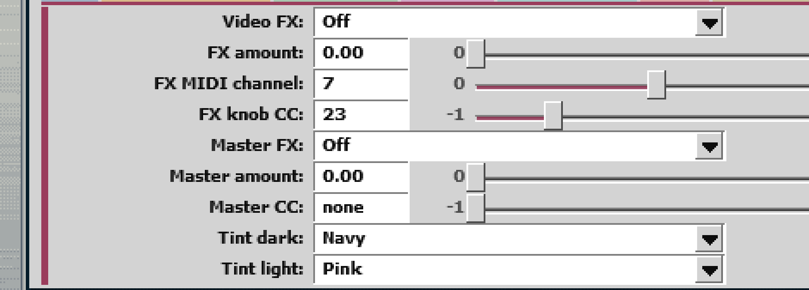

*Figure 17. The FX tab of the setup screen*

Effects are drawn by the Video processor that setup puts on the `video` track when it creates deck B. So they have no effect in projects without deck B. Neither the effect type nor the amount is shown on the front screen.

| Parameter | Default | What it does |
|---|---|---|
| **Video FX (this deck's picture)** | Off | The effect on this deck's picture (15 kinds). How each looks, and the sound it pairs with: the table in [“Sound and video effects”](pad-modes-loops-filter-and-effects.md#sound-and-video-effects). Line art and Halftone change colour when combined with `Tint` (examples below the table). These two and Zoom blur are applied before Tint and the others |
| **Video FX amount** | 0 | The amount (0 = off). What it means for each effect is below the table |
| **Video FX MIDI channel (0=none)** | 7 | MIDI channel of the knob that sets the amount |
| **Video FX CC (centre = off; FLX4 CFX knob; -1=none)** | 23 | CC number of the knob that sets the amount. Off in the middle, stronger either way (DDJ-FLX4 `CFX` knob: 23 for deck 1, 24 for deck 2; not yet tested on the real hardware) |
| **Master video FX (after the mix; deck A's is used)** | Off | An effect on the picture after the two are layered (same types as above). Deck A's setting is used |
| **Master video FX amount** | 0 | Its amount |
| **Tint dark colour / Tint light colour** | Navy / Pink | The Tint's colours: the darks of the picture become the dark colour, the lights the light colour, with a gradient between. 15 colours (below the table). The Tint after the mix uses deck A's colours |
| **Master video FX CC (on the Video FX channel; -1=none)** | -1 | CC number that sets the master video FX amount (on the `Video FX MIDI channel`; 0–127 is the amount). -1 = not used (an earlier version's 0 = not used becomes -1 when opened). The Reloop Buddy's FX knob chooses the type, so this is -1 |
| Video FX on/off note (Video FX channel; -1 = none) | -1 | Note number of a button that turns this deck's video effect on/off (Reloop Buddy FX ON: note 0 on ch 9 for deck 1, ch 10 for deck 2). Each press toggles the amount between 0 and the previous amount (1 the first time; the Buddy's bar is on while engaged). On the setup screen's `More` tab (`Video FX` group) |

**Video FX**: Colour examples for Line art and Halftone: Tint's dark colour Purple and light colour White give white lines on purple paper; Magenta and White give magenta dots on white.

What **Video FX amount** means for each effect:

- Tint, Invert, Threshold: the blend with the original picture
- Hue rotate: the angle (1 = a full turn)
- Mirror: below 0.5 left-right, from 0.5 left-right and up-down
- Kaleidoscope: the number of mirrors
- LoRez: the coarseness
- Shift RGB: the offset
- Strobe: the flash rate (1 to 1/16 beat; without a BPM, 2–16 times a second; light and dark the same number of frames each, every other frame when faster than the frame rate)
- Trails: the length of the trail
- VHS: how worn it looks
- Disc: nothing on the picture (it is fully on as soon as it is on), only the sound changes
- Line art: line thickness (takes full effect when enabled, not a blend with the original: lower values draw thin lines with fine detail; 1 draws thick lines with only rough outlines)
- Halftone: how fine the dots are (it is fully on as soon as it is on: coarse when low, fine at 1)
- Zoom blur: how far it streams

**Tint dark colour / Tint light colour**: the 15 colours are Black, White, Lamp colour (the yellow / blue of `Lamp colour`), Red, Orange, Yellow, Lime, Green, Cyan, Sky, Blue, Navy, Purple, Magenta and Pink.

### 13. Controller numbers and other settings (the setup screen's `More` tab and REAPER's parameter list)

The numbers of the controller's buttons and knobs (most are filled in by presets) are on the setup screen's `More` tab, in 8 groups (a 9th group, `Metronome`, holds the metronome's settings). To use a controller without a preset, enter the numbers there. Pick a group on the left; scroll a long group with the wheel or the bar on the right (the wheel over a value changes the value, as on the other tabs). Hover over an item to see an explanation (such as which channel it reads) in the bottom bar. `none` (−1) = not used. The names are the same as when they were in REAPER's parameter list. For how they work, see the chapter [“Pad modes, loops, filter and effects”](pad-modes-loops-filter-and-effects.md).

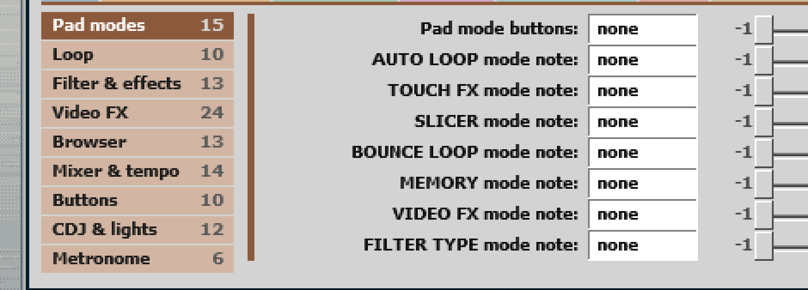

*Figure 18. The setup screen's More tab (the groups on the left, the group's items on the right)*

| Group | Items |
|---|---|
| **Pad modes** | `Pad mode buttons`, `AUTO LOOP mode note` – `VIDEO FX mode note`, `FILTER TYPE mode note` (the numbers that choose the mode), `Pad modes by notes` (the list for controllers that send a different number for each mode), `Pad layout`, `Hot cue pad order`, `Hot cues 5-8 row`, `Sample 5-8 notes`, `Sample pads scroll back / on note` (the APC40 grid layout, shifting the sample row) |
| **Loop** | `Loop knob MIDI channel` – `Reloop note` (the loop knob: turn, press, move; reloop), `Loop half note` / `Loop double note`, `Auto loop notes`, `RELOOP/EXIT note` (a single button that exits and goes back), `Relative knobs' format` (two's complement / 64-centre) |
| **Filter & effects** | `Filter morph knob CC` – `Filter cutoff knob CC`, `Filter knobs' channel`, `Filter cutoff knob channel`, `SHIFT for the filter knobs` (whether SHIFT gives them another job), `Echo / Bitcrusher / Vibrato fader`, `Fader effects on / off channel`, `Freeze note`, `Effects off while held note` and `Effects off while held (deck)` (buttons that turn all effects off for a moment) |
| **Video FX** | `Video FX on/off note`, `Video FX knob type`, `Video FX amount − / + button`, `Master video FX amount − / + button`, `Master video FX type knob CC`, `Both decks note` (while held, `PLAY`, `CUE` and `SYNC` act on both decks; the APC40's `MASTER`), `Video blend knob CC` and `Video blend note`, `FX knobs' first CC`, `DEVICE knob 1 type` to `DEVICE knob 8 type` (the 8 DEVICE knobs' types), `VHS colour`, `VHS on-screen text`, `Disc tone`, `Sound of the video FX fader`, `FX ON bar's combos` (VHS colour and three others: below the table) |
| **Browser** | `Browser section MIDI channel` – `LOAD replace (any ch)` (the BROWSE knob and the LOAD buttons; see [“Loading with the LOAD button (from the Media Explorer)”](basic-use.md#loading-with-the-load-button-from-the-media-explorer)), `PREVIEW button` and `Mode button + LOAD` (the preview's buttons; see [“Previewing a Media Explorer file”](basic-use.md#previewing-a-media-explorer-file-p-key)), `Key knob CC` (below the table), `Slot back note` (previous / next sample) |
| **Mixer & tempo** | `Mixer MIDI channel`, `Deck select note`, `Crossfader assign note`, `Mute note`, `Picture mute note` (mute only the picture), `Cue mix encoder CC`, `Tempo fader resolution` / `direction` / `centre zone` (the width in the middle that gives 0%), `Tempo range note`, `Tempo encoder CC`, `Nudge − / + note`, `Tap tempo note` |
| **Buttons** | `Cue button note` (headphone CUE), `Stop note`, `Back to CUE note`, `SHIFT note`, `Search jog CC` (SHIFT + jog = big jumps), `Knob page notes`, `REAPER metronome / record note`, `Extra buttons MIDI channel` / `note` |
| **CDJ & lights** | `Memory cue buttons' order`, `SLIP note`, `QUANTIZE note`, `REVERSE note`, `Held reverse note`, `Next sample note`, `Brake knob CC`, `Start knob CC`, `Needle search CC` (buttons on CDJs and others), `Pad and button lights` (see [“Button lights”](controller-setup-and-midi-mapping.md#button-lights)), `Light on value` (the value that turns on a one-colour light), `Crossfader end value` (the value taken as the crossfader's end; 120 on the APC40 mkII) |
| **Metronome** | `Metronome` (on/off), `Metronome follows` (which deck), `Metronome out` (where it sounds), `Stopped / in hand` (while a deck is stopped or in your hand), `Metronome volume`, `METRONOME button` (a MIDI button for on/off). See [“Listening to a metronome while you play”](listening-to-a-metronome-while-you-play.md) |

Notes (items in the `Video FX` and `Browser` groups):

- `VHS colour`: the VHS effect's tint. `Pink fringes` = red and blue fringes alike, pinkish; `Blue-white` (the default) = weaker red fringes and reds, with a cold blue-white cast over the whole picture. Per deck, saved with the project
- `VHS on-screen text`: while VHS is on, "PLAY ▶" at the top left and "SP" at the top right of the picture. Off by default. Per deck, saved with the project
- `Disc tone`: the Disc sound's tone at maximum amount. 0 (`dark`, the default) = fuller lows, duller highs; 1 (`bright`) = leaner lows, the upper mids forward. Low amounts always start bright. Per deck, saved with the project
- `FX ON bar's combos` (Reloop Buddy): while the FX ON bar is on, the FX knob sets that deck's video effect amount, `FX PARAM` ◀ ▶ picks that deck's video effect type, and `SHIFT` + the FX knob sets the amount too. Also when on: with nothing held ◀ ▶ and the FX knob pick the transition and soften it, `SHIFT` + the FX knob and ◀ ▶ set the amount and type after the mix, the mode button + ◀ ▶ and the FX knob pick the blend and set the key threshold, BROWSE sets the headphone Cue mix (with the bar or a pad, its sound), and `SHIFT` + BROWSE sets the sound after the mix (with the bar, that deck's overall sound multiplier)
- `Key knob CC`: the knob for each effect's sound amount and the key, on the browser channel. With `FX ON bar's combos` off, turned while pressed = the key threshold, with `SHIFT` too = the softness

Notes (what the values the presets fill in mean):

- `Tempo fader resolution`: `14-bit` = CC+32 is the low byte (DDJ-FLX4); `10-bit` = CC+54 is the low byte (Reloop Buddy)
- `Tempo range note`: the note that switches the tempo range (−1 = SYNC note + 8; Reloop Buddy SHIFT+SYNC: 3; DDJ-FLX2: 0 = not used)
- `Hot cue pad order`: `CDJ` = `Pad 1 note` +4 to +7 are hot cues 1–4 and +0 to +3 are 5–8, matching HOT CUE A–D and E–H on the CDJ-2000NXS2
- `Tempo fader direction`: `Reversed` = 127 is the + side
- `Mixer MIDI channel`: the MIDI channel of the volume faders, headphone Cue buttons and deck select buttons
- `Deck select note`: the deck select button (when present, the shared buttons such as PLAY act only on the selected deck)
- `Video FX knob type`: the shape of the video effect knob (0 in the middle / 0 at the left end)
- `Extra buttons`: the 4 buttons for spinback, video effect on/off, SLIP and Q
- `Pad layout`: `Across channels` = one row is the same note on channels 1–8, as on the APC40 mkI
- `Pad and button lights`: the controller to light the buttons for (`APC40 mkII` / `APC40 mkI` and others)

The values on the `More` tab are not sliders, so automation cannot move them. They are saved with the project (like the controller settings on the other tabs).

The following are not on the setup screen; view or change them in REAPER's FX parameter list (automation can move them too).

| Parameter | What it does |
|---|---|
| **CUE LOOP** | CUE LOOP on/off (same as the `L` key). Default Off |
| **Filter morph / Filter / Filter type / Filter resonance** | The filter values (Morph, Cutoff, one of the 8 types, Resonance). Changed by the knobs and the FILTER TYPE pads. Cutoff has a dead zone of ±0.05 around the centre, with no filter |
| **Echo / Bitcrusher / Vibrato** | Amounts of echo, bitcrusher and vibrato (APC40 track faders 2–4) |
| **Echo length / Echo feedback / Vibrato step / Gate / Strobe step** | Echo length (1/8 to 2 beats) and feedback, the vibrato step (1 to 1/8 beat), and the steps of the gate and Strobe |
| **Key** | Pitch (±12 semitones; the tempo does not change) |
| **Sound of the video FX** | How much the video effects affect the sound (0–1, default 1; 0 = picture only) |
| **Video opacity / Mute** | This deck's picture strength (the sound stays) / mute |
| **FX knob 1 – FX knob 8, FX knob: Strobe** | Amounts of the video effects set by the APC40's `DEVICE CONTROL` knobs (each knob's type is chosen in setup's `More` tab → `Video FX`; Strobe is `SHIFT` + knob 8). Below 0.05 is a dead zone with no effect |
| Envelope scratch, Envelope fader, Envelope vfx …, Envelope filter …, Envelope pad FX, Envelope master … | The envelope lanes (patterns, recorded performances). No need to touch them ([“Scratching from envelopes (patterns)”](scratching-from-envelopes-patterns.md)). A recorded performance is written to them when you stop recording |
| New file in slot – Slot command B | Used by scripts (such as LOAD) to hand samples to the JSFX (no need to touch them) |

### Display only (values to look at; they appear in REAPER's parameter list, and the small windows and lamps at the top right of the screen show the same information)

| Parameter | What it shows |
|---|---|
| Head position (s) | The current read position (seconds). The video sync script reads this to move the edit cursor |
| Head speed (x) | The current head speed (1 = normal, negative = backwards) |
| Touched | 1 when counted as touching |
| MIDI messages received | How many MIDI messages arrived on this channel (on screen, the `midi` lamp lights with each one). If it does not go up when you use the controller, MIDI is not arriving |
| Blocks processed | Number of audio blocks processed (for checking that it runs) |
| Output peak (linear, pre-limit) | The highest output since loading (1.0 = 0 dBFS; anything above is clipped) |
| File sample rate / File length (frames) | Sample rate and length of the loaded WAV |
| Sample memory (values) | How much audio can be held (number of values across all channels). Depends on the REAPER version |
| Sample cut (s of file, 0=whole) | When a track was too long to load completely, the length of the whole file (seconds). 0 if it all loaded |
| Crossfader gain | The volume set by the crossfader (0–1). While it is below 0.5, the video sync script mutes the `video` track to hide the picture |
| Crossfader position | The received crossfader position (0 = left end, 1 = right end) |
| GUI scale | Screen scale (1x, 2x, …) |
| CPU worst block / CPU average | How heavy this JSFX is. Worst = the share of its time slot (the buffer length) used by the heaviest single block in the last second; average = the average share of real time. Read by the load test script |
| Sample load time | CPU time used by the last sample load (milliseconds, the total of all the pieces) |
| Load test | The switch used by the load test script (while on, the deck scratches by itself). Always off when a project is opened |
| Dropout threshold / Dropouts | Dropouts counted by ReaScratch itself. One is counted whenever audio processing falls behind real time by the threshold (ms; 0 = one block's length + 3 ms) or more. The load test script sets the threshold and reads the count |

---

---

← [Pad modes, loops, filter and effects](pad-modes-loops-filter-and-effects.md)   |   [Contents](../README.md#documentation)   |   [Controller setup and MIDI mapping](controller-setup-and-midi-mapping.md) →
