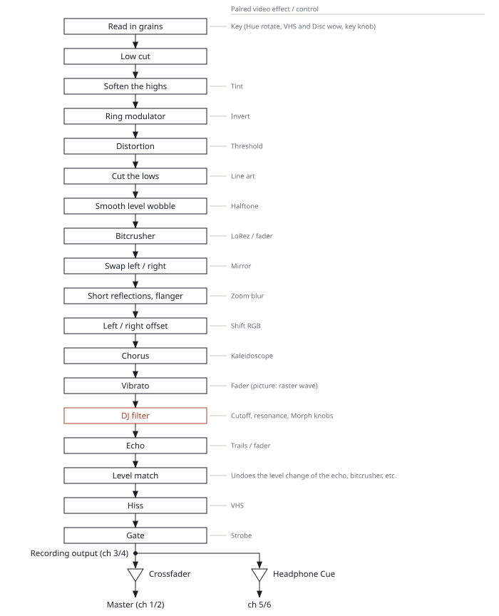
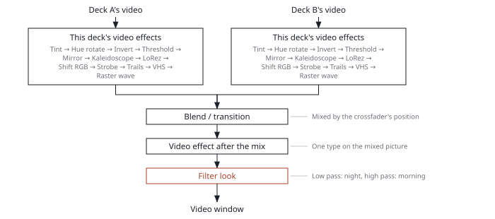

[ReaScratch](../README.md) › Pad modes, loops, filter and effects

<!-- Generated by tools/make_docs.py from manual/ReaScratch_manual_en.md. Edit that file and build again -->

## Pad modes, loops, filter and effects

**Contents**

- [Pad modes](#pad-modes)
- [CUE LOOP](#cue-loop)
- [Loops](#loops)
- [Filter](#filter)
- [Sound and video effects](#sound-and-video-effects)

Besides hot cues, there are modes that play loops and effects from the pads, a DJ filter, and sound and video effects. Which buttons do what differs by controller (see [“Preset list”](controller-setup-and-midi-mapping.md#preset-list) below). This chapter uses the Reloop Buddy and the APC40 mkII as examples.

### Pad modes

Each deck has one pad mode. How you choose it depends on the controller.

- **Reloop Buddy**: hold `PERFORMANCE MODES` (the mode button) and press the pad printed with the mode
- **APC40 mkII**: the 8 `DEVICE CONTROL` buttons of the selected deck (`TRACK SELECT`) (on the APC40 mkI, the buttons in the same place)
- **Other controllers**: the controller's own pad mode buttons (`HOT CUE`, `PAD FX`, `BEAT LOOP` and so on) are mapped to the mode closest to their label

The chosen mode is shown in the strip at the bottom of the screen, for example `pads: AUTO LOOP`. After choosing a new preset, and right after opening, it is `HOT CUE`.

| # | Mode | Buddy label | APC40 mkII label |
|---|---|---|---|
| 1 | HOT CUE | HOT CUE | ◀ DEVICE |
| 2 | AUTO LOOP | AUTO LOOP | DEVICE ▶ |
| 3 | TOUCH FX | TOUCH FX | ◀ BANK |
| 4 | FILTER TYPE | SAMPLER | BANK ▶ |
| 5 | SLICER | SLICER | DEV. ON/OFF |
| 6 | BOUNCE LOOP | BOUNCE LOOP | DEV. LOCK |
| 7 | PITCH PLAY | NEURAL MIX | CLIP/DEV. VIEW |
| 8 | NEURAL MIX | LOOPER | DETAIL VIEW |

Pads 1–8 in each mode:

- **HOT CUE**: hot cues 1–8 (see [“Step 3: Scratch”](basic-use.md#step-3-scratch) above). SHIFT + pad: clear
- **AUTO LOOP**: loops of 1/8, 1/4, 1/2, 1, 2, 4, 8 and 16 beats. Press the same pad again to exit. Pressing another pad during a loop keeps the start and changes the length. SHIFT + pad: loop only while held (exits on release)
- **TOUCH FX**: effects while held (1 Echo, 2 Bitcrusher, 3 Vibrato, 4 Invert, 5 Threshold, 6 Mirror, 7 Kaleidoscope, 8 Shift RGB). Any number can be layered, and they act on both sound and picture. SHIFT + pad: the second row of effects while held (1 Tint, 2 Hue rotate, 3 Strobe, 4 Disc, 5 Line art, 6 Halftone, 7 Zoom blur, 8 VHS; covering all video effect types together with the first row). Press a pad twice quickly to latch it on (twice again to turn it off; both rows)
- **FILTER TYPE**: choose the filter type (the 8 types under [“Filter”](#filter) below). The chosen pad lights brightly.
- **PATTERN**: choose FILTER TYPE again while in the FILTER TYPE mode to switch to it (again to go back). Pads 1–8 play the scratch patterns assigned to them (at first Baby, Baby x2, Chirp, Tear, Flare (1 click), Crab, Transformer, Stutter 16th). With quantize (`Q`) on it starts on the next beat, and immediately when off; when the pattern ends it counts as letting go (with slip on, back to where the song would be). Touching the record while it plays gives your hand priority. The pad playing a pattern lights brightly. While recording it is recorded as `Rec A-1` … like hand movements. Change the assignments in the `reascratch_pattern.lua` menu ("Put on a PATTERN pad", see [“Placing a pattern”](scratching-from-envelopes-patterns.md#placing-a-pattern)). It works while the video sync script runs. If the deck's `Swing` is above 50, the pad patterns swing too (see [“Fitting the swing”](scratching-from-envelopes-patterns.md#fitting-the-swing))
- **SLICER**: divides one bar (4 beats) into 8 and jumps to the same place within the beat in the pressed pad's slice (the beat does not shift). SHIFT + pad: jump to that slice and loop half a beat while held
- **BOUNCE LOOP**: loops only while held. Lengths 1/8, 1/6, 1/4, 1/3, 1/2, 2/3, 1 and 2 beats (including triplets).
- **PITCH PLAY**: plays hot cue 1 at a pitch set by the pad (pads 1–4 = +1 to +4 semitones, pads 5–8 = −3, −2, −1, 0 semitones; the tempo does not change). It is pressed like a hot cue, and if hot cue 1 is empty, the current position is stored as hot cue 1. The pitch stays until you change mode. SHIFT + pad: choose the filter type
- **NEURAL MIX**: pads 1–4 = the memory cue buttons MEMORY, CALL ◀, CALL ▶ and DELETE. Pads 5–8 = while held, a fast spinback, reverse play at 1x, half speed, fast forward (on release, a playing deck goes back to its speed and a stopped deck stops). `SHIFT` + pads 5–8: stop after the move

- When **SLIP** (the `S` key, `slip` on screen) is on, releasing a loop that runs while held (AUTO LOOP with SHIFT, BOUNCE LOOP, SLICER, NEURAL MIX 5–8) goes back to where the track would have been if it had kept running. When it is off, it continues from where you let go
- With SLIP off, SLICER remembers the bar of the first pad you pressed and keeps jumping within that bar while you keep pressing pads (it forgets one bar after your last release, or when you touch the jog, stop, or change mode). On samples without a BPM it works as one bar at 120 BPM, and `SLICER: no BPM` is shown in the strip at the bottom of the screen
- The strength of TOUCH FX is remembered for each effect (100% at first). On the Buddy, turn the FX knob while holding the pad to change it smoothly, or use `FX PARAM` ◀ ▶ for 10% steps (also while it is latched)
- On the APC40, memory cues and the moves while held are always on the grid's 4th and 5th rows, so in mode 8 the top two rows' 8 pads choose the **video blend** (Add, Subtract, Multiply, Overlay, Soft light, Hard light, Luma key, Chroma key; pressing the lit one again gives Mix). The blend is shared by both decks (deck A's setting)
- The Buddy has no SAMPLER mode for choosing samples. When using only the Buddy, switch samples with the `F1`–`F8` keys or the `1`–`8` buttons at the bottom of the screen (on the APC40, the grid's 3rd row)
- Holding a hot cue and pressing another hot cue loops between the two (the same on every controller, whatever the mode; exit as described under [“Loops”](#loops) below)

### CUE LOOP

When on, pressing a hot cue starts a loop of the current loop length (default 4 beats) from that hot cue's position. It does not go back when you let go. Pressing another hot cue moves the loop there. A stopped deck starts playing too. An empty pad just stores a hot cue as before. Use it to place hot cues on each word of a vocal and play with repeating the words.

- To switch it: the `L` key, a click on the title `HOT CUE` above the pads on the front screen (it shows `CUE LOOP` while on), or choosing the `HOT CUE` mode again while already in `HOT CUE` mode (on controllers with pad mode buttons, such as the Buddy and the APC40)
- Change the loop length with the `J` / `K` keys (shorter / longer), the Buddy's loop knob, or ▲ ▼ on the APC40. Exit as described under [“Loops”](#loops) below
- It is not on the setup screen; it is `CUE LOOP` (slider 179) in REAPER's parameter list

### Loops

| Action | Key | Reloop Buddy | APC40 mkII |
|---|---|---|---|
| Enter / exit a loop of the current length | `Shift`+`L` | Press the LOOP knob | `SHIFT` + the 1st pad of row 5 |
| Halve / double the length (1/32 to 32 beats, default 4 beats) | `J` / `K` | Turn the LOOP knob | ▼ / ▲ |
| Loop of a set length | – | AUTO LOOP mode pads | `SCENE LAUNCH` 1–4 (1, 2, 4, 8 beats; the same one again exits) |
| Move the loop by 1 beat (outside a loop, jump 1 beat) | – | `SHIFT` + turn the LOOP knob | `SHIFT` + ▲ / ▼ |
| Go back to the last loop (reloop) | – | `SHIFT` + press the LOOP knob | `SCENE LAUNCH` 5 (exits during a loop) |

- With quantize (`Q`) on, a loop starts from the nearest beat
- On exit, with SLIP on it jumps to where the track would have been if it had kept running during the loop. With SLIP off it continues from the current position inside the loop
- Switching samples ends the loop

### Filter

A DJ filter placed before the volume fader, the crossfader and the headphone Cue. It is controlled by three knobs. Among the sound effects, it comes after the bitcrusher, the vibrato and the others, and before the echo (the cutoff also trims the bitcrusher's sound, and an echo's tail keeps its earlier tone after you turn the filter back).

- **Cutoff**: off in the middle. Turning left gives a low-pass (12 kHz → 100 Hz), turning right a high-pass (25 Hz → 6 kHz)
- **Morph**: the middle is the normal shape above. Turning it changes the filter shape through band-pass, high-pass and notch
- **Resonance**: emphasis at the cutoff (0–1, default 0.4)
- **Type**: 8 types ported from Saike's (Joep Vanlier's) FM Filter 2: `nlSVF`, `Ladder`, `Steiner`, `Pillow`, `Rect`, `Shriek4p`, `MS-20`, `Moog`. Choose with the pads in FILTER TYPE mode (license: the included `LICENSE_Saike_filters.txt`)

The knobs are HIGH = Morph, LOW = Resonance and FILTER = Cutoff on the Buddy, and `TRACK KNOB` 2–4 (deck B: 6–8) on the APC40. On other controllers the CFX or FILTER knob is Cutoff, and the HI and LOW knobs are Morph and Resonance (see [“Preset list”](controller-setup-and-midi-mapping.md#preset-list)).

Turning the filter also changes the colour tone of the layered picture (mixed by how loud each deck is).

- Low-pass side (only low sounds) = night: dark parts sink, the colours get a little colder, the brightness slowly sways and the picture ripples. The corners get darker and blurry
- High-pass side (only high sounds) = morning: white light bleeds from bright parts, light rays shine in from above, and the whole picture is washed out white. Blocks and colour bleeding like an old JPEG appear

### Sound and video effects

Effects come in pairs of picture and sound. When you apply a video effect, a matching sound effect is applied too. The video effect after the mix also applies its sound effect to both decks.

The images in the table below show each video effect on a deck's picture at amount 100 % (Hue rotate, LoRez and Line art at 50 %): on the left a test pattern, on the right the 3D model shown when a sound-only sample is loaded. Every shot was taken with the deck stopped at the same place, so the moving parts are at the same moment (the 3D model facing the front). Trails is the exception: it shows nothing on a still picture, so it was shot while playing.

| Picture | Look | Sound |
|---|---|---|
| No effect | The picture before any effect (for comparison) | — |
| Tint | Colours it in two colours (`Tint dark colour` / `Tint light colour` in setup's `FX` tab) | A warmer, muffled tone (cuts the high sounds: above 500 Hz at amount 1) |
| Hue rotate | Turns the hue (exactly once round at amount 1, back to the original colours) | Raises the key (amount 1 = one octave) |
| Invert | Inverts the colours | Ring modulator |
| Threshold | Black and white | Distortion (hard clip; the volume does not go up) |
| Mirror | A mirror image | Chorus (as many copies as the picture has parts). Below 0.5: the original plus a copy with left and right swapped, pitched slightly up. From 0.5: also a copy pitched slightly down and a swapped copy pitched slightly down, four in all. The larger the amount, the wider the detune (2–30 cents) |
| Kaleidoscope | A kaleidoscope that turns with the beat | Chorus |
| LoRez | Mosaic | Bitcrusher |
| Shift RGB | Colour offset | Stereo offset (delays the right channel) |
| Strobe | Flashes with the beat (the left half of the image is a lit frame, the right half a black one) | Gate on the beat (same steps as the picture's flashing) |
| Trails | Afterimages | Echo |
| VHS | An old videotape look: the picture degraded as an analogue signal, one scan line at a time, ported from zhuker's ntsc: colour smearing to the right, white halos and rainbow edges, noise streaks trailing right, hue wandering and colour dropping out line by line, and irregular sideways shifts. The higher the amount, the slower the tape speed (SP to EP) and the more noise and shifting, with scan lines above 30 % and dubbing-like generation loss above 60 % | Tape wow (the pitch wavers slowly), the highs rounded, a little hiss |
| Disc | Cut out as a record that turns with the platter, and turns in reverse when you scratch | A record's sound (a slightly off phono EQ, a warped record's wobble, crackle). Low amounts are brighter with almost no wobble or crackle; the higher the amount, the darker it gets (fuller lows, duller highs), with more wobble (about 3% at amount 1) and crackle. The tone at maximum amount is set by `Disc tone` in setup's `More` tab → `Video FX` |
| Line art | An X-ray-like line drawing: glowing white outlines on black, with a faint image in inverted brightness | A thin sound with the lows cut (below 1.5 kHz at amount 1) |
| Halftone | Black dots on white paper | Cuts the sound into small grains and lines them up again (8 grains a beat; 16 a second with no BPM). Each grain plays a random moment from just before, reaching further back at higher amounts (up to 0.125 s). The finer the dots, the more grains overlap (2 at the minimum, 8 at 1) |
| Zoom blur | A blur streaming out from the centre | A flanger (a jet-like whoosh; one sweep every 2 beats, or every second with no BPM) and 4 short reflections |

Sound and picture are processed in the order below, from top to bottom.

*Figure 5. The sound path (per deck)*

*Figure 6. The picture path*

Effects are turned on as follows. When the same type comes from several places, the largest amount is used.

- **This deck's video effect (one type)**: choose the type on the setup `FX` tab. The `V` key (on/off) and `Shift`+`V` (amount), the Buddy's FX ON bar (while the bar is on, the FX knob sets the amount, changing the picture and the sound together, and `FX PARAM` ◀ ▶ steps the type back / forward, cycling through Tint to Shift RGB, then Disc, Line art, Halftone, Zoom blur, VHS, Trails, Strobe), `SHIFT` + `CLIP STOP` (columns 1 and 5) on the APC40, or on other controllers the CFX or similar knob (see [“12. Video effects”](jsfx-reascratch-parameter-reference.md#12-video-effects-setup-fx-tab) above)
- **8 types at once (APC40)**: the 8 `DEVICE CONTROL` knobs are the amounts of 8 types on the selected deck: by default Tint, Hue rotate, Invert, Threshold, Mirror, Kaleidoscope, Shift RGB and VHS. Choose each knob's type from the 15 in setup's `More` tab → `Video FX` → `DEVICE knob 1 type` to `DEVICE knob 8 type` (per deck, saved with the project). Strobe is knob 8 with `SHIFT` held
- **Echo, bitcrusher, vibrato**: APC40 track faders 2–4 (deck B: 6–8). On the picture they are Trails, LoRez (from the centre of the screen) and a raster wave (the picture ripples up and down). `CLIP STOP` (columns 2–4 and 6–8) turns them on and off while the fader stays up. TOUCH FX pads 1–3 play them too
- **Vibrato sound type**: set by the `pitch ─ tape` bar on the front screen (`Pitch mode (tape)`). Toward pitch (left), the voice loses its own pitch movements and swings smoothly up and down around a fixed note (C4; about 2.4 semitones each way). The voice is analysed and made again at the new pitch, so it keeps its character (the sound comes about 23 ms later for this). Toward tape (right), the pitch swings smoothly up and down (about ±4 semitones at the end). In between, the two are mixed
  - The key (TRACK KNOB 4 on the `USER` page) moves the centre note; the width of the swing (0–12; the number × 0.48 semitones each way) is changed by TRACK KNOB 3 on the `SENDS` page with SHIFT held. The width is saved with the project
  - Where the voice has no clear pitch (consonants, silence, unpitched sounds), the sound plays as it is
- **Video effect after the mix**: the type with the Buddy's `SHIFT` + `FX PARAM` ◀ ▶ or page 5 of the second APC40; the amount with the Buddy's `SHIFT` + FX knob or the APC40's master fader. Its sound goes on both decks (each following its own "how much the video effects act on the sound")
- **Video blend and transitions**: on the Buddy, pick the blend (Mix to Chroma key) with `FX PARAM` ◀ ▶ while holding the mode (`PERFORMANCE MODES`) button, and the transition with ◀ ▶ alone (hold to scroll fast; the far left is no transition). Blends and transitions can be combined: turn the combination on with the mode button + `SHIFT` + ◀ ▶ (it starts off; while off, a transition brings in B as usual), and the picture coming in is the blend of A and B instead of B (instead of A when going back), and at the end only that deck shows. With Mix, B comes in as usual. On the APC40, `METRONOME` (each press goes to the next, including transitions) or the pads in mode 8

Sound adjustments:

- **How much the video effects affect the sound** (0–1, default 1; 0 = picture only): APC40 track fader 1 (deck B: 5), on the Buddy, `SHIFT` + turning BROWSE with that deck's FX ON bar on (5% per click). It is not on the setup screen; change it as `Sound of the video FX` in REAPER's parameter list ([“13. Controller numbers and other settings”](jsfx-reascratch-parameter-reference.md#13-controller-numbers-and-other-settings-the-setup-screens-more-tab-and-reapers-parameter-list)). To move it with a fader of another controller, enter `(channel − 1) × 128 + CC` as `Sound of the video FX fader` in the `Video FX` group of setup's `More` tab. This is that deck's overall sound multiplier
- **Each effect's own sound amount** (defaults: Threshold 30%, bitcrusher (LoRez) 45%, echo (Trails) 50%, the others 100%): on the Buddy, turning the BROWSE knob changes the sound amount of the effect that matches what you hold by 5% per click, shown on the screen as `VHS sound 30 %` (a TOUCH FX pad held = that pad's effect, the FX ON bar on = that deck's effect). With nothing held, `SHIFT` + BROWSE changes the sound of the effect after the mix (turning it without `SHIFT` changes the headphone Cue mix). Each effect keeps its own value, shared by both decks and saved with the project. It is multiplied by the overall sound multiplier above. Echo shares Trails' value and the bitcrusher shares LoRez's
- **Echo length and feedback**: TRACK KNOB 1 and 2 on the APC40's `SENDS` page, `SHIFT` + HIGH and LOW on the Buddy
- **Vibrato and gate steps**: TRACK KNOB 3 and 4 on the APC40's `SENDS` page. The vibrato step is how long each upward and downward swing takes (1, 1/2, 1/3, 1/4, 1/6 or 1/8 beat; 1/4 beat = a 16th note at first). One swing up and down takes two steps and follows the deck's BPM and beat position (with no BPM, 0.2 s a swing). The tape side swings at the same speed
- **Key** (±12 semitones; the tempo does not change): TRACK KNOB 4 on the APC40's `USER` page, `SHIFT` + FILTER on the Buddy

Turning everything off or stopping:

- **Turn all effects off for a moment** (while held; the filter stays): `BANK` on the APC40 (both decks), `SHIFT` + the FX ON bar on the Buddy (that deck)
- **Freeze** (while held, sound and picture stop where they are and the same grain keeps sounding): `CLIP STOP` (columns 1 and 5) on the APC40, `SHIFT` + CUE on the Buddy, the `X` key. On release, with SLIP on it continues from where the track would have been; with SLIP off, from where it stopped
- **Hide only the picture** (the sound stays): `SHIFT` + `ACTIVATOR` on the APC40, `SHIFT` + the headphone CUE on the Buddy

---

---

← [Basic use](basic-use.md)   |   [Contents](../README.md#documentation)   |   [JSFX (ReaScratch) parameter reference](jsfx-reascratch-parameter-reference.md) →
