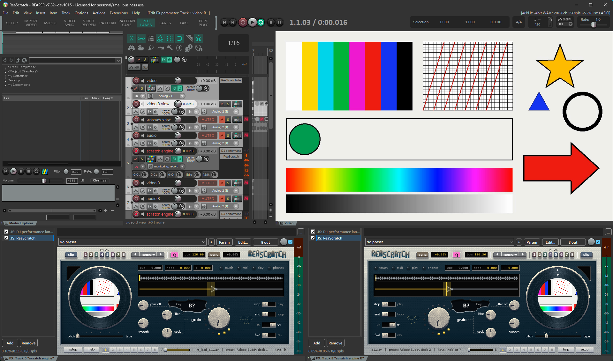

[ReaScratch](../README.md) › Setup

<!-- Generated by tools/make_docs.py from manual/ReaScratch_manual_en.md. Edit that file and build again -->

## Setup

### What you need

- **REAPER 7.x** (Windows / macOS; tested with 7.80)
- **A MIDI controller** (you can also try it with the mouse and keyboard). Some controllers need the manufacturer's driver.
  - Reloop Buddy (Windows): needs Reloop's “ASIO Driver”. Without it, the jog and buttons do not respond (see [“Troubleshooting”](troubleshooting.md)).
  - Some Hercules models, CDJs and others: noted under “Preparation” in the table and in “Notes by model” of the [“Preset list”](controller-setup-and-midi-mapping.md#preset-list).
  - NI Traktor Kontrol (HID): uses the included `HID bridge` and loopMIDI (see [“HID controllers”](controller-setup-and-midi-mapping.md#hid-controllers-ni-traktor-kontrol-s4-s3-s2)).
- **Used when present** (the basic features work without them)
  - FFmpeg: used for the following. For where ReaScratch looks for it, see [“Heavy video”](heavy-video-all-intra-conversion.md).
    - Importing a video and converting it to all-intra (so that the frames match the source exactly)
    - Making videos when capturing a performance
    - Loading a file by dragging it onto a JSFX window (Windows only)
    - Loading with the LOAD button (from the Media Explorer; Windows only)
  - The js_ReaScriptAPI extension (install it with ReaPack): needed for the LOAD button and for previewing a Media Explorer file (the `P` key).
  - The SWS extension (install it with ReaPack): needed for previewing a Media Explorer file (the `P` key).

### 1. Copy the files

You can install with ReaPack or copy the kit's folders by hand. Use one of the two.

**With ReaPack** (you can also get updates via ReaPack)

1. In REAPER, choose `Extensions` > `ReaPack` > `Import repositories...`, paste this URL and click `OK`:
   `https://raw.githubusercontent.com/tobokegao/ReaScratch/main/index.xml`
2. In `Extensions` > `ReaPack` > `Browse packages...`, find `ReaScratch`, right-click it, choose `Install`, then click `Apply`.
3. The installed files and their locations are the same as when copied by hand. The manual PDFs and the HID bridge are not included; get them from the GitHub Releases if you need them.
4. Restart REAPER and proceed to "2. Initial setup".

**By hand**

1. Connect your MIDI controller to the PC and start REAPER.
2. In REAPER, choose `Options` > `Show REAPER resource path in explorer/finder`. This opens the **REAPER resource folder** where plug-ins and scripts live (it contains folders such as `Effects` and `Scripts`).
3. Copy the kit's **`Effects` / `Scripts` / `Data` / `ProjectTemplates`** folders into that folder as they are (merging with the folders of the same name).
   - **macOS note**: dragging onto a folder of the same name in Finder "replaces" it by default, deleting what was already in `Scripts` and the others. **Hold Option while dragging and choose "Merge"** (if "Merge" does not appear, open each of the 4 folders and copy their contents into the matching folders).
4. Restart REAPER.

### 2. Initial setup

1. Open `Options` > `Preferences` > `Audio` > `MIDI Inputs` and check that your controller's MIDI input is enabled (Enabled).
   - To light the controller's buttons, also enable the same controller under `MIDI Outputs`. Setup points the deck tracks' MIDI output there (if you enable it later, run setup again; see [“Button lights”](controller-setup-and-midi-mapping.md#button-lights)).
2. Open `Actions` > `Show action list...`.
3. Click `New action...` > `Load ReaScript...`, load `Scripts/ReaScratch/reascratch_setup.lua`, select it in the list and click `Run`.
   - If you installed with ReaPack, `reascratch_setup.lua` is already in the list: type `reascratch_setup` in the filter box, select it and click `Run`.
   - First (after checking that the JSFX is installed), a menu “Language / 言語 (ReaScratch messages)” appears with three choices: `Auto (follows REAPER's language pack: …)` (the end shows the language Auto gives right now), `English` and `日本語`. The current setting is checked. `Auto` gives Japanese when the filename of the language pack chosen in REAPER (`langpack=` under `[REAPER]` in reaper.ini) is a Japanese one (it contains `Japanese`, `jpn` or `日本`, or starts with `ja_`, `jp_` and the like), and English otherwise (also when no language pack is used). Closing the menu without choosing keeps the current setting. The setting is stored in REAPER on this PC (for all projects); the rest of this setup run and the messages of the other scripts use it. The menu appears every time you run setup.
   - Three tracks, `video`, `audio` and `scratch engine`, are created, and the JSFX is inserted on `scratch engine`.
   - The MIDI input of `scratch engine` is set to "All MIDI inputs". You choose your controller with the JSFX's `Preset` (see below).
   - The other scripts are registered in the action list too (search for "`reascratch`" to find them).
   - You are asked “Make a second deck (deck B)?”. Yes creates 4 tracks, `video B`, `audio B` (both muted), `scratch engine B` (deck B's JSFX) and `video B view` (shows deck B's picture; just above or just below `video`, to suit the project's video settings), plus a Video processor on the `video` track that layers the two pictures. If you answer No, the answer is stored in the project and you are not asked again for that project (to add deck B later, create an empty track named `scratch engine B` and run setup). See [“Two decks with layered video (deck B)”](two-decks-with-layered-video-deck-b.md).
   - A `Cue` track for headphones is created. It is not sent to the master but straight to the headphone output. If an output has "Phones" or similar in its name, that one is used; otherwise a menu “Which output goes to your headphones (Cue)? (to change it later: ROUTE on the Cue track)” lists the outputs and you pick the one your headphones are on (for example `Analog 7 / Analog 8` on an RME Fireface UCX II). The choice is saved in REAPER's settings on this PC and you are not asked again. See [“Listening to a deck on headphones (Cue)”](listening-to-a-deck-on-headphones-cue.md).
   - A box titled “ReaScratch setup: video conversion height (smaller = lighter, coarser)” asks for `Height (720 / 540 / 360)` (default 720; another number becomes the nearest of the three). This is the height used when converting videos to all-intra; smaller is lighter on the PC and coarser. Choose 540 or 360 on a slower PC. The value is kept in REAPER's settings on this PC and applies to all projects (Cancel keeps the current value).
   - If REAPER is set to draw the video ahead and cache it (REAPER's default), a notice “REAPER is set to draw the video ahead and cache it.” appears. With this, the crossfader and video effects show up about 0.2–0.5 s late. Right-click the video window (`View` > `Video`) and choose `Performance tweaks (experimental)` > `Video cache` > `All media and video FX are not cached`. It works at once; no need to restart REAPER.
   - Next you are asked “Start the video sync (reascratch_video_sync.lua) automatically when REAPER starts?”. **We recommend Yes.** A few lines are added to REAPER's `Scripts/__startup.lua` (a file REAPER runs every time it starts), and from then on the picture follows automatically as soon as you open a project that contains ReaScratch, without starting the sync script by hand. Projects without ReaScratch are left alone. To stop auto-sync, run setup again and answer No; only the added lines are removed (the rest of `__startup.lua` stays as it was).
   - Then you are asked “Use the ReaScratch window layout?”. Yes puts ReaScratch's 11 buttons on toolbar 3 (see [“ReaScratch buttons (toolbar 3)”](#reascratch-buttons-toolbar-3)) and adds a window set “ReaScratch” (this toolbar at the top left, the video window at the top right at 16:9) in a free slot. If toolbar 3 already has other buttons, or window sets #01-#10 are all in use, you are asked before they are replaced (what was there is kept; see [“Things that depend on your setup”](things-that-depend-on-your-setup.md)). REAPER reads window sets when it starts, so **restart REAPER**, then switch with the action `Screenset: Load window set #NN` (NN = the number in the message). The same kind of action switches back to another layout.
4. Open the video window with `View` > `Video`.
5. Choose your controller. Open the JSFX window with the [FX] button of the `scratch engine` track, press `setup` in a bottom corner (usually the bottom right; when you made deck B, deck A's window is mirrored and it is at the bottom left) and pick your model from the `Preset` menu (manufacturer → model → `deck 1` / `deck 2`; see [“Preset list”](controller-setup-and-midi-mapping.md#preset-list)). If you made deck B, pick `deck 2` in the JSFX window of `scratch engine B`. For a controller without a preset, make one in setup's `Learn` tab (see [“Check by touch / make a preset”](controller-setup-and-midi-mapping.md#check-by-touch--make-a-preset-setup-learn-tab)). Without a controller, `Custom` is fine.

> **Tip: new projects from now on**
> Once setup has been run, you can start straight from `File` > `Project templates` > `ReaScratch` (the template only contains deck A's `scratch engine`; deck B, the `Cue` track and the controller's button lights (the MIDI output) are created and set when you run setup after opening the template).

### ReaScratch buttons (toolbar 3)

*Figure 1. An example of the ReaScratch window layout (toolbar 3 at the top left, the video window at the top right, the JSFX screens of decks A and B below)*

If you answer Yes to the window layout prompt, the following 11 buttons appear at the top left of the window set “ReaScratch” (it is REAPER's toolbar 3; with another layout, open it with the action `Toolbar: Open/close toolbar 3`). Each button does the same as running the script of the same name from the action list.

*Figure 2. ReaScratch buttons (toolbar 3)*

| Button | Script it runs | What it does |
|---|---|---|
| `SETUP` | `reascratch_setup.lua` | The initial setup (the steps on this page). You can run it any number of times (to add deck B or the `Cue` track, re-point the MIDI output, change the message language, and so on) |
| `IMPORT VIDEO` | `reascratch_import_video.lua` | Imports a video as a sample ([“Step 1: Import a video”](basic-use.md#step-1-import-a-video)) |
| `MJPEG` | `reascratch_reencode_mjpeg.lua` | Converts a video to all-intra (AVI/MJPEG) and swaps it in. It converts the selected video items, or the video of deck A's current sample when nothing is selected ([“Heavy video”](heavy-video-all-intra-conversion.md)) |
| `VIDEO SYNC` | `reascratch_video_sync.lua` | Starts / stops the video sync (each press toggles it; [“Step 2: Start the sync”](basic-use.md#step-2-start-the-sync)) |
| `VIDEO REOPEN` | `reascratch_video_reopen.lua` | Reopens a video window that has stopped ([“Projector output”](projector-output.md)) |
| `PATTERN` | `reascratch_pattern.lua` | Places a scratch pattern on a deck ([“Placing a pattern”](scratching-from-envelopes-patterns.md#placing-a-pattern)) |
| `PATTERN SAVE` | `reascratch_pattern_save.lua` | Saves a rearranged pattern under a name ([“Saving a rearranged pattern”](scratching-from-envelopes-patterns.md#saving-a-rearranged-pattern)) |
| `REC LANES` | `reascratch_record_lanes.lua` | Switches whether the performance being recorded is written to envelopes. The button is lit while on (on by default; [“Recording a performance into envelopes”](scratching-from-envelopes-patterns.md#recording-a-performance-into-envelopes)) |
| `LANES` | `reascratch_lanes.lua` | Shows or hides the envelope lanes by group ([“Showing only the lanes you use”](scratching-from-envelopes-patterns.md#showing-only-the-lanes-you-use)) |
| `TAKE` | `reascratch_take.lua` | Turns performance capturing on / off. The button is lit while on ([“Capturing a performance”](scratching-from-envelopes-patterns.md#capturing-a-performance)) |
| `PERF PLAY` | `reascratch_perf_play.lua` | Turns “play the performance” on / off. The button is lit while on ([“Recording and playing a performance on REAPER's timeline”](scratching-from-envelopes-patterns.md#recording-and-playing-a-performance-on-reapers-timeline)) |

---

---

← [Files in the kit](files-in-the-kit.md)   |   [Contents](../README.md#documentation)   |   [Basic use](basic-use.md) →
